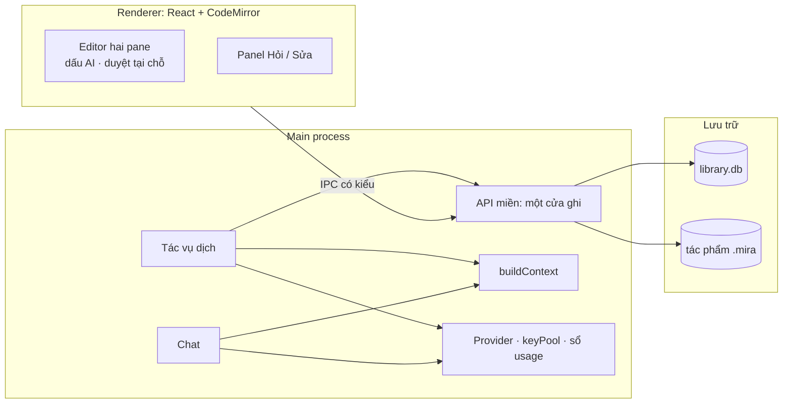

# Mira

Mira là workspace dịch thuật cho Windows, dành trước tiên cho dịch giả truyện nhiều chương từ Anh, Trung giản thể/phồn thể và Nhật sang Việt. Mục tiêu lõi: **làm việc cùng AI ngay trong editor**. AI dịch và đề xuất sửa; người dịch duyệt từng chỗ tại chỗ, `Ctrl+Z` hoàn tác được. Mọi thứ trừ bước gọi AI chạy offline, và dữ liệu nằm trên máy người dùng.

> **Trạng thái: bản MVP để thử nghiệm.** Repo hiện chạy được (thư viện, kho SQLite, editor hai pane, dịch chương, panel Hỏi AI) nhưng chưa phải bản hoàn chỉnh, **chưa gọi nhà cung cấp AI thật lần nào** và **không dùng để giữ bản dịch thật**. Sắp tới từng module được làm lại hoàn chỉnh theo kiến trúc bên dưới, mỗi module có spec, test và nghiệm thu trước khi sang module kế.

**Bắt đầu tại [tài liệu theo module](docs/modules/README.md).** Handbook cũ đã gỡ khỏi repo ngày 2026-10-06; các link vào handbook dưới đây trỏ tới bản cuối của nó ở commit `501be2a`, chỉ để tra lịch sử.

| Bạn cần | Đọc |
| --- | --- |
| Biết module nào đang làm gì | [Tài liệu theo module](docs/modules/README.md) |
| Hiểu sản phẩm | [Định hướng](https://github.com/minh1904/app-novel/blob/501be2a/docs/handbook/product/vision.md), [quyết định hiện hành](https://github.com/minh1904/app-novel/blob/501be2a/docs/handbook/product/decisions.md) |
| Hiểu kiến trúc đích | [ADR-005](https://github.com/minh1904/app-novel/blob/501be2a/docs/handbook/decisions/0005-ai-first-proposals-no-sentence-mode.md), [Luồng làm việc và kiến trúc AI-first](https://github.com/minh1904/app-novel/blob/501be2a/docs/handbook/engineering/ai-first-architecture.md) |
| Biết repo đang có gì | [Hiện trạng](https://github.com/minh1904/app-novel/blob/501be2a/docs/handbook/engineering/current-state.md) (mỗi phần ghi giữ, viết lại hay gỡ) |
| Biết làm gì tiếp | [Lộ trình theo module](https://github.com/minh1904/app-novel/blob/501be2a/docs/handbook/delivery/roadmap.md), [scope](https://github.com/minh1904/app-novel/blob/501be2a/docs/handbook/product/scope.md) |
| Hiểu đối thủ | [Thị trường](https://github.com/minh1904/app-novel/blob/501be2a/docs/handbook/research/market-landscape.md), [mapping với Mira](https://github.com/minh1904/app-novel/blob/501be2a/docs/handbook/research/feature-map.md) |
## Kiến trúc

Hướng kiến trúc đã chốt ở [ADR-005](https://github.com/minh1904/app-novel/blob/501be2a/docs/handbook/decisions/0005-ai-first-proposals-no-sentence-mode.md); thiết kế đầy đủ ở [kiến trúc AI-first](https://github.com/minh1904/app-novel/blob/501be2a/docs/handbook/engineering/ai-first-architecture.md). Năm ý chính:

1. **Đơn vị làm việc là chương, bên trong là đoạn** (mỗi dòng không trống). Không lưu ranh giới câu, không liên kết giữa câu gốc và câu dịch. Mode dịch **Từng câu đã bị bỏ**.
2. **Một nguồn sự thật có cấu trúc: SQLite.** Mỗi tác phẩm là một tệp `.mira`, kèm `library.db` làm chỉ mục. Markdown chỉ là cách chiếu dữ liệu ra (cho editor, prompt, xuất), không phải nơi lưu.
3. **Một đường ghi: người gõ thì ghi, AI thì đề xuất.** Bản dịch đang trống thì AI ghi thẳng kèm dấu AI; đã có chữ thì AI tạo đề xuất hiện ngay trong pane (CodeMirror + `@codemirror/merge`), nhận/bỏ từng khối, có snapshot trước khi áp dụng.
4. **Ba động cơ AI dùng chung một bộ dựng ngữ cảnh và một sổ chi phí:** tác vụ dịch chạy bền trong `main`, Hỏi/Sửa trong panel chat, và ngữ cảnh truyện (thuật ngữ, xưng hô, văn phong).
5. **Electron + `node:sqlite`.** Không chuyển Tauri (IME trên WebView2 không ghim được), không CRDT. Kết nối AI bằng API key qua **một adapter tương thích OpenAI**; không dùng OAuth thuê bao.



Sơ đồ là kiến trúc **đích**; mã đang chạy ở [hiện trạng](https://github.com/minh1904/app-novel/blob/501be2a/docs/handbook/engineering/current-state.md). Phần chưa làm: tác vụ dịch bền trong `main`, bảng đề xuất/snapshot, dấu AI, `buildContext` dùng chung.

### Cấu trúc mã nguồn

```text
src/
  shared/              chạy ở mọi nơi; không node:, electron, react
    contracts/         kiểu, schema valibot, tên kênh IPC, DesktopApi, Result
    algorithms/        hàm thuần trên văn bản (chuẩn hóa raw, chia câu để cắt lô)
  main/
    index.ts           gốc lắp ráp; cùng electron/ là nơi duy nhất import 'electron'
    electron/          safeStorage, đăng ký IPC
    ipc/               kênh → handler đã kiểm đầu vào, mỗi khu vực một tệp (handlers/)
    services/          nghiệp vụ: library, ai (kết nối, chat, dịch chương, chi phí)
    infra/             storage (SQLite, schema, migration), providers (adapter HTTP, keyPool)
  preload/             chỉ electron và shared/contracts
  renderer/src/        app/, components/, features/, styles/
```

Mỗi tầng của `main` chỉ được import tầng dưới nó: `infra` < `services` < `ipc` < `electron`. Luật này do `no-restricted-imports` trong [`eslint.config.mjs`](eslint.config.mjs) ép, không chỉ là quy ước. Chi tiết và cách thêm thành phần mới: [Cấu trúc mã nguồn và luật ranh giới](https://github.com/minh1904/app-novel/blob/501be2a/docs/handbook/engineering/architecture.md#cấu-trúc-mã-nguồn-và-luật-ranh-giới).

### Lộ trình theo module

Mỗi module là một change openspec riêng; xong module trước mới sang module sau. Điều kiện xong và trạng thái đầy đủ ở [lộ trình](https://github.com/minh1904/app-novel/blob/501be2a/docs/handbook/delivery/roadmap.md).

| Module | Nội dung | Trạng thái |
| --- | --- | --- |
| 0 | Chat Hỏi/Sửa: kiểm chứng với nhà cung cấp thật | Code xong, chưa kiểm chứng |
| 2 | Đoạn: định nghĩa và nhập raw chỉ chuẩn hóa | Chưa làm |
| 3 | Đề xuất: bảng `proposal`, snapshot, duyệt tại chỗ | Chưa làm |
| 4 | Tác vụ: `JobRunner` bền trong main, sổ chi phí | Chưa làm |
| 5 | Kho v6, gỡ mode Từng câu và dữ liệu câu | Chưa làm |
| 6 | Ngữ cảnh truyện: thuật ngữ, xưng hô, văn phong | Chưa làm |
| 7, 8 | QA nhất quán; xuất `.md`/`.txt` | Chưa làm |

## Chạy và kiểm tra

Yêu cầu Node.js >=24 và pnpm 8.9.0 theo `package.json` (`packageManager`). Nên lấy pnpm qua `corepack`: pnpm toàn cục mới hơn bản ghim có thể in cảnh báo rồi thoát mã 0 **mà không chạy gì**, và `pnpm install`/`pnpm add` bằng nó sẽ ghi đè `pnpm-lock.yaml` từ lockfileVersion 6.0 sang 9.0. Xem [quy tắc repository](AGENTS.md#checks).

```powershell
pnpm install                  # bằng pnpm 8.9.0 (corepack)
pnpm dev                      # chạy Electron ở chế độ phát triển
node scripts/check.mjs        # typecheck (node + web), test, lint: chạy trước khi commit
node scripts/check.mjs --build   # thêm electron-vite build: chạy trước khi push
pnpm build:win                # installer Windows bằng electron-builder, chưa phải quy trình phát hành chính thức
```

Lần cài/chạy đầu có thể cần tải Electron qua mạng. Nếu terminal đặt `NPM_CONFIG_OFFLINE=true`, chuyển sang `false` khi cài dependency cần mạng.

Brand đổi từ Miyati sang **Mira** ngày 2026-09-29. Thư mục repo `app-novel` giữ nguyên. Xem [brand](https://github.com/minh1904/app-novel/blob/501be2a/docs/handbook/product/brand.md) về định danh bản cài và giới hạn migration.

Commit theo [quy tắc repository](AGENTS.md#commits). Handbook viết bằng tiếng Việt; commit message viết bằng tiếng Anh.
