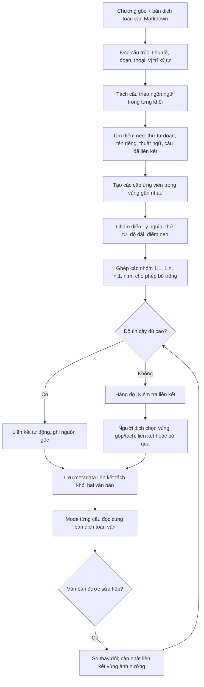

# Flow đề xuất: bản dịch toàn văn → từng câu

Cập nhật: 2026-09-23. Đây là flow để prototype và kiểm chứng bằng chương truyện thật; chưa chốt thuật toán hoặc ngưỡng tin cậy.



## Mỗi bước làm gì

1. **Giữ nguyên hai văn bản.** Bản gốc và bản dịch được lưu độc lập. Markdown được phân tích thành khối; vẫn giữ vị trí ký tự để liên kết chỉ tới đúng vùng, không dựa vào dòng hiển thị trên màn hình.
2. **Tách theo ngôn ngữ.** Trong mỗi đoạn/khối, phát hiện câu bằng quy tắc phù hợp EN/ZH (giản thể và phồn thể)/JA/VI. Tránh cắt nhầm ở viết tắt, dấu ba chấm, lời thoại, tiêu đề. Ranh giới tự động chỉ là gợi ý và có thể sửa.
3. **Tìm điểm neo.** Ưu tiên tiêu đề, ranh giới đoạn, tên riêng, thuật ngữ và các liên kết người dùng đã xác nhận. Chỉ tìm ứng viên trong vùng gần nhau để tránh ghép một câu ở đầu chương với một câu giống nghĩa ở cuối chương.
4. **Chấm điểm và ghép.** Kết hợp thứ tự, độ tương đồng ngữ nghĩa đa ngôn ngữ, tỷ lệ độ dài và điểm neo. Tìm chuỗi liên kết có tổng điểm tốt, cho phép 1:1, 1:n, n:1, n:m và câu bị bỏ/được thêm. Bản dịch văn học không bắt buộc giống số câu của bản gốc.
5. **Kiểm tra chỗ mơ hồ.** Liên kết chắc chắn có thể dùng ngay nhưng vẫn ghi là tự động; vùng có nhiều ứng viên tương đương, đảo thứ tự hoặc viết lại thoát ý cần người dịch chọn. Không viết lại hoặc chia bản dịch để ép khớp.
6. **Lưu và đồng bộ.** Chỉ lưu quan hệ giữa các ID/range và trạng thái xác nhận, tách khỏi nội dung văn bản. Mode từng câu là một cách nhìn/sửa trên cùng nội dung. Khi toàn văn đổi, cập nhật liên kết tại vùng ảnh hưởng; khi không chắc thì đưa lại vào hàng đợi kiểm tra.

## Ví dụ

```text
Gốc:    A. Cô mở cửa.  B. Căn phòng trống rỗng.  C. Cô quay đi.
Dịch:   1. Cô mở cửa, chỉ thấy căn phòng trống rỗng.  2. Rồi cô quay đi.
Ghép:   A + B ↔ 1; C ↔ 2
```

Trường hợp câu gốc bị lược bỏ có thể là `Gốc X ↔ không có câu dịch`; câu dịch bổ sung có thể là `không có câu gốc ↔ Dịch Y`. Cả hai cần hiển thị để kiểm tra nhưng không mặc định xem là lỗi.

## Giới hạn và việc cần thử

- Nếu người dùng đảo nhiều đoạn hoặc viết lại gần như toàn chương, căn chỉnh tự động không đủ tin cậy. Giữ bản dịch nguyên vẹn và yêu cầu kiểm tra ở cấp đoạn trước khi xuống cấp câu.
- Phải đo độ chính xác trên chương thật có thoại, nhiều dấu câu, tên riêng và bản dịch thoát ý. Ngưỡng “đủ cao” chưa thể chốt bằng trực giác.
- Không lấy số liên kết hoàn tất làm tỷ lệ dịch xong; chất lượng bản dịch và chất lượng căn chỉnh là hai trạng thái khác nhau.
- Prototype cần thử thao tác sửa trong mode từng câu rồi quay về Markdown, và chiều ngược lại, bao gồm undo, lịch sử ; AI viết lại vùng chọn thuộc giai đoạn sau P0.

Tham khảo: [Vecalign](https://github.com/thompsonb/vecalign) dùng liên kết 1–nhiều/nhiều–nhiều; [memoQ Alignment Editor](https://docs.memoq.com/current/en/Workspace/alignment-editor.html) cho phép sửa liên kết tự động bằng tay. Đây là nguồn tham khảo, không phải quyết định áp dụng nguyên thuật toán hoặc UI.
