# Kết nối AI

> **Một câu:** vùng này giữ khóa API và tài khoản thuê bao, dựng "một kết nối sẵn sàng gọi" cho một mục
> model, rồi đưa mỗi lời gọi đi qua hàng chờ, khóa, retry và đúng giao thức HTTP của nhà cung cấp.
> Cập nhật: 2026-10-15 · Nguồn: đọc code tại commit db2455f.

## 1. Vì sao vùng này tồn tại

Mira dịch và chat bằng model của nhiều nhà cung cấp (Gemini, OpenRouter, OpenAI, DeepSeek, Anthropic, gateway
tự dựng, Ollama/LM Studio) và hai gói thuê bao (ChatGPT/Codex, GitHub Copilot). Mỗi nơi có cách xác thực, giao
thức, dạng lỗi và hạn mức riêng. Vùng này gói hết khác biệt đó sau một cửa duy nhất:
`ConnectionService.translator(connectionId, entryId)`. Hàm này trả một `OpenAiCompatibleProvider` có `chat()`,
`complete()`, `probe()` và `listModels()`. Các vùng dịch chương ([04](04-dich-chuong.md)), trích ngữ cảnh
([05](05-ngu-canh-dich.md)) và trợ lý/chat ([06](06-tro-ly-agent.md)) gọi cửa này, không gọi HTTP trực tiếp.
Ở chiều xuống, vùng này đọc/ghi bảng `ai_*` trong SQLite của thư viện ([02](02-luu-tru.md)), mã hóa bí mật bằng
`safeStorage`, và gọi mạng qua `net.fetch` của Electron. Ở renderer, module `ai-connections` lo Cài đặt,
onboarding và menu chọn model. Renderer chỉ gọi qua `window.mira.ai.*` ([01](01-process-va-ipc.md)).

**Chú ý tên gọi:** trong code, `Gateway` (`infra/providers/gateway/gateway.ts`) là lớp điều phối khóa, retry và
hàng chờ *bên trong Mira*. Nó không phải "Gateway tự dựng" (CLIProxyAPI ở `127.0.0.1:8317`), thứ chỉ là một
preset endpoint tương thích OpenAI.

## 2. Bản đồ file

**Main · service (điều phối)**

| File | Làm gì | Symbol chính |
| --- | --- | --- |
| [connectionService.ts](../../src/main/services/ai/connectionService.ts) | Mặt tiền cho IPC: CRUD kết nối/khóa/mục model, test, probe, dựng provider cho một mục | `ConnectionService`, `translator`, `test`, `ensureWithKey`, `keysFor`, `toView` |
| [accountCredentials.ts](../../src/main/services/ai/accountCredentials.ts) | Token thuê bao → `Credential`; refresh từng cái một; đánh dấu "cần đăng nhập lại"; hạn mức Codex | `AccountCredentials`, `credential`, `keySource`, `reloginError`, `codexUsage` |
| [accountLogins.ts](../../src/main/services/ai/accountLogins.ts) | Phiên đăng nhập mã thiết bị chạy ở main, renderer chỉ hỏi trạng thái | `AccountLogins`, `start`, `poll`, `run`, `store`, `isLoginUrl` |
| [endpointProbe.ts](../../src/main/services/ai/endpointProbe.ts) | Kiểm URL endpoint trước khi lưu: `/models`, biến thể `/v1`, route chat | `probeEndpoint`, `alternateBase`, `routeServed` |
| [errorPolicy.ts](../../src/main/services/ai/errorPolicy.ts) | Bảng "loại lỗi → phản ứng" cho dịch/chat/probe; câu lỗi cho người đọc | `taskErrorPolicy`, `withPolicy`, `describeProviderError` |
| [fallback.ts](../../src/main/services/ai/fallback.ts) | Khi nào chuyển sang model dự phòng, và câu "Đã chuyển sang Y vì X" | `shouldFallback`, `fallbackChain`, `fallbackLine` |
| [costEstimate.ts](../../src/main/services/ai/costEstimate.ts) | Ước lượng chi phí trước khi dịch, quy usage thật ra USD | `estimateCost`, `costOfUsage` |

**Main · infra/providers (gọi model)**

| File | Làm gì | Symbol chính |
| --- | --- | --- |
| [openAiCompatible.ts](../../src/main/infra/providers/openAiCompatible.ts) | Mặt tiền provider: ghép `Gateway` + `ChatTransport`; còn chứa mã dịch MVP | `OpenAiCompatibleProvider`, `chat`, `complete`, `probe`, `listModels`, `translate` (legacy) |
| [gateway/gateway.ts](../../src/main/infra/providers/gateway/gateway.ts) | Hàng chờ → nhịp RPM → mượn khóa → gọi → đổi khóa/retry; không retry khi stream đã chạy | `Gateway.call`, `Gateway.stream`, `next`, `GatewayRegistry` |
| [gateway/keyScheduler.ts](../../src/main/infra/providers/gateway/keyScheduler.ts) | Chọn khóa fill-first, lượt thăm dò, `epoch` chống ghi đè khi chạy song song | `KeyScheduler.pick`, `settle` |
| [keyPool.ts](../../src/main/infra/providers/keyPool.ts) | Đóng băng bao lâu theo loại lỗi (phút/ngày/không rõ) | `decideFreeze`, `nextDailyReset` |
| [connectionKeySource.ts](../../src/main/infra/providers/connectionKeySource.ts) | Nối kho khóa SQLite + `KeyScheduler` + `SecretStore` thành `KeySource` | `createConnectionKeySource` |
| [gateway/retryPolicy.ts](../../src/main/infra/providers/gateway/retryPolicy.ts), [limiter.ts](../../src/main/infra/providers/gateway/limiter.ts), [ratePacer.ts](../../src/main/infra/providers/gateway/ratePacer.ts), [keys.ts](../../src/main/infra/providers/gateway/keys.ts) | Backoff có jitter; trần đồng thời; giãn RPM; giao diện `KeySource`/`KeyLease` | `decideRetry`, `Limiter`, `RatePacer`, `KeyOutcome` |
| [transports/transportFactory.ts](../../src/main/infra/providers/transports/transportFactory.ts) | Chọn giao thức theo kết nối + model | `createTransport`, `selectApiMode`, `guessApiMode` |
| [transports/transportShared.ts](../../src/main/infra/providers/transports/transportShared.ts) | Deadline, hủy, gộp header, refresh-sau-401, `Credential` | `Attempt`, `sendWithRefresh`, `buildHeaders`, `ChatTransport` |
| [openAiChatTransport.ts](../../src/main/infra/providers/transports/openAiChatTransport.ts) · [responsesTransport.ts](../../src/main/infra/providers/transports/responsesTransport.ts) · [anthropicTransport.ts](../../src/main/infra/providers/transports/anthropicTransport.ts) | Ba giao thức: Chat Completions, Responses, Anthropic Messages. Mỗi cái tự dựng body và đọc stream | `ChatStreamEvent`, `buildChatBody`, `buildResponsesBody`, `buildAnthropicBody` |
| [accounts/codex.ts](../../src/main/infra/providers/accounts/codex.ts) · [copilot.ts](../../src/main/infra/providers/accounts/copilot.ts) | Hằng số, device code, refresh/đổi token, header riêng, danh sách model dự phòng | `CODEX`, `COPILOT`, `refreshCodex`, `exchangeCopilotToken`, `copilotUsesResponses` |
| [accounts/accountReasoning.ts](../../src/main/infra/providers/accounts/accountReasoning.ts), [jwt.ts](../../src/main/infra/providers/accounts/jwt.ts) | Thang mức suy luận Codex/Copilot; đọc claim JWT, không kiểm chữ ký | `codexThinkingLevels`, `jwtClaims` |
| [classifyError.ts](../../src/main/infra/providers/classifyError.ts) | Đọc phản hồi lỗi HTTP thành `kind` + retryAfter + quotaScope | `classifyHttpError` |
| [types.ts](../../src/main/infra/providers/types.ts) | `ProviderError`, chín loại lỗi, bảng `RETRYABLE` | `ProviderError`, `ProviderErrorKind` |
| [chatStream.ts](../../src/main/infra/providers/chatStream.ts), [usage.ts](../../src/main/infra/providers/usage.ts), [redact.ts](../../src/main/infra/providers/redact.ts), [filterReason.ts](../../src/main/infra/providers/filterReason.ts) | Đọc SSE; quy usage về một dạng; xóa khóa khỏi lỗi; lý do bộ lọc chặn | `parseSseStream`, `Usage`, `redactSecrets`, `findBlockEvidence` |
| [generation.ts](../../src/main/infra/providers/generation.ts), [compat.ts](../../src/main/infra/providers/compat.ts) | Cài đặt mục → tham số request (chỉ gửi cái được bật); khác biệt nhỏ theo provider | `buildGeneration`, `settingsKey`, `resolveCompat` |
| [modelCatalog.ts](../../src/main/infra/providers/modelCatalog.ts) + `modelCatalog.json`, [modelCapability.ts](../../src/main/infra/providers/modelCapability.ts) | Giá/giới hạn từ bản chụp models.dev; mức suy luận model nhận | `lookupModel`, `checkThinkingLevel` |
| [fetchAdapter.ts](../../src/main/infra/providers/fetchAdapter.ts) + [electron/netFetch.ts](../../src/main/electron/netFetch.ts) | Dùng `net.fetch` (theo proxy hệ thống) thay `fetch` của Node | `asFetch`, `electronFetch` |
| [mockProvider.ts](../../src/main/infra/providers/mockProvider.ts), [reconcile.ts](../../src/main/infra/providers/reconcile.ts) | Provider giả cho test; khớp bản dịch theo ID (đường MVP) | `MockProvider`, `reconcile` — `legacy`, xem mục 7 |

**Main · lưu và IPC** (chi tiết bảng ở [02](02-luu-tru.md))

| File | Làm gì | Symbol chính |
| --- | --- | --- |
| [storage/secretStore.ts](../../src/main/infra/storage/secretStore.ts) + [electron/safeStorage.ts](../../src/main/electron/safeStorage.ts) | Mã hóa bằng kho khóa hệ điều hành; không có thì từ chối lưu | `SecretStore.seal/open`, `electronSafeStorage` |
| [ipc/handlers/ai.ts](../../src/main/ipc/handlers/ai.ts), [accounts.ts](../../src/main/ipc/handlers/accounts.ts) | Adapter kênh `ai:connections:*`, `ai:keys:*`, `ai:models:*`, `ai:preferences:*`, `ai:accounts:*` | `aiHandlers`, `accountHandlers` |

**Shared · contract**

| File | Làm gì | Symbol chính |
| --- | --- | --- |
| [aiConnections.ts](../../src/shared/contracts/aiConnections.ts) | `ConnectionView`, preset, `ApiMode`, schema IPC, kết quả probe | `CONNECTION_PRESETS`, `API_MODES`, `EndpointProbeResult` |
| [modelSettings.ts](../../src/shared/contracts/modelSettings.ts) | Cài đặt một mục model, giới hạn, header/body bị cấm, bản vá | `ModelSettings`, `THINKING_LEVELS`, `applySettingsPatch`, `FORBIDDEN_HEADERS` |
| [aiPreferences.ts](../../src/shared/contracts/aiPreferences.ts) | Model chính, dự phòng (tối đa 8), cờ bỏ qua onboarding | `MainModel`, `ModelRef`, `MAX_FALLBACKS` |
| [aiAccounts.ts](../../src/shared/contracts/aiAccounts.ts), [aiProviders.ts](../../src/shared/contracts/aiProviders.ts) | Trạng thái đăng nhập, chip hạn mức; thẻ provider và nhóm trong Cài đặt | `LoginStatus`, `usageChip`, `PROVIDER_CARDS`, `connectionSection` |
| [endpointUrl.ts](../../src/shared/contracts/endpointUrl.ts), [usage.ts](../../src/shared/contracts/usage.ts), [models/thinkingLevels.ts](../../src/shared/models/thinkingLevels.ts) | Bỏ đuôi `/chat/completions`; usage qua IPC; nhãn mức suy luận | `normalizeBaseUrl`, `TokenUsage` |

**Renderer · module ai-connections** (`src/renderer/src/modules/ai-connections/`)

| File | Làm gì | Symbol chính |
| --- | --- | --- |
| [store/connectionStore.ts](../../src/renderer/src/modules/ai-connections/store/connectionStore.ts) | Zustand: danh sách kết nối, kết quả test, preference; `connectKey` | `useConnectionStore`, `connectKey`, `fieldOf` |
| [store/overlayStore.ts](../../src/renderer/src/modules/ai-connections/store/overlayStore.ts) | Mở/đóng modal Cài đặt và onboarding | `useAiOverlayStore` |
| [onboarding/onboardingMachine.ts](../../src/renderer/src/modules/ai-connections/onboarding/onboardingMachine.ts), [Onboarding.tsx](../../src/renderer/src/modules/ai-connections/onboarding/Onboarding.tsx), [accountLogin.ts](../../src/renderer/src/modules/ai-connections/onboarding/accountLogin.ts), [AccountFlow.tsx](../../src/renderer/src/modules/ai-connections/onboarding/AccountFlow.tsx) | Reducer thuần + màn onboarding; hook hỏi trạng thái đăng nhập mỗi 2 giây | `onboardingReducer`, `useAccountLogin`, `FlowPanel` |
| [settings/](../../src/renderer/src/modules/ai-connections/settings/) | Modal Cài đặt: Tài khoản, Khóa API, Endpoint, Trên máy, Model chính, Dự phòng, Danh sách model | `SettingsModal`, `KeysPage`, `EndpointsPage`, `AccountsPage`, `FallbacksPage` |
| [model-selection/](../../src/renderer/src/modules/ai-connections/model-selection/) | Menu chọn model trên ô soạn, hộp thoại cài đặt mục | `ModelSelectionMenu`, `useModelPicker`, `resolveModelChoice`, `addableModels` |

**Script:** [refresh-model-catalog.mjs](../../scripts/refresh-model-catalog.mjs) chụp lại `modelCatalog.json` từ
models.dev (chạy tay). [capture-provider-fixtures.mjs](../../scripts/capture-provider-fixtures.mjs) ghi phản hồi
Gemini thật vào `__fixtures__/live` cho test (khóa đọc từ env, file ghi ra được quét lại để chắc không sót khóa).

## 3. Luồng chính

### 3.1 Kiến trúc lớp: từ service tới HTTP

Mọi lời gọi model (dịch, chat, trích ngữ cảnh, nút Kiểm tra) đi cùng một chồng lớp. Kết quả cuối là một chuỗi
`ChatStreamEvent` hoặc một `CompleteResult`.

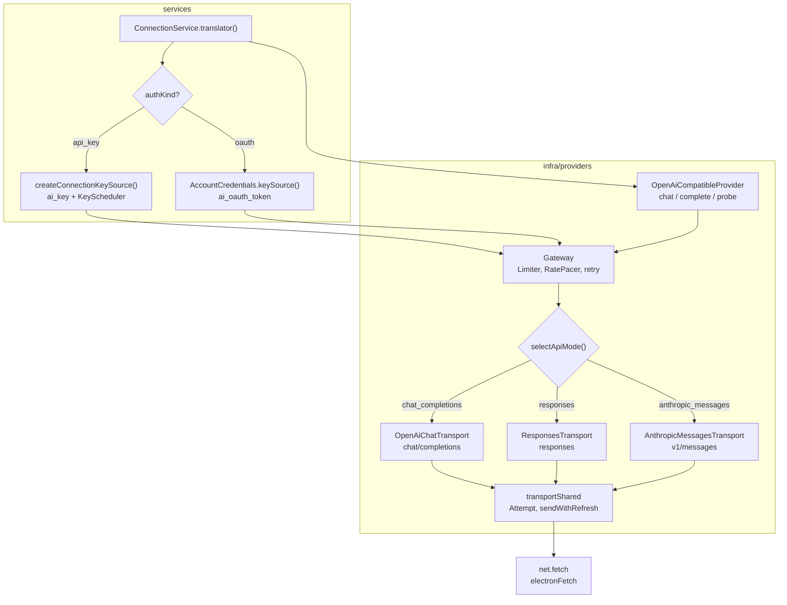

Đọc sơ đồ:

- `translator()` dựng provider **mới mỗi lần gọi**: địa chỉ, khóa và cài đặt mục đọc lại từ DB, nên sửa có hiệu lực
  ngay. Chỉ phần runtime sống lâu nằm trong `GatewayRegistry`: `KeyScheduler` theo kết nối, `Limiter` +
  `RatePacer` theo mục model.
- `KeySource` là ranh giới: `Gateway` không biết khóa nằm ở bảng `ai_key` hay là token tài khoản. Tài khoản trả
  `KeyLease` có thêm `credential` và `refresh`.
- `selectApiMode` (trong `transportFactory.ts`): Codex luôn `responses`; Copilot dùng `responses` cho `gpt-N`
  với N ≥ 5 (trừ `gpt-5-mini`), còn lại `chat_completions`; `providerId === 'anthropic'` luôn Messages; endpoint
  tùy chỉnh theo `apiMode`, còn `auto` thì đoán theo host/đường dẫn (`guessApiMode`).
- Ba transport nhận và trả **cùng dạng nội bộ** (`ChatRequest`, `ChatStreamEvent`), nên chat, dịch và tool
  chạy giống nhau dù giao thức nào ở dưới.
- `blockedBy`: mức suy luận đã lưu mà model không nhận thì provider ném `invalid_request` ngay, không gửi gì ra
  mạng (`checkThinkingLevel` trong `translator()`).

### 3.2 Dán khóa API vào thẻ provider (Cài đặt › Khóa API)

Người dùng dán khóa vào thẻ Gemini/OpenAI/… rồi bấm Lưu (`KeyField.save`) → kết nối được tạo nếu chưa có, khóa
được mã hóa, Mira gọi `GET /models` để kiểm và thêm model đầu tiên.

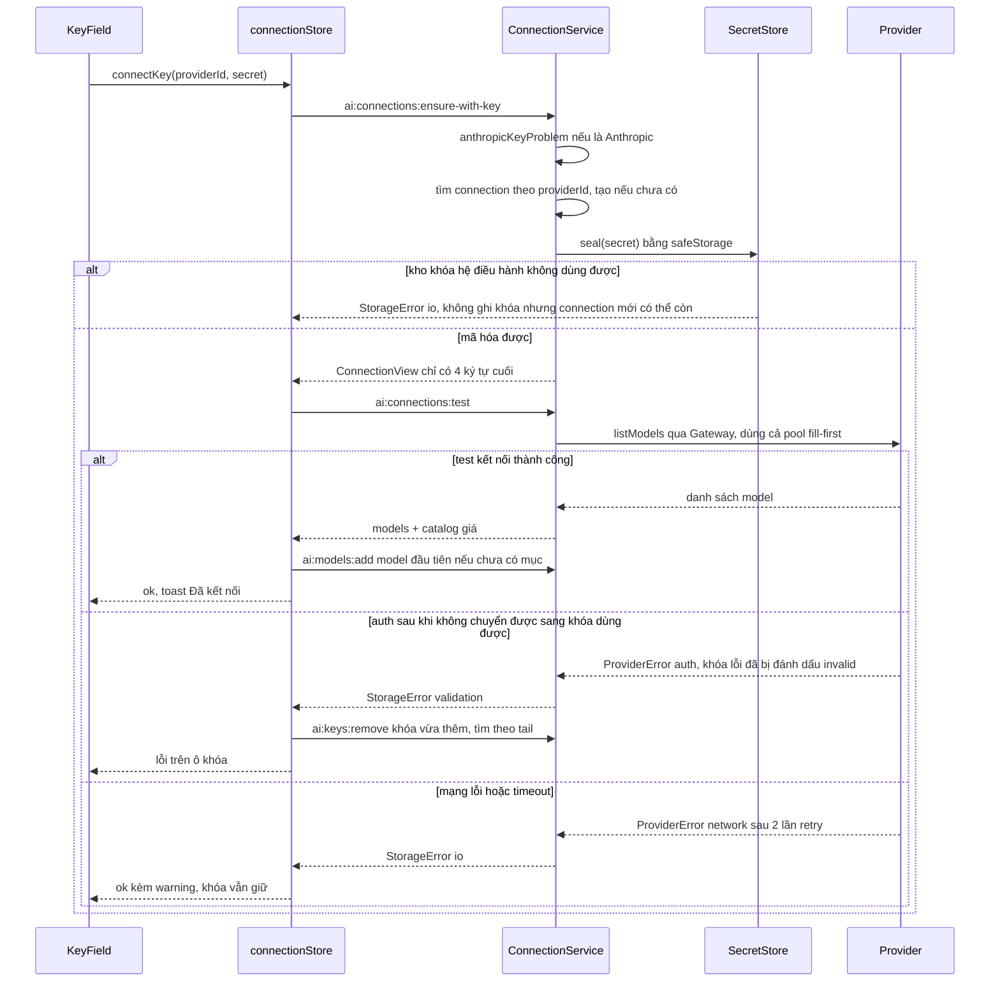

Đọc sơ đồ:

- `ensureWithKey` (main) tìm kết nối theo `providerId`, không có thì tạo từ `CONNECTION_PRESETS`. Khóa
  Anthropic không bắt đầu bằng `sk-ant-api` bị từ chối trước khi lưu.
- `SecretStore.seal` trả `{cipher, tail}`: DB giữ bản mã và 4 ký tự cuối. Renderer không bao giờ nhận lại khóa.
  Nếu mã hóa lỗi thì không ghi khóa, nhưng `ensureWithKey` đã tạo connection trước bước này nên có thể
  để lại connection rỗng; không phải toàn luồng là một transaction nguyên tử.
- `test` kiểm **cả pool** theo fill-first, không bảo đảm dùng khóa vừa thêm. Khóa cũ tốt có thể che khóa
  mới hỏng; một khóa bị `auth` có thể bị đánh dấu invalid rồi Gateway thử khóa tiếp trước khi trả kết quả.
  Đây là giới hạn đã ghi trong [module Kết nối AI](../modules/ai-connections/README.md).
- Rẽ nhánh "sai khóa" và "mạng" do **renderer** quyết định bằng `fieldOf`: regex trên câu lỗi (`khóa|unauthor…`
  → `key`). Main chỉ phân `validation`/`io` qua `taskErrorPolicy('probe', kind).probeCode`.
- `listModels` nuốt các lỗi "endpoint không liệt kê" (`invalid_request`, `refused`…) thành `listed: false`. Chỉ
  `auth`, `network`, `timeout`, `cancelled` và "hết khóa" mới là lỗi kết nối thật.
- Onboarding có bản sao của luồng này (`Onboarding.finishConnection`). Bản đó gỡ khóa với **mọi** lỗi test, kể cả
  lỗi mạng (xem mục 7).

### 3.3 Thêm endpoint tùy chỉnh và probe

Kích hoạt khi bấm "Kiểm tra" ở `EndpointForm`, `ConnectionDetails`, `LocalPage` hoặc onboarding "Gateway tự
dựng" → `ai:connections:probe` → `probeEndpoint()` trả `EndpointProbeResult` (không tự lưu gì).

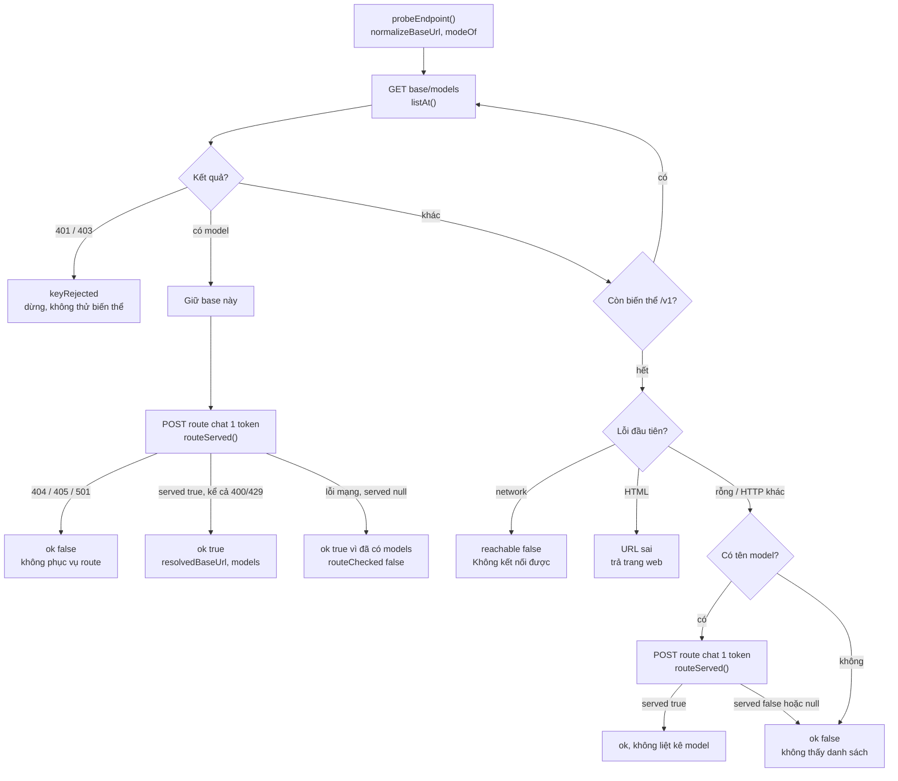

Đọc sơ đồ:

- Biến thể base: `alternateBase` thêm hoặc bỏ `/v1`. Anthropic không thử biến thể vì route đã có `/v1`
  (`anthropicBase`).
- Route kiểm theo `apiMode`: `/chat/completions`, `/responses` hoặc `/v1/messages`. Header Anthropic là
  `x-api-key` + `anthropic-version`.
- Probe **không đi qua `Gateway`**, có timeout riêng (10 giây cho list, 15 giây cho route) và dùng `fetch` đã
  tiêm. Nếu không truyền khóa, nó mở khóa `ok` đầu tiên của kết nối (`ConnectionService.probe`).
- Chưa lấy được danh sách model thì probe chỉ thành công khi có tên model và `route.served === true`;
  route lỗi mạng (`null`) hoặc không tồn tại (`false`) đều trả `ok: false`. Chỉ khi đã có danh sách
  model, route lỗi mạng mới vẫn trả `ok: true, routeChecked: false`.
- Bên gọi quyết định giữ `resolvedBaseUrl`: `EndpointForm.check` điền lại ô URL, `ConnectionDetails` gọi
  `update({ baseUrl })`.

### 3.4 Đăng nhập tài khoản thuê bao (Codex, Copilot)

Người dùng chọn ChatGPT/Codex hoặc GitHub Copilot ở onboarding hay trang Tài khoản → device code chạy ở main
→ token được mã hóa vào `ai_oauth_token`, kết nối `authKind: 'oauth'` được tạo, model tài khoản được thêm.

**Trạng thái bằng chứng:** đây là luồng đã có trong mã. [Module Kết nối AI](../modules/ai-connections/README.md)
còn đánh dấu task 7.2 cần thử thật đăng nhập/dịch/chat bằng tài khoản Codex và Copilot; không lấy sơ đồ này
làm bằng chứng rằng luồng thuê bao đã được kiểm chứng end-to-end với tài khoản thật.

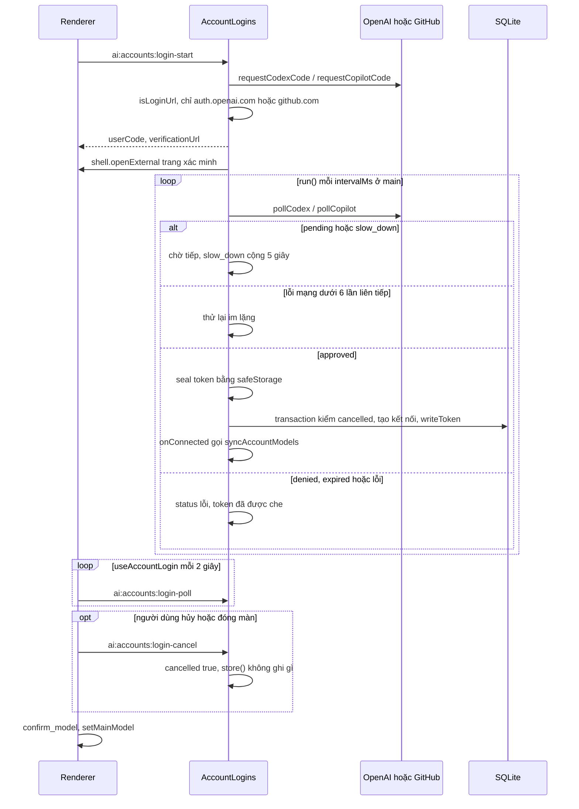

Đọc sơ đồ:

- Hai vòng lặp độc lập: main hỏi nhà cung cấp theo nhịp nhà cung cấp cho (`AccountLogins.run`), renderer hỏi
  main mỗi 2 giây (`POLL_MS` trong `accountLogin.ts`). Token không bao giờ đi qua IPC.
- Mỗi nhà cung cấp chỉ có một phiên `pending`: `start` hủy phiên cũ. `sweep` dọn phiên hết hạn.
- `store()` kiểm `session.cancelled` hai lần: sau khi mã hóa và **bên trong** transaction ghi token. Hủy đúng lúc
  đang lưu thì không còn token mồ côi.
- Mỗi nhà cung cấp tối đa một kết nối (`findAccountConnection`). Đăng nhập lại thì ghi đè token và trả `state` về
  `ok`.
- `syncAccountModels` liệt kê model của tài khoản (Codex qua transport, Copilot qua `/models` kèm header VS Code),
  thất bại thì dùng `CODEX_FALLBACK_MODELS`/`COPILOT_FALLBACK_MODELS`.

### 3.5 Lấy credential tài khoản khi gọi model

Mỗi lần `Gateway` mượn "khóa" của kết nối oauth, `AccountCredentials.keySource().acquire()` trả token còn hạn.

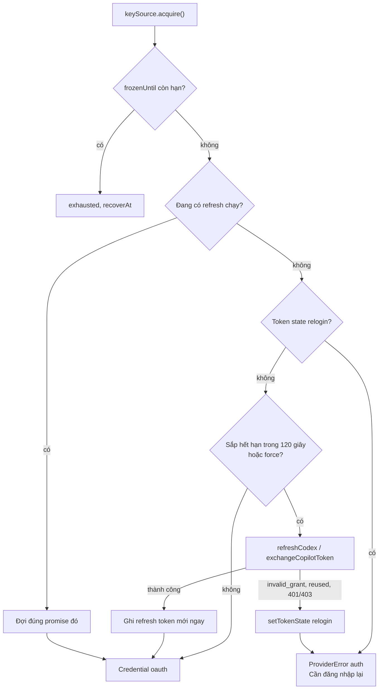

Đọc sơ đồ:

- `credential()` giữ một `Promise` theo tài khoản trong `refreshing`: refresh token Codex chỉ dùng được một lần,
  hai lần làm mới song song sẽ làm hỏng phiên.
- Copilot giữ token ngắn hạn trong bộ nhớ (`copilotTokens`); DB chỉ giữ GitHub token.
- Lỗi 401 khi đang gọi: `sendWithRefresh` gọi `lease.refresh()` (`credential(account, true)`) rồi gửi lại **một**
  lần. Copilot cũng refresh khi thân lỗi khớp `COPILOT_REFRESH_MARKERS`.
- `report` của tài khoản chỉ đóng băng với `rate_limited`/`quota` (mặc định 60 giây nếu không có
  `retryAfterMs`). `auth` không đóng băng (xem mục 7).

### 3.6 Một lời gọi model: chọn mục → gateway → transport → stream

Kích hoạt khi chat, dịch, trợ lý hay trích ngữ cảnh gọi `connections.translator(c, e).provider.chat()` hoặc
`.complete()`. Kết quả là stream `reasoning`/`delta` rồi một `done` hoặc `tool-calls`.

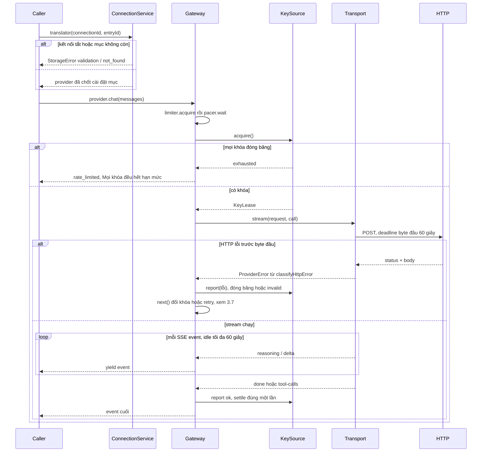

Đọc sơ đồ:

- Thứ tự cố định trong `Gateway.stream`: slot `Limiter` → `RatePacer.wait` → `keys.acquire` → gọi. `LeaseGuard`
  bảo đảm mỗi lease được `report` **đúng một lần**: `ok`, lỗi đã phân loại, hoặc `neutral` (hủy/timeout).
- `Attempt` gộp signal của người gọi với deadline. Hủy thắng timeout: người bấm Hủy thấy `cancelled`, không thấy
  "nhà cung cấp chậm".
- Lỗi giữa stream (frame có `error`) cũng qua `classifyHttpError`. Đứt kết nối giữa chừng thành `network`.
- Một khi `started = true`, `Gateway.stream` ném lỗi thẳng lên, không retry hay đổi khóa, để không lặp chữ đã hiện.
- `complete()` (dịch, trích ngữ cảnh) dùng `Gateway.call` cùng logic và đếm `attempts` qua `onAttempt`.

### 3.7 Bên trong Gateway: đổi khóa hay retry

`Gateway.next()` chạy sau mỗi lần gọi thất bại. Nó trả về lease để thử tiếp, hoặc ném lỗi lên tầng service.

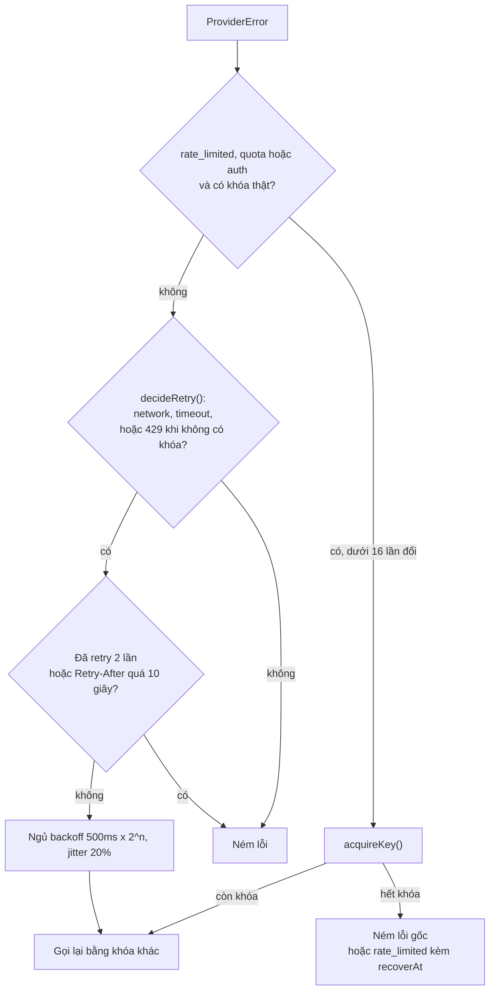

Đọc sơ đồ:

- Lỗi "của khóa" đổi khóa **ngay**, không ngủ. `KeyScheduler.settle` + `decideFreeze` ghi hiệu ứng: `auth` →
  `invalid`, `quota` → đóng băng tới nửa đêm Los Angeles, `rate_limited` theo `quotaScope` (phút: đúng
  `retryAfterMs` + 1 giây; ngày: tới mốc reset; không rõ: 60 giây nhân đôi, trần 30 phút).
- Chọn khóa kiểu **fill-first**: dùng cạn khóa đầu rồi sang khóa sau. Khóa vừa hết đóng băng mà còn `strikes`
  chỉ được một lượt thăm dò (`probing`).
- `epoch` theo khóa: lượt `ok` bắt đầu trước một đợt lỗi không được gỡ đóng băng; nhiều 429 cùng đợt chỉ tính một
  strike.
- Retry và "hỏi lại vì nội dung" là hai ngân sách tách rời: phần sau ở tầng dịch
  (`MAX_CONTENT_RETRIES_PER_BATCH`, `translationCore`; xem [04](04-dich-chuong.md)).

### 3.8 Phân loại lỗi → chính sách → fallback sang model khác

Một `ProviderError` đi lên tới service. Chat tự chuyển model dự phòng, dịch thì chỉ gợi ý.

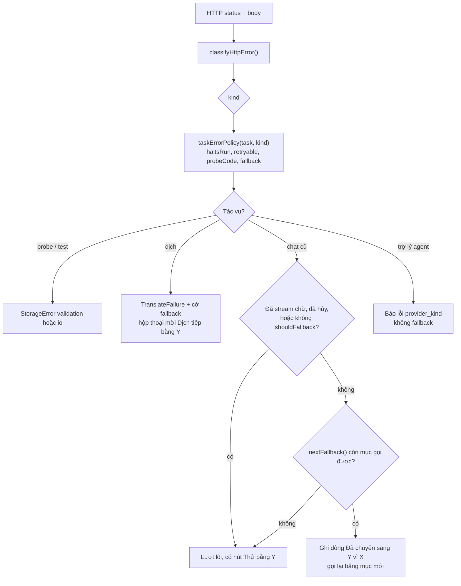

Đọc sơ đồ:

- `classifyHttpError` đọc bốn lớp: chi tiết Google (`RetryInfo`, `QuotaFailure`), thân OpenAI, quét chuỗi thô, rồi
  mới tới mã HTTP. Các ngoại lệ đáng nhớ: Gemini sai khóa trả 400 → `auth`; `insufficient_quota` → `quota`; Codex
  `usage_limit_reached` → `quota` kèm mốc reset; Copilot "premium request" → `quota`; Anthropic 529 →
  `rate_limited`; 4xx có bằng chứng bộ lọc → `refused`; 413/"too long" → `requestProblem: 'too_large'`.
- `shouldFallback` nhận `quota`, `rate_limited`, `network`, `timeout`, `invalid_response`, và `invalid_request`
  chỉ khi giống "model không tồn tại/không được phép". Sai khóa, request sai, bị chặn thì không.
- Chuỗi dự phòng = `preferences().fallbacks` bỏ mục đang chạy và mục trùng (`fallbackChain`). Mục tắt hoặc đã xóa bị
  bỏ qua trong `ChatService.nextFallback`.
- Chỉ `ChatService.run` tự chuyển. `agentService` chỉ đổi lỗi thành `{ code: 'provider_' + kind }`. Dịch không tự
  đổi model, theo quyết định sản phẩm ngày 2026-10-08.

### 3.9 Chọn model ở UI

Ô soạn chat cũ (`AiComposer`), ô soạn Trợ lý (`AgentComposer`) và hộp thoại dịch (`AiTranslateDialog`) dùng
`ModelSelectionMenu`. Kết quả là một `{ connectionId, entryId }` gửi kèm lệnh chat/dịch.

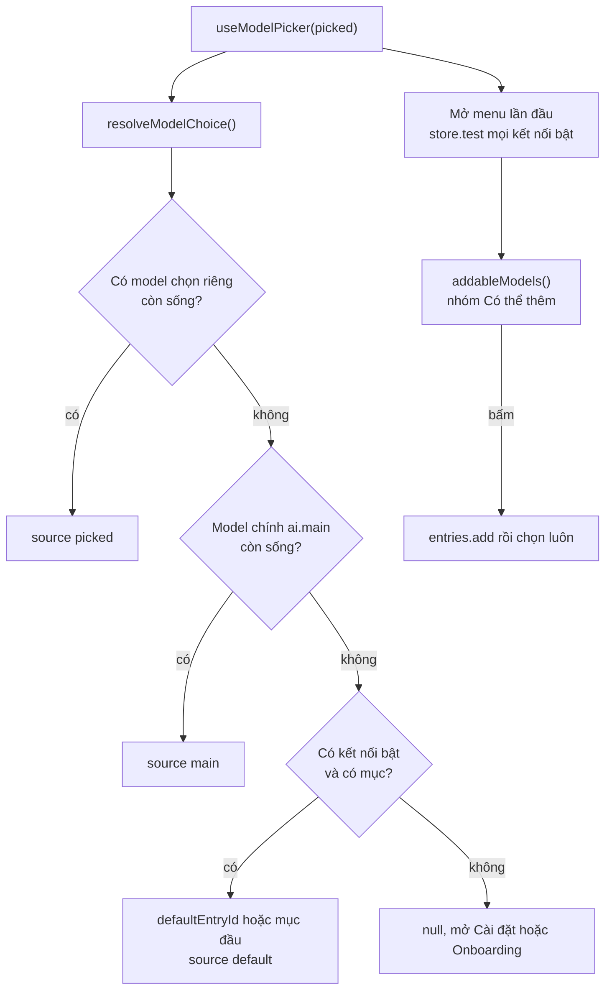

Đọc sơ đồ:

- "Còn sống" nghĩa là kết nối `enabled` và mục còn tồn tại. Tham chiếu chết bị bỏ qua, không báo lỗi.
- Đổi mức suy luận trong submenu ghi thẳng vào **mục model** (`thinkingPatch` → `ai:models:update`). Main kiểm lại
  bằng `checkThinkingLevel` cho mọi đường lưu.
- Gợi ý "Có thể thêm" lấy từ `GET /models` qua `ai:connections:test`, lọc model đã có, `deprecated` và model không
  dùng để chat (đoán theo tên).
- Yêu thích và nhóm đã thu gọn nằm trong `localStorage` (`mira.model-favorites`, `mira.model-groups-collapsed`).
- Main cũng có `defaultModelSelection` (agent/task) nhưng nó **bỏ qua** `ai.main`, nên renderer luôn gửi model đã
  chọn (xem mục 7).

### 3.10 Onboarding lần đầu

Tự hiện khi thư viện chưa có kết nối nào và `ai.onboarding.skipped` chưa bật (hoặc mở tay qua
`useAiOverlayStore.setOnboardingOpen`). Kết quả: một kết nối, một mục model, và model chính được đặt.

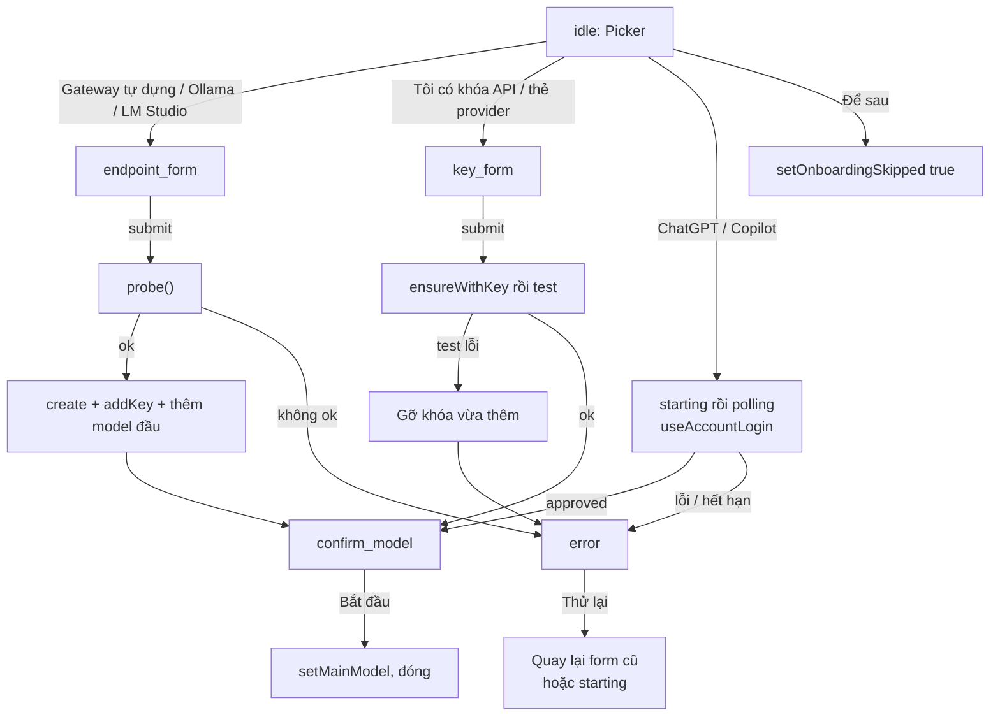

Đọc sơ đồ:

- `onboardingReducer` là hàm thuần: component dispatch sự kiện, IPC nằm trong `Onboarding.tsx` và `accountLogin.ts`.
- `error` nhớ `form` để "Thử lại" quay đúng chỗ. Lỗi đăng nhập quay về `starting` và xin mã mới.
- Trang Cài đặt › Tài khoản dùng lại cùng reducer và `useAccountLogin` (`AccountsPage`).

## 4. Dữ liệu và trạng thái

**Kiểu chính**

- `ConnectionView` ([aiConnections.ts](../../src/shared/contracts/aiConnections.ts)): kết nối như renderer thấy.
  Gồm `authKind`, `oauthProvider`, `apiMode`, `account` (label, `ok|relogin`), `keys` (chỉ `tail`, `state`,
  `frozenUntil`) và `models: ModelEntryView[]`, mỗi mục kèm `capability` (mức suy luận, có nhận nhiệt độ không).
  `capability` do main tính ở `toView`.
- `ModelSettings` ([modelSettings.ts](../../src/shared/contracts/modelSettings.ts)): cài đặt một mục (thinking,
  temperature, topP, giới hạn token, concurrency, RPM, extraBody/extraHeaders). `buildGeneration` chỉ gửi trường đã bật.
  `settingsKey(entry)` là dấu vân tay để lô dịch phát hiện cài đặt bị sửa giữa chừng.
- `KeyLease`/`KeySource` ([keys.ts](../../src/main/infra/providers/gateway/keys.ts)), `Credential`/`CallOptions`
  ([transportShared.ts](../../src/main/infra/providers/transports/transportShared.ts)).
- `ProviderError` ([types.ts](../../src/main/infra/providers/types.ts)): `kind` thuộc một trong chín loại, kèm
  `retryable` cố định theo `kind`, `retryAfterMs`, `status`, `quotaScope`, `bodySnippet` (đã che), `sent` (tham số
  đã gửi, không có header) và `account`.
- `AiPreferences` ([aiPreferences.ts](../../src/shared/contracts/aiPreferences.ts)), `LoginStatus`/`UsageWindowView`
  ([aiAccounts.ts](../../src/shared/contracts/aiAccounts.ts)).

**Nơi lưu**

| Dữ liệu | Ở đâu | Vòng đời |
| --- | --- | --- |
| Kết nối | bảng `ai_connection` (DB app của thư viện) | đến khi xóa; xóa thì `pruneAiPreferences` gỡ tham chiếu |
| Khóa API | `ai_key.secret` (BLOB `safeStorage`), `tail`, `state`, `frozen_until`, `frozen_scope`, `freeze_strikes` | đóng băng/invalid ghi bởi `connectionKeySource.apply` |
| Mục model | `ai_model` (id, name, model_id, ord, `settings` JSON), từ schema v5 | sửa bằng bản vá `applySettingsPatch` |
| Token tài khoản | `ai_oauth_token` (BLOB mã hóa JSON `{access, refresh}` hoặc `{githubToken}`, `state ok|relogin`), từ v7 | ghi đè khi refresh hoặc đăng nhập lại |
| Model chính, dự phòng, bỏ onboarding | bảng `meta`, khóa `ai.main`, `ai.fallbacks`, `ai.onboarding.skipped` | đọc qua `ai:preferences:get` |
| Runtime khóa (`epoch`, `probing`), `Limiter`, `RatePacer` | bộ nhớ, `GatewayRegistry` trong `ConnectionService` | mất khi tắt app; `forget`/`forgetEntry` khi xóa |
| Token Copilot ngắn hạn, `frozenUntil` tài khoản, cache hạn mức Codex 5 phút | bộ nhớ, `AccountCredentials` | mất khi tắt app |
| Mức suy luận Copilot từ `/models` | `copilotReasoning` (Map cấp module) | mất khi tắt app, quay về catalog |
| Phiên đăng nhập | bộ nhớ, `AccountLogins.sessions` | dọn khi hết hạn mã |
| Kết nối, kết quả test, preference ở renderer | Zustand `useConnectionStore`; overlay ở `useAiOverlayStore` | reset qua `registerStoreReset` |
| Yêu thích, nhóm thu gọn | `localStorage` | theo máy |

**Trạng thái một khóa API** (`keyPool.ts`, `keyScheduler.ts`):

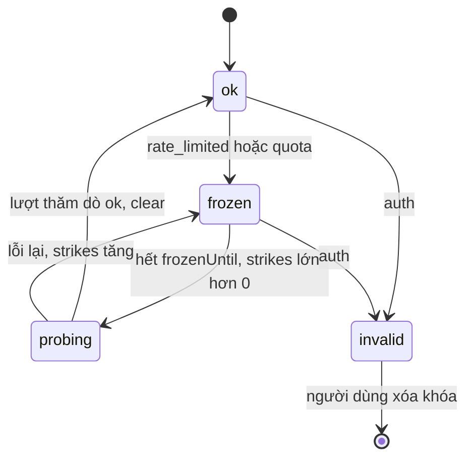

**Trạng thái kết nối tài khoản** (`ai_oauth_token.state`): `ok` → `relogin` khi refresh bị từ chối hẳn hoặc tài
khoản không có Copilot. `relogin` → `ok` khi đăng nhập lại (`writeToken` đặt lại `state = 'ok'`).

## 5. Tại sao code viết như vậy

- **Tách transport và gateway.** Một class cũ vừa giữ kết nối vừa nói chuyện với model: không cho biết vì sao lời
  gọi hỏng, retry ở hai nơi, dùng chung khóa không an toàn khi chạy song song. Nay transport chỉ làm một lời gọi và
  trả lỗi có kiểu; gateway giữ retry, đổi khóa, trần đồng thời. Mỗi phần test và thay riêng được. **[commit]**
  `b4374e2`. Transport thứ hai và thứ ba (Responses, Messages) thêm vào mà không đụng gateway. **[commit]** `cc1612a`.
- **Không dùng SDK nhà cung cấp.** Với `fetch` trần, thân lỗi thô (vd `RetryInfo` của Gemini trong `error.details`)
  luôn tới tay `classifyError`. **[code]** comment đầu `openAiCompatible.ts`.
- **`net.fetch` thay `fetch` của Node.** `net.fetch` theo proxy hệ thống (PAC, WPAD) và kho chứng chỉ hệ thống;
  người dùng sau proxy sẽ thấy "không kết nối được" nếu dùng `fetch` của Node. **[code]** `fetchAdapter.ts`.
- **Lưu khóa bằng `safeStorage`, không có thì từ chối.** `SecretStore.seal` ném `StorageError('io')` khi
  `isEncryptionAvailable()` sai, không bao giờ ghi plaintext. Dùng API async vì nó báo `shouldReEncrypt` khi hệ điều
  hành xoay khóa, rồi `reSealKey` ghi lại ngay. Phần mã hóa được tiêm (`SecretCrypto`) để test chạy ngoài Electron.
  Giới hạn đã ghi: trên Windows là DPAPI, chặn người dùng khác cùng máy nhưng **không** chặn app khác cùng tài
  khoản. **[code]** `secretStore.ts`, `electron/safeStorage.ts`. Token tài khoản dùng cùng cơ chế; Hermes để token
  dạng chữ thường, Mira cố ý không làm vậy. **[docs]** [Kết nối AI](../modules/ai-connections/README.md).
- **Khóa không quay về renderer.** Mọi trả về là `ConnectionView` chỉ có `tail`; `redactSecrets` che khóa **ngay
  chỗ tạo lỗi** vì lỗi còn đi vào log và output test, không chỉ IPC. **[code]** `redact.ts`, `connectionService.ts`.
- **Fill-first, không round-robin.** Đúng cho hạn mức miễn phí: round-robin làm cả bộ khóa cạn cùng lúc. **[code]**
  `keyPool.ts` (D4).
- **`quota` khác `rate_limited`.** Hết tiền thì chờ không giúp. Nhưng Gemini hết hạn mức ngày cũng viết "exceeded
  your current quota… billing", nên chỉ đổi sang `quota` khi không có bằng chứng phạm vi phút/ngày. **[code]**
  `classifyError.ts` (D8 của `ai-gateway`).
- **Gemini sai khóa trả 400.** Nếu chỉ xét mã HTTP thì đó là `invalid_request` và khóa sai không được đánh dấu.
  Vì vậy Mira đọc `API_KEY_INVALID`/câu "valid API key" để đổi sang `auth`. **[code]** `classifyError.ts`, fixture
  `bad-key.json`.
- **`listModels` phải gửi khóa.** Thiếu khóa, Gemini trả 404 cho `/models`, và kết nối trông như "nối được nhưng
  không có model". **[code]** comment trên `listModels` (đang đặt nhầm chỗ, xem mục 7).
- **`neutral` khi hủy/timeout.** Một lần dùng chưa xong không chứng minh gì về khóa: báo `ok` là nói dối, báo lỗi thì
  đóng băng oan một khóa lành. **[code]** `OpenAiCompatibleProvider.chat`, `outcomeFor`.
- **Không retry sau byte đầu của stream.** Tránh lặp chữ đã hiện; chat cũng không fallback khi đã có `delta` hoặc
  `reasoning`. **[code]** `Gateway.stream`, `ChatService.run`.
- **Cài đặt mục chốt một lần mỗi lượt.** `translator()` đọc cài đặt một lần rồi để trong provider: một lượt chat
  nhiều vòng tool hay một lô dịch không trộn hai cấu hình. **[code]** `connectionService.ts`.
- **Refresh một-lúc-một-cái và ghi refresh token mới ngay.** Refresh token dùng một lần; hai lần làm mới song song
  làm hỏng phiên. **[code]** `accountCredentials.ts`.
- **Device code chạy ở main, renderer chỉ poll.** Token không đi qua IPC; trình duyệt chỉ được mở tới
  `auth.openai.com` và `github.com`. **[code]** `accountLogins.ts`. **[docs]** README module, mục
  `subscription-providers`.
- **Client ID và header giả VS Code cho Copilot.** Đây là rủi ro chủ sản phẩm đã chấp nhận: thiếu header thì
  Copilot trả 400. Ngoài chỗ đó Mira tự xưng `originator: mira` và `User-Agent: Mira/<version>`. **[docs]**
  [README](../modules/ai-connections/README.md), "Quyết định 2026-10-08".
- **Dịch không tự đổi model.** Một chương không nên đổi giọng văn giữa chừng; hộp thoại chỉ mời "Dịch tiếp bằng Y".
  **[docs]** README, mục "Model chính và dự phòng".
- **Bản chụp catalog thay vì gọi models.dev lúc chạy.** Phải biết giá khi offline; model lạ không phải lỗi, phải hiện
  "chưa biết giá" chứ không hiện 0. **[code]** `modelCatalog.ts`.

## 6. Đọc code bắt đầu từ đâu

1. [connectionService.ts](../../src/main/services/ai/connectionService.ts): đọc `translator()` và `test()` để thấy
   một kết nối được lắp ra sao.
2. [gateway/gateway.ts](../../src/main/infra/providers/gateway/gateway.ts): `call`, `stream`, `next` là trái tim
   của retry và đổi khóa.
3. [transports/transportFactory.ts](../../src/main/infra/providers/transports/transportFactory.ts) rồi
   [transportShared.ts](../../src/main/infra/providers/transports/transportShared.ts): chọn giao thức, deadline,
   refresh-sau-401.
4. [classifyError.ts](../../src/main/infra/providers/classifyError.ts) +
   [errorPolicy.ts](../../src/main/services/ai/errorPolicy.ts) + [fallback.ts](../../src/main/services/ai/fallback.ts):
   lỗi được hiểu và xử lý thế nào.
5. [connectionStore.ts](../../src/renderer/src/modules/ai-connections/store/connectionStore.ts): mọi thao tác UI đi
   qua đây; sau đó xem `Onboarding.tsx`.

## 7. Điểm đáng ngờ / nợ kỹ thuật

1. **Mã dịch MVP gần như chết trong provider.** `OpenAiCompatibleProvider.translate`, `translateBatch`,
   `SYSTEM_PROMPT`, `splitIntoBatches`, `parseItems`, `reconcile` vẫn còn. Nhưng `chapterTranslation.ts`,
   `paragraphTranslation.ts` và `chapterTranslationRunner.ts` chỉ rẽ vào nhánh `provider.translate()` khi provider
   **không** có `complete`. Provider thật luôn có `complete`, nên nhánh đó chỉ còn chạy với `MockProvider` trong test.
2. **Tài khoản trả `auth` có thể lặp nhiều vòng [suy luận].** `Gateway.next` coi `auth` là "lỗi khóa" và gọi lại
   `acquireKey` khi `lease.id !== null`, tối đa `MAX_KEY_SWITCHES = 16` lần. Với kết nối oauth, `lease.id` là id tài
   khoản, và `AccountCredentials.keySource().report` không đóng băng khi gặp `auth`. Nếu token vẫn `ok` nhưng nhà
   cung cấp cứ trả 401 (vd tài khoản thiếu quyền), mỗi vòng có thể gửi lại request và gọi refresh. Chưa thấy test
   cho ca này (`gateway.test.ts` chỉ thử nguồn khóa giả).
3. **Renderer đoán loại lỗi bằng regex trên câu tiếng Việt.** `fieldOf` trong `connectionStore.ts` quyết định
   "sai khóa" (để gỡ khóa) bằng cách khớp `khóa|api key|unauthor…` trên `error.message`. Main đã biết `kind` nhưng
   chỉ gửi qua IPC mã `validation`/`io`. Đổi câu lỗi ở main có thể làm hỏng việc rollback.
4. **Hai bản logic "lưu khóa rồi kiểm" lệch nhau.** `connectionStore.connectKey` chỉ gỡ khóa khi lỗi thuộc `key`,
   còn `Onboarding.finishConnection` gỡ khóa với **mọi** lỗi test, kể cả mạng. Cả hai tìm khóa vừa thêm bằng 4 ký
   tự cuối. README module đã ghi giới hạn này ở "Khoảng trống và rủi ro hiện tại".
5. **Quyết định 2026-10-12 chưa có trong code.** README ghi "luật chat tự chuyển sang dự phòng không áp cho kết nối
   tài khoản thuê bao" (trạng thái: chưa triển khai). `shouldFallback`/`ChatService.run` hiện không xét `authKind`.
   Kimi và chế độ gateway CLIProxyAPI cũng chưa có.
6. **`MainModel.thinking` không ai dùng.** Field có trong `aiPreferences.ts` ("Mức suy luận chọn cùng model
   chính"), nhưng Cài đặt › Model chính ghi mức vào **mục model** (`modelPages.tsx`, `thinkingPatch`). Không chỗ nào
   đọc hay ghi `main.thinking`. Kèm theo đó `defaultModelSelection` (agent/task) bỏ qua `ai.main`; README đã ghi
   khoảng trống này cho `taskService`.
7. **Tên gọi gây nhầm.** `OpenAiCompatibleProvider` nay bọc cả Responses và Anthropic, và comment đầu file vẫn nói
   "Provider duy nhất gọi ra ngoài: một endpoint tương thích OpenAI". Lớp `Gateway` trùng tên với preset "Gateway tự
   dựng". JSDoc dài của `listModels` nằm phía trên `guard()`, không phải phía trên `listModels`.
8. **Tài liệu module trỏ đường dẫn cũ.** README `ai-connections` còn ghi `src/renderer/src/features/settings/…`,
   `features/models/…`, `features/onboarding/` từ trước refactor `7ed2220`. Code thật nằm ở `modules/ai-connections/…`.

## 8. Liên kết

- Tài liệu module: [Kết nối AI](../modules/ai-connections/README.md) ·
  [Rà flow so với Hermes](../modules/ai-connections/hermes-ux-flow-review.md) ·
  [Cài đặt và lớp provider của Hermes](../modules/ai-connections/hermes-settings-and-adapters.md) ·
  [Lõi gọi model của Hermes](../modules/ai-connections/hermes-runtime-research.md) · OpenSpec
  [`add-subscription-gateway-auth`](../../openspec/changes/add-subscription-gateway-auth/proposal.md) (chưa triển khai).
- Code-tour liên quan: [README](README.md) (hành trình tổng) ·
  [01 Process và IPC](01-process-va-ipc.md) (`window.mira.ai`, `createServices` dựng `ConnectionService`, `registerIpc`
  tiêm `electronFetch`/`electronSafeStorage`) · [02 Lưu trữ](02-luu-tru.md) (bảng `ai_*`, `meta`, migration v5/v7) ·
  [04 Dịch chương](04-dich-chuong.md) (`translationCore` gọi `complete`, `withPolicy`, "Dịch tiếp bằng Y") ·
  [05 Ngữ cảnh dịch](05-ngu-canh-dich.md) (`contextExtractionService` gọi `translator().provider.complete`) ·
  [06 Trợ lý và agent](06-tro-ly-agent.md) (`ChatService` fallback, `agentService.chat`, `defaultModelSelection`) ·
  [08 Giao diện renderer](08-giao-dien-renderer.md) (ô soạn, hộp thoại dịch dùng `ModelSelectionMenu`) ·
  [09 Đo lường và công cụ](09-do-luong-va-cong-cu.md) (`refresh-model-catalog.mjs`, fixture provider).
