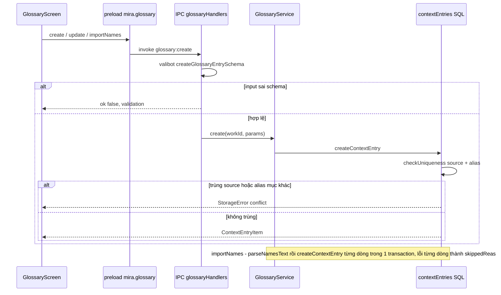
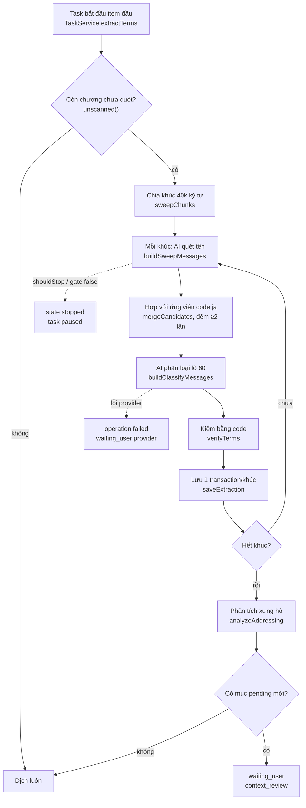
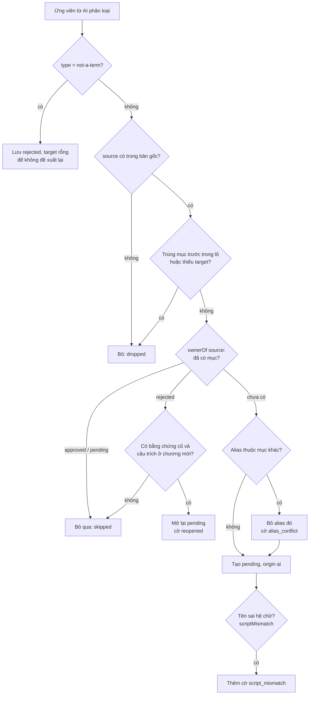
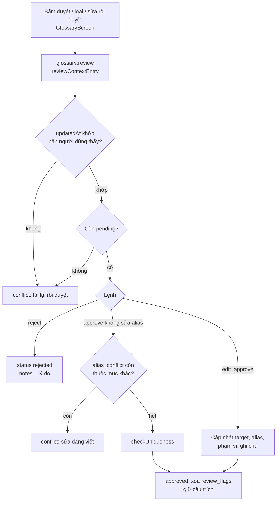
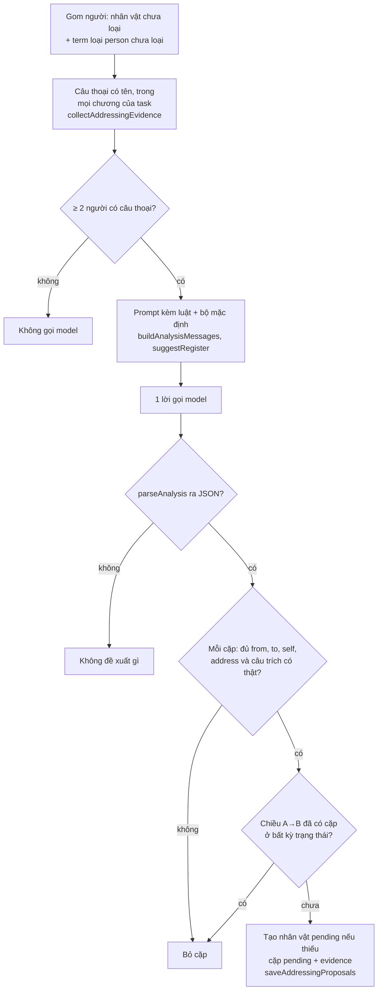
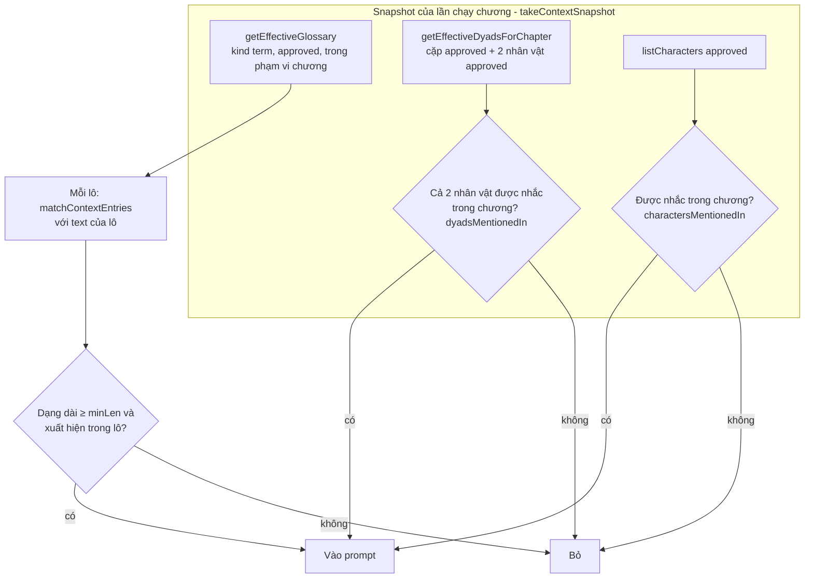
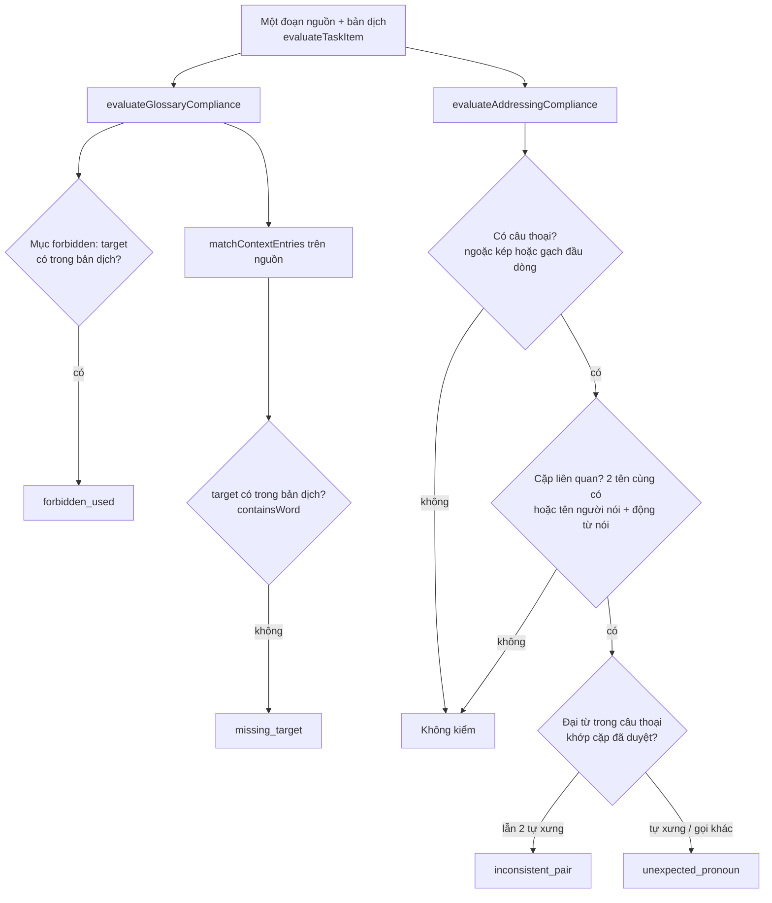
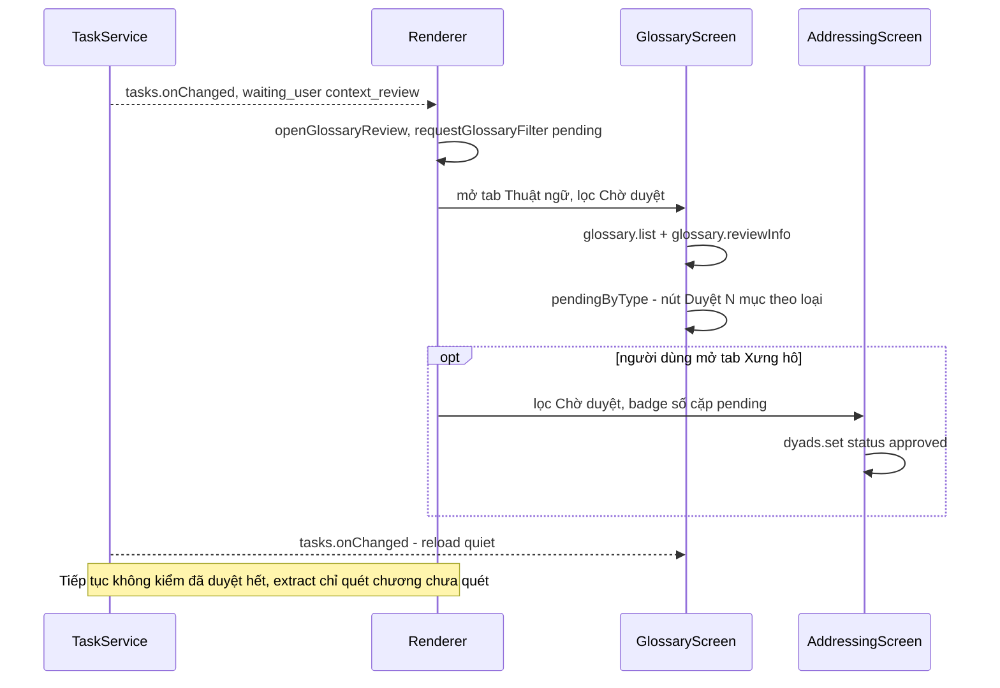
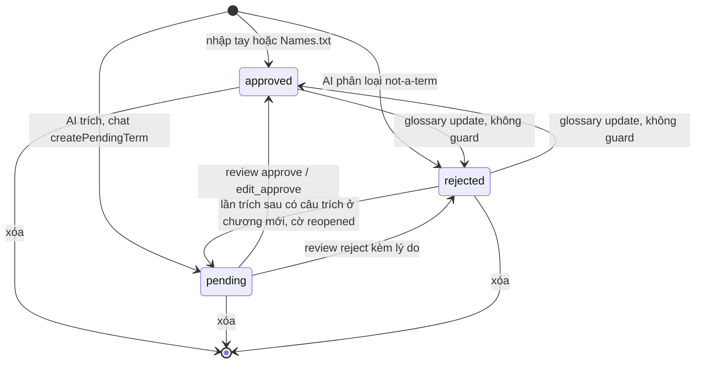

# Ngữ cảnh dịch: glossary, nhân vật, xưng hô

> **Một câu:** vùng này lưu và duyệt các quy ước của một tác phẩm (thuật ngữ, nhân vật, cặp xưng hô), cho AI
> đề xuất chúng từ bản gốc, chọn mục nào đi vào prompt và kiểm bản dịch có theo quy ước không.
> Cập nhật: 2026-10-15 · Nguồn: đọc code tại commit db2455f.

## 1. Vì sao vùng này tồn tại

Dịch tiểu thuyết dài bằng LLM thường lệch tên riêng và lẫn xưng hô giữa các chương: model không nhớ chương
trước đã gọi ミリィ là "Milly" hay Rion xưng "tôi" với Milly. Vùng này giữ các **quy ước đã duyệt** của tác
phẩm trong SQLite của tác phẩm. Bộ dịch (file [04](04-dich-chuong.md)) đọc quy ước đó vào prompt. Nguyên tắc
xuyên suốt: AI chỉ tạo **ứng viên** (`pending`), code kiểm những gì kiểm được, người dịch chốt.

Ai gọi vùng này:

- Renderer gọi qua `window.mira.glossary.*` và `window.mira.addressing.*` (màn Ngữ cảnh, tab Ngữ cảnh ở
  panel chương).
- Task dịch của agent (file [06](06-tro-ly-agent.md)) gọi `ContextExtractionService.extract` trước item
  đầu, và dùng `evaluateGlossaryCompliance`/`evaluateAddressingCompliance` để QA.
- Pipeline dịch (file [04](04-dich-chuong.md)) gọi `matchContextEntries`, `getEffectiveGlossary`,
  `getEffectiveDyadsForChapter`.

Vùng này gọi: storage `contextEntries.ts`/`addressingEntries.ts` (file [02](02-luu-tru.md)), provider qua
`ConnectionService.translator()` (file [03](03-ket-noi-ai.md)), `appendAiCall` để log lời gọi model.

## 2. Bản đồ file

**Hợp đồng (shared/contracts)**

| File | Làm gì | Symbol chính để grep |
| --- | --- | --- |
| [glossary.ts](../../src/shared/contracts/glossary.ts) | Kiểu mục ngữ cảnh, schema valibot cho IPC glossary, lệnh duyệt, cờ duyệt | `ContextEntryItem`, `CONTEXT_KINDS`, `reviewContextCommandSchema`, `ReviewFlag`, `ContextReviewInfo`, `AppliedContext` |
| [addressing.ts](../../src/shared/contracts/addressing.ts) | Kiểu nhân vật, cặp xưng hô có chiều, báo cáo compliance | `CharacterItem`, `AddressingDyadItem`, `AddressingDyadResolved`, `setDyadSchema` |
| [addressingPresets.ts](../../src/shared/contracts/addressingPresets.ts) | 6 bộ xưng hô mặc định theo bối cảnh + luật chung | `REGISTER_PRESETS`, `ADDRESSING_RULES`, `NAME_ADDRESSING_RULE` |

**Logic thuần (shared/context)** — chạy được ở main lẫn renderer, không đọc DB

| File | Làm gì | Symbol |
| --- | --- | --- |
| [contextMatching.ts](../../src/shared/context/contextMatching.ts) | Khớp mục glossary (nguồn + alias) với văn bản nguồn | `matchContextEntries`, `isCJK` |
| [glossaryCompliance.ts](../../src/shared/context/glossaryCompliance.ts) | Bản dịch có chứa target đã duyệt / có dùng từ cấm không | `evaluateGlossaryCompliance` |
| [addressingCompliance.ts](../../src/shared/context/addressingCompliance.ts) | Soát đại từ trong câu thoại so với cặp đã duyệt | `evaluateAddressingCompliance`, `COMMON_SELF_PRONOUNS` |
| [namesParser.ts](../../src/shared/context/namesParser.ts) | Đọc tệp `Names.txt` (`gốc=dịch`) | `parseNamesText` |

**Main: service và AI**

| File | Làm gì | Symbol |
| --- | --- | --- |
| [glossaryService.ts](../../src/main/services/context/glossaryService.ts) | Bọc storage glossary cho IPC; import Names.txt; xem "ngữ cảnh áp dụng" | `GlossaryService`, `applied`, `importNames`, `review`, `bulkApprove` |
| [addressingService.ts](../../src/main/services/context/addressingService.ts) | Bọc storage nhân vật/cặp cho IPC | `AddressingService`, `getEffectiveDyads` |
| [contextExtractionService.ts](../../src/main/services/context/contextExtractionService.ts) | Điều phối trích xuất: quét → phân loại → kiểm → lưu, rồi phân tích xưng hô | `ContextExtractionService.extract`, `analyzeAddressing`, `scriptMismatch`, `quotesOf` |
| [glossaryExtraction.ts](../../src/main/services/ai/glossaryExtraction.ts) | Hàm thuần: ứng viên bằng code, prompt quét/phân loại, parse, `verifyTerms` (Lab dùng chung) | `japaneseCandidates`, `mergeCandidates`, `sweepChunks`, `buildSweepMessages`, `buildClassifyMessages`, `verifyTerms` |
| [addressingAnalysis.ts](../../src/main/services/ai/addressingAnalysis.ts) | Hàm thuần: gom câu thoại bằng chứng, prompt phân tích xưng hô, kiểm câu trích | `collectAddressingEvidence`, `buildAnalysisMessages`, `parseAnalysis`, `verifiedQuotes` |

**Main: IPC và storage (storage thuộc file 02, liệt kê để grep)**

| File | Làm gì | Symbol |
| --- | --- | --- |
| [handlers/glossary.ts](../../src/main/ipc/handlers/glossary.ts) | 11 kênh `glossary:*` | `glossaryHandlers` |
| [handlers/addressing.ts](../../src/main/ipc/handlers/addressing.ts) | 11 kênh `addressing:*` | `addressingHandlers` |
| [contextEntries.ts](../../src/main/infra/storage/contextEntries.ts) | SQL của glossary, lưu kết quả trích, duyệt có guard | `saveExtraction`, `ownerOf`, `checkUniqueness`, `reviewContextEntry`, `getEffectiveGlossary`, `hasGlossary` |
| [addressingEntries.ts](../../src/main/infra/storage/addressingEntries.ts) | SQL nhân vật/cặp, lưu đề xuất xưng hô | `setDyad`, `saveAddressingProposals`, `getEffectiveDyadsForChapter`, `changeDyadFrom` |

**Renderer (`modules/context`)**

| File | Làm gì | Symbol |
| --- | --- | --- |
| [glossary/GlossaryScreen.tsx](../../src/renderer/src/modules/context/glossary/GlossaryScreen.tsx) | Bảng thuật ngữ, lọc trạng thái, duyệt nhanh, duyệt hàng loạt theo loại | `GlossaryScreen`, `pendingByType`, `reviewFlagLabel` |
| [glossary/useGlossary.ts](../../src/renderer/src/modules/context/glossary/useGlossary.ts) | Hook gọi IPC, nạp lại khi task đổi | `useGlossary`, `requestGlossaryFilter` |
| [glossary/GlossaryDialogs.tsx](../../src/renderer/src/modules/context/glossary/GlossaryDialogs.tsx) | Hộp sửa, nhập Names.txt, xóa | `EditGlossaryDialog`, `ImportNamesDialog` |
| [glossary/AppliedContext.tsx](../../src/renderer/src/modules/context/glossary/AppliedContext.tsx) | Tab chỉ đọc: chương này dịch bây giờ sẽ dùng gì | `AppliedContext` |
| [addressing/AddressingScreen.tsx](../../src/renderer/src/modules/context/addressing/AddressingScreen.tsx), [useAddressing.ts](../../src/renderer/src/modules/context/addressing/useAddressing.ts), [AddressingDialogs.tsx](../../src/renderer/src/modules/context/addressing/AddressingDialogs.tsx) | Danh sách nhân vật + ma trận cặp xưng hô | `AddressingScreen`, `useAddressing`, `EditDyadDialog` |
| [shared-glossary/SharedGlossaryMock.tsx](../../src/renderer/src/modules/context/shared-glossary/SharedGlossaryMock.tsx) | Màn "Kho dùng chung" — **mock**, dữ liệu cứng, nút vô hiệu | `SharedGlossaryMock` |
| [style-profiles/StyleProfilesMock.tsx](../../src/renderer/src/modules/context/style-profiles/StyleProfilesMock.tsx) | Màn "Prompt & văn phong" — **mock** | `StyleProfilesMock` |

Màn Thuật ngữ/Xưng hô được nhúng trong `ContextAreaMock` (tab Văn phong của nó vẫn là mock) ở
[work-detail](../../src/renderer/src/modules/workspace/work-detail/ContextAreaMock.tsx), thuộc file
[08](08-giao-dien-renderer.md).

## 3. Luồng chính

### 3.1 Quản lý thủ công và nhập Names.txt

Người dùng thêm/sửa/xóa thuật ngữ hoặc nhập `Names.txt` ở màn Ngữ cảnh → hàng `context_entry` mới, mặc định
`approved`.

Đọc sơ đồ:

- Mọi kênh dùng `createHandler(schema, fn)`; lỗi trả về dạng `{ ok: false, error }` (xem file
  [01](01-process-va-ipc.md)).
- `checkUniqueness` so **không phân biệt hoa thường**, chỉ trong các kind glossary (`GLOSSARY = kind NOT IN
  ('character','dyad')`), cả source lẫn alias của mục khác.
- `GlossaryService.importNames`: dòng trống/chú thích bị bỏ im lặng; dòng sai định dạng hoặc trùng thành lý do
  bỏ qua. Mục nhập vào có `status: 'approved'`, `origin: 'import'` — không qua hàng duyệt.
- Sau mỗi thao tác, `useGlossary.reload()` tải lại cả danh sách và `reviewInfo`.

### 3.2 Trích xuất glossary bằng AI — tổng quan

Kích hoạt: task dịch của agent có `contextStrategy = 'extract_then_review'` bắt đầu hoặc được "Tiếp tục"
(`TaskService.extractTerms`). Kết quả: ứng viên `pending` có bằng chứng, task vào
`waiting_user(context_review)`.

Đọc sơ đồ:

- Chương "đã quét" lưu ở bảng `context_extraction_scan`, ghi **cùng transaction** với ứng viên của khúc. Khúc
  lỗi giữa chừng không ghi gì, lần sau quét lại cả khúc (`saveExtraction`).
- Ứng viên bằng code chỉ có cho tiếng Nhật (`japaneseCandidates`: chuỗi katakana, kanji 1–4 chữ đứng trước
  さん/くん/様…). Tiếng Trung/Anh chỉ dựa vào lượt AI quét.
- `mergeCandidates` bỏ dạng AI quét mà không có trong bản gốc hoặc xuất hiện dưới 2 lần — trước khi tốn lời
  gọi phân loại. Giới hạn 400 ứng viên/khúc.
- Mỗi lời gọi đi qua `ask()`: hỏi `shouldStop` và `gate` (ngân sách task) **trước** request, báo usage lúc bắt
  đầu và kết thúc, ghi `appendAiCall(kind: 'extract')` kể cả khi lỗi.
- `Stopped` (pause/budget/app_closed) trả `state: 'stopped'` với phần đã lưu; lỗi khác ném lên `TaskService`.

### 3.3 Kiểm ứng viên và lưu: các nhánh bị loại, trùng, xung đột

Chi tiết bước `verifyTerms` (thuần) + `saveExtraction` (SQL) cho **một** ứng viên.

Đọc sơ đồ:

- `verifyTerms` không bao giờ sửa bản dịch đề xuất; dạng chữ lạ chỉ thành cờ. Alias không có trong bản gốc
  hoặc đã bị mục khác trong lô chiếm thì bị lọc bớt.
- Mục rejected không có bằng chứng cũ, như mục `not-a-term` mới tạo, không được tự mở lại
  (`known.size === 0`). Mục AI từng có bằng chứng rồi bị người dùng loại vẫn có thể trở lại pending
  khi lần trích sau có bằng chứng ở chương mới. Code phân biệt theo bằng chứng, không theo người loại.
- `scriptMismatch`: tiếng Nhật — tên người phải là chữ Latin; tiếng Trung — tên/địa danh/tổ chức phải là
  Latin và không chứa f/j/w/z hay vần `ei`/`ou` (dấu hiệu pinyin thay vì Hán Việt).
- Câu bằng chứng lưu vào `context_entry_evidence` là `quotesOf(source, chunk)`: dòng đầu tiên chứa dạng
  nguồn ở mỗi chương, tối đa 3 — **không** phải câu model trích (xem mục 7).
- Kết quả `pending` gồm id mục mới và mục mở lại; `TaskService` dùng số này để quyết định chờ duyệt.

### 3.4 Người dùng duyệt ứng viên

Người dùng bấm "Xem và duyệt" (task đang chờ hoặc tab Ngữ cảnh) → màn Thuật ngữ và Xưng hô mở sẵn bộ lọc
"Chờ duyệt" → duyệt/loại từng mục hoặc duyệt hàng loạt theo loại.

Đọc sơ đồ:

- Guard `expectedUpdatedAt` là optimistic concurrency: một task đang chạy có thể mở lại mục trong lúc người
  dùng đang xem.
- `bulkApproveContextEntries` từ chối cả lô nếu trộn nhiều `term_type`; nếu không, mỗi mục gọi
  `reviewContextEntry` trong transaction lồng và trả kết quả riêng — một mục lỗi không bị đếm là đã duyệt.
- Nút loại nhanh dùng lý do cố định (hoặc ghi chú hiện có) — comment `shortcut:` trong
  `GlossaryScreen.handleQuickStatus`.
- Mục không còn `pending` (đã duyệt/đã loại) đổi trạng thái qua `glossary:update`, không qua guard.
- Cặp xưng hô duyệt qua `addressing:dyads:set` (`setDyad`), **không** có guard `updatedAt`. Duyệt một cặp
  thì tự duyệt luôn hai nhân vật `pending` của nó.

### 3.5 Phân tích xưng hô trong bước trích

Chạy cuối `extract()` khi lần trích có quét ít nhất một chương → cặp xưng hô `pending` có câu trích, và
nhân vật `pending` cho người chưa có hàng nhân vật.

Đọc sơ đồ:

- Bằng chứng là câu bắt đầu bằng 「『“" có một dạng tên, kèm câu dẫn liền trước (để biết ai nói), rải đều
  qua các chương, tối đa 14 câu/người, cộng bảng đếm đại từ nguồn (`PRONOUNS`).
- `verifiedQuotes` bỏ tiền tố `chN:` và `[câu dẫn]`, giữ câu có nguyên văn trong một chương.
- AI không bao giờ ghi đè hay mở lại cặp đã duyệt/đã loại: `pairExists` kiểm theo chiều, bỏ qua phạm vi.
- Nhân vật AI tạo lấy `target` từ mục glossary, nhưng **không** mang alias (alias ở lại mục glossary). Vì thế
  commit db2455f thêm `nameForms` để khớp nhân vật theo từng phần tên (xem 3.6).
- Nếu task dừng vì ngân sách đúng ở lời gọi này, lần "Tiếp tục" không phân tích lại vì chương đã được đánh dấu
  quét ([docs](../modules/context/characters-and-addressing.md)).

### 3.6 Chọn mục ngữ cảnh đưa vào prompt (chỉ phần chọn)

Kích hoạt: mỗi lần dịch chương/lô. Kết quả: danh sách glossary, cặp, nhân vật cho prompt. Phần dựng prompt
thuộc file [04](04-dich-chuong.md).

Đọc sơ đồ:

- Phạm vi chương: `from_chapter_id`/`to_chapter_id` so theo `chapter.position`. Mốc trỏ tới chương đã xóa
  (`position IS NULL`) được coi là mở.
- `matchContextEntries`: CJK so chuỗi con, độ dài tối thiểu 2; Latin dùng `\b` khi dạng bắt đầu/kết thúc bằng
  chữ, tối thiểu 3, không phân biệt hoa thường. Thử dạng dài trước; kết quả xếp theo độ dài dạng khớp, rồi tần
  suất. Không có trần số mục (`maxMatches` không ai truyền).
- Glossary lọc theo **lô**, cặp và nhân vật lọc theo **cả chương**: tiếng Nhật hay lược tên, nên một lô không
  nhắc tên vẫn có thể là lời của họ (comment ở `dyadsMentionedIn`).
- `mentions()` khớp `source`, `target`, alias và từng phần tên dài ≥ 2 ký tự khi tên tách bằng `・`, `=` hoặc
  khoảng trắng (`nameForms`, commit db2455f).
- Có hai đường: lần chạy chương dùng snapshot đóng băng (`promptFromSnapshot`); dịch lại đoạn trong
  `chapterTranslation.ts` đọc store trực tiếp và **nuốt lỗi** nạp ngữ cảnh (`catch {}` → dịch không ngữ cảnh).
- Tab Ngữ cảnh gọi `GlossaryService.applied()` để hiển thị ngữ cảnh **hiện tại ở lần tải**: toàn bộ
  glossary đã duyệt còn hiệu lực theo phạm vi chương, cùng nhân vật/cặp khớp chương. Đây không phải
  request của từng lô hay snapshot đã ghim của task; glossary còn được lọc theo nội dung lô và tab
  không tự tải lại khi kho ngữ cảnh đổi.
- Bộ xưng hô mặc định (`register`) chọn bằng `suggestRegister(sourceLang, genre)` — đoán từ chuỗi thể loại,
  hoặc mã ghi thẳng như `[ja-fantasy]`.

### 3.7 Kiểm tuân thủ glossary và xưng hô sau dịch

Kích hoạt: QA của task dịch (`readTaskQuality` → `evaluateTaskItem`, file [06](06-tro-ly-agent.md)), từng
đoạn một, với glossary và cặp của snapshot đã ghim. Kết quả: các `QaFinding` chỉ cảnh báo, không sửa chữ.

Đọc sơ đồ:

- Không thấy target chỉ là **cờ xem lại**: có thể dùng đại từ hay lược tự nhiên
  ([docs](../modules/context/glossary.md#kiểm-bản-dịch)).
- Kiểm xưng hô dò đại từ trong danh sách cố định `COMMON_SELF_PRONOUNS`/`COMMON_RECIPIENT_PRONOUNS` và đoán
  người nói bằng tên + `SPEAKING_VERB_REGEX`. Đây là heuristic; QA gọi từng đoạn không kèm id người nói.
- Hai kênh IPC `glossary:checkCompliance` và `addressing:checkCompliance` có trong preload nhưng renderer
  không gọi (mục 7).

### 3.8 UI: từ task chờ duyệt đến màn Ngữ cảnh

- `requestGlossaryFilter`/`requestAddressingFilter` là Map cấp module, "dùng một lần": lần mở sau quay về
  "Tất cả".
- `ReviewDetails` hiện loại thuật ngữ, cờ và câu trích đầu tiên kèm số chương.
- `Continue` không kiểm tra đã duyệt hết. Nếu các chương đã được đánh dấu quét, task có thể dịch
  ngay khi thuật ngữ/cặp vẫn pending; các mục pending không vào prompt (`TaskService.control/extractTerms`).
- Màn Xưng hô chưa hiện câu bằng chứng của cặp; hộp sửa cặp chưa có ô đại từ ngôi hai (giữ giá trị AI)
  ([docs](../modules/context/characters-and-addressing.md)).

## 4. Dữ liệu và trạng thái

**Một bảng cho mọi loại.** Glossary, nhân vật và cặp xưng hô đều là hàng của `context_entry` trong DB của
tác phẩm (schema v6, mở rộng ở v14 — [workSchema.ts](../../src/main/infra/storage/workSchema.ts)):

| Bảng | Nội dung |
| --- | --- |
| `context_entry` | `kind` ∈ term/character/dyad/world/style/summary; `source`, `target`, `status`, `origin` (user/ai/import), `forbidden`, `from/to_chapter_id`, `notes`, `term_type`, `review_flags` (JSON) |
| `context_alias` | Dạng viết khác của một mục; `UNIQUE(form)` toàn tác phẩm |
| `context_entry_evidence` | Câu trích của một lần chạy: `run_id`, `chapter_id`, `quote`, `model`, `prompt_hash` |
| `context_extraction_scan` | Chương nào đã quét, bởi run/model/prompt nào |

Cách các kind dùng cột chung (khác nhau, dễ nhầm):

| Kind | `source` / `target` | `notes` |
| --- | --- | --- |
| `term` | dạng nguồn / bản dịch | ghi chú tự do |
| `character` | tên gốc / tên dịch | JSON `{gender, role, thirdPerson, userNotes}` |
| `dyad` | **id nhân vật** người nói / người nghe | JSON `{speakerPronoun, recipientPronoun, secondPerson, formality, userNotes}` |

`world`, `style`, `summary` có trong CHECK và `CONTEXT_KINDS` nhưng không code nào ghi chúng (**chưa dùng**).

**Kho dùng chung và hồ sơ văn phong không có mô hình dữ liệu.** Không có bảng, contract hay IPC; chỉ có hai màn
mock dữ liệu cứng. Glossary luôn riêng từng tác phẩm. Bộ xưng hô mặc định (`REGISTER_PRESETS`) là hằng số
trong code, chọn theo thể loại; việc lưu lựa chọn theo tác phẩm "chưa có (cần schema)"
([docs](../modules/context/vietnamese-addressing.md)).

Kiểu chính: `ContextEntryItem`, `ContextReviewInfo` (đọc tách khỏi item vì snapshot dịch hash cả item —
comment trong [glossary.ts](../../src/shared/contracts/glossary.ts)), `CharacterItem`, `AddressingDyadItem`,
`AddressingDyadResolved`, `ContextSnapshot` (file 04). Renderer giữ state cục bộ trong hook
(`useGlossary`, `useAddressing`), không dùng Zustand store.

Vòng đời trạng thái một mục (term; character/dyad dùng cùng ba trạng thái nhưng không có `reopened`):

Chỉ `approved` (và đúng phạm vi chương) mới vào prompt và vào QA.

## 5. Tại sao code viết như vậy

- **AI chỉ tạo ứng viên; dữ liệu Lab phải đi qua luồng AI thật.** Số đo trên glossary soạn tay bỏ qua bước
  trích mà sản phẩm phải chạy. **[docs]** [glossary-extraction §1](../modules/context/glossary-extraction.md),
  **[commit]** d6f1a32, **[code]** header `glossaryExtraction.ts`.
- **Code sinh ứng viên trước, AI bù, code kiểm sau.** Code rẻ và tất định nhưng sót tên kanji/kỹ năng; AI có
  thể bịa nên mọi dạng phải có trong bản gốc. **[docs]** glossary-extraction §3.
- **Ghi theo khúc trong một transaction, kể cả bảng "đã quét".** Dừng giữa chừng không để lại khúc nửa vời;
  lần sau tiếp từ chương chưa quét. **[code]** doc-comment `ContextExtractionService`, `saveExtraction`.
- **Lưu `not-a-term` thành `rejected`.** Để không đề xuất lại. Mục rejected mới không có bằng chứng cũ
  không tự mở lại; mục từng có bằng chứng chỉ mở lại khi có chương mới. **[code]** `saveExtraction`,
  **[docs]** [glossary](../modules/context/glossary.md#trích-xuất-và-duyệt).
- **Alias trùng thành cờ thay vì lỗi.** Ràng buộc alias duy nhất được docs coi là quá chặt; lưu ứng viên vẫn
  thành công, xung đột để người duyệt sửa. **[code]** `saveExtraction`, **[docs]** glossary.md "Khớp nguồn".
- **Guard `updatedAt` khi duyệt.** Task chạy nền có thể mở lại/ghi mục trong lúc người dùng xem. **[code]**
  `reviewContextCommandSchema`, **[commit]** a6fca69.
- **Duyệt hàng loạt chỉ trong một loại.** Theo đề xuất hàng duyệt "duyệt hàng loạt trong một loại".
  **[docs]** glossary-extraction §5–6, **[code]** `bulkApproveContextEntries`.
- **Phân tích xưng hô chạy cùng bước trích.** **[docs]** characters-and-addressing, **[commit]** 296a3e8
  đặt mục tiêu duyệt cả thuật ngữ và cặp trước khi dịch. **[code]** hiện chỉ dừng khi trích xong có ứng viên
  mới; `Continue` không bắt buộc đã duyệt hết. Không coi mục tiêu trong docs là guard đã triển khai.
- **Duyệt cặp thì duyệt luôn hai nhân vật.** Prompt chỉ dùng cặp có hai nhân vật đã duyệt; không làm vậy thì
  cặp đã duyệt vẫn không vào prompt. **[code]** comment cuối `setDyad`.
- **Ô đại từ ngôi hai (`secondPerson`).** Khi cách gọi là tên ("Rion-sama"), model tự điền đại từ theo tuổi và
  hầu gái gọi chủ nhỏ là "em". Lưu trong JSON `notes` nên không cần migration. **[commit]** 37e2e5b.
- **Cặp lọc theo chương, glossary lọc theo lô.** Tiếng Nhật hay lược tên. **[code]** comment `dyadsMentionedIn`.
- **Khớp nhân vật theo từng phần tên.** Nhân vật trích ra là ノエル・アーデン không có alias, truyện lại viết
  ノエル様; 10/12 chương không gửi cặp nào. **[commit]** db2455f.
- **Không đoán bộ mặc định khi thiếu tín hiệu.** Bộ sai bối cảnh kéo model sai, tệ hơn không có. **[code]**
  comment `suggestRegister`.
- **Mặc định trích trước khi tác phẩm chưa có glossary.** **[docs]** glossary-extraction §5, **[code]**
  `TaskService` (`hasGlossary` → `extract_then_review`).
- **`ContextReviewInfo` tách khỏi `ContextEntryItem`.** Snapshot dịch hash nguyên item; thêm cờ/bằng chứng vào
  item sẽ đổi hash dù quy ước không đổi. **[code]** comment trong `glossary.ts`.

## 6. Đọc code bắt đầu từ đâu

1. [glossary.ts](../../src/shared/contracts/glossary.ts) và [addressing.ts](../../src/shared/contracts/addressing.ts) — nắm kiểu dữ liệu và ba trạng thái.
2. [contextExtractionService.ts](../../src/main/services/context/contextExtractionService.ts) — toàn bộ luồng AI trong ~400 dòng, gọi xuống hai file AI thuần.
3. [contextEntries.ts](../../src/main/infra/storage/contextEntries.ts) từ `saveExtraction` trở xuống — các nhánh trùng/mở lại/duyệt nằm ở đây.
4. [contextMatching.ts](../../src/shared/context/contextMatching.ts) rồi `takeContextSnapshot` trong [contextSnapshot.ts](../../src/main/services/ai/translate/contextSnapshot.ts) — cách chọn mục vào prompt.
5. [GlossaryScreen.tsx](../../src/renderer/src/modules/context/glossary/GlossaryScreen.tsx) — phía người duyệt.

## 7. Điểm đáng ngờ / nợ kỹ thuật

1. **Code chết / API không ai gọi.** `GlossaryService.match` không có caller. Kênh `glossary:checkCompliance`
   và `addressing:checkCompliance` có handler và preload nhưng renderer không gọi; compliance thật chạy qua
   `shared/translation/taskQuality.ts`. `CONTEXT_KINDS` world/style/summary không được ghi.
2. **`verifyTerms` làm việc bị bỏ phí.** Nó lọc câu `evidence` của model và hạ `confidence`, nhưng
   `ContextExtractionService` lưu câu do `quotesOf` tự tìm, và không lưu `confidence`. Với tiếng Nhật, cờ "tên
   không phải chữ Latin" bị ghi hai lần: vào `notes` ("Cần xem: …") và thành cờ `script_mismatch`.
3. **Alias của nhân vật đi đường riêng.** `createCharacter`/`updateCharacter`
   ([addressingEntries.ts](../../src/main/infra/storage/addressingEntries.ts)) chèn `context_alias` không có
   cột `id` (SQLite cho phép NULL ở khóa chính TEXT) và bỏ qua `checkUniqueness` → trùng alias với glossary
   thành lỗi UNIQUE thô. Ngược lại, `ownerOf` không lọc kind ở nhánh alias, nên alias của nhân vật có thể chặn
   một ứng viên glossary — trái với comment `GLOSSARY` "characters keep their own names" **[suy luận từ code]**.
4. **Hai cách duyệt không đồng bộ.** Glossary có guard `expectedUpdatedAt`; cặp xưng hô duyệt qua `setDyad`
   không guard. `setDyad` không có `dyadId` còn **ghi đè im lặng** cặp cùng chiều cùng phạm vi.
5. **Nhập Names.txt tự duyệt hàng loạt, không xem trước.** Docs viết "không dùng import để tự duyệt hàng loạt
   mà không nói rõ" và đòi xem trước ([glossary.md](../modules/context/glossary.md#trích-xuất-và-duyệt)).
6. **Xóa chương làm mốc biến phạm vi thành mở.** `from/to_chapter_id ... ON DELETE SET NULL` và truy vấn coi
   NULL là "từ đầu/đến cuối" — đúng điều [data-lifecycle](../modules/context/data-lifecycle.md) đề xuất tránh.
7. **Checker xưng hô lệch về văn phong Hán Việt.** Danh sách đại từ có ta/ngươi/huynh/muội nhưng thiếu
   tớ/cậu/tao/mày, là các cặp chính của bộ `ja-modern`. Đoán liên quan bằng tên + động từ nói dễ báo nhầm.
8. **Lệch nhỏ khi nối service.** `createServices` dựng `GlossaryService` với `library.appNow()` nhưng không dựng
   `AddressingService`; `addressingOf` tạo mới với `Date.now`. Term `pending` do chat tạo (`createPendingTerm`)
   không có `term_type` nên không vào nhóm "Duyệt N mục theo loại".

## 8. Liên kết

**Đề xuất trong docs nhưng chưa có code** (đừng tìm trong source):

- Kho thuật ngữ dùng chung nhiều tác phẩm, hồ sơ văn phong, tab Văn phong — chỉ có màn mock.
- Lưu bộ xưng hô mặc định theo tác phẩm (hiện đoán từ `genre`).
- Ứng viên bằng code từ ruby/furigana Nhật và từ mẫu 说/道/叫 tiếng Trung (glossary-extraction §3).
- Quyền "không gửi AI" tách khỏi trạng thái duyệt; phiên bản/revision của mục; danh sách chỗ bị ảnh hưởng khi
  đổi mục; xử lý đồng dạng nhiều nghĩa ([glossary](../modules/context/glossary.md),
  [data-lifecycle](../modules/context/data-lifecycle.md)).
- Ngân sách token và cắt ngữ cảnh có giải thích ([context-assembly](../modules/context/context-assembly.md)).
- Vòng tự cải thiện qua các chương (`often_missing`, alias bằng code, học từ sửa) — glossary-extraction §6.
- Hiện câu bằng chứng của cặp và ô đại từ ngôi hai trong hộp sửa cặp.

**Tài liệu module:** [README](../modules/context/README.md) ·
[glossary](../modules/context/glossary.md) · [glossary-extraction](../modules/context/glossary-extraction.md) ·
[characters-and-addressing](../modules/context/characters-and-addressing.md) ·
[vietnamese-addressing](../modules/context/vietnamese-addressing.md) ·
[context-assembly](../modules/context/context-assembly.md) · [data-lifecycle](../modules/context/data-lifecycle.md) ·
[post-editing](../modules/context/post-editing.md) (dùng compliance trong vòng sửa — đề xuất).

**Code-tour khác:**

- [01 process và IPC](01-process-va-ipc.md) — `createHandler`, preload `window.mira`, `createServices`.
- [02 lưu trữ](02-luu-tru.md) — `contextEntries.ts`, `addressingEntries.ts`, schema v6/v14, `aiCallLog`.
- [03 kết nối AI](03-ket-noi-ai.md) — `ConnectionService.translator()` mà bước trích dùng để gọi model.
- [04 dịch chương](04-dich-chuong.md) — `takeContextSnapshot`, `translatePrompt` (dựng khối glossary/xưng hô).
- [06 trợ lý agent](06-tro-ly-agent.md) — `TaskService.extractTerms`, `contextStrategy`, QA task, `changeDyadFrom`,
  `createPendingTerm` của chat.
- [08 giao diện renderer](08-giao-dien-renderer.md) — `ContextAreaMock`, `AssistantSidePanel`, `openGlossaryReview`.
- [09 đo lường](09-do-luong-va-cong-cu.md) — Lab gọi chung `glossaryExtraction.ts`.
