# Thư viện, nguồn raw, xuất tệp và phiên làm việc

> **Một câu:** vùng này tạo và quản lý tác phẩm (metadata, ảnh bìa, ảnh dán), đưa raw vào chương (dán/tệp
> hoặc tải từ nguồn như Kakuyomu), theo dõi danh mục chương của nguồn để báo cập nhật, xuất bản dịch ra
> txt/md/docx/pdf và khôi phục các tab đang mở khi mở lại app.
> Cập nhật: 2026-10-15 · Nguồn: đọc code tại commit db2455f.

## 1. Vì sao vùng này tồn tại

Mira dịch tiểu thuyết theo chương, nên trước khi dịch phải có **tác phẩm** và **raw** trong từng chương; sau
khi dịch phải **xuất** được ra tệp đọc được. Raw đến từ hai lối: người dùng dán hoặc chọn tệp cho một chương,
hoặc gắn một **Bản raw** (thư mục, tệp đơn, URL Kakuyomu) rồi tải chương theo danh mục. Với truyện đang ra,
người dùng cần biết có chương mới hay raw bị sửa mà không phải tự lục web — đó là việc của hệ thống nguồn và
trang **Cập nhật**.

Trong bức tranh lớn: renderer gọi qua `window.mira.{works,chapters,images,sources,export,workspace}` →
IPC handler ở [`src/main/ipc/handlers/`](../../src/main/ipc/handlers/) → `LibraryStore`,
`SourceServices`, `ExportService`, `WorkspaceService`. Dữ liệu tác phẩm/chương và nguồn nằm trong
SQLite của từng tác phẩm; phiên tab nằm trong `library.db`; export ghi ra tệp/thư mục được chọn
(chi tiết lưu trữ ở [02-luu-tru.md](02-luu-tru.md)). Pipeline dịch
([04](04-dich-chuong.md)) và trợ lý ([06](06-tro-ly-agent.md)) đọc/ghi chương thông qua chính `LibraryStore`.

## 2. Bản đồ file

**Thư viện (main)**

| File/thư mục | Làm gì | Symbol chính để grep |
| --- | --- | --- |
| [library.ts](../../src/main/services/library/library.ts) | Façade nghiệp vụ trên tệp tác phẩm: tạo/sửa work, chương, text, row, ảnh bìa, ảnh, backup/restore, write lease cho agent | `LibraryStore`, `changeChapters`, `withWork`, `withWorkAsync`, `acquireTargetWriteLease` |
| [crash.test.ts](../../src/main/services/library/crash.test.ts) | Test crash-safety: giết tiến trình con đang ghi rồi kiểm dữ liệu | `runAndKill`, `bundleChild` |
| [crashChild.ts](../../src/main/services/library/crashChild.ts), [crashChaptersChild.ts](../../src/main/services/library/crashChaptersChild.ts), [crashTextChild.ts](../../src/main/services/library/crashTextChild.ts), [crashRestoreChild.ts](../../src/main/services/library/crashRestoreChild.ts), [crashTextShared.ts](../../src/main/services/library/crashTextShared.ts) | **Không phải code app.** Script tiến trình con của `crash.test.ts`: ghi liên tục và báo `ack` ra stdout | `report(`, `textForRevision` |
| [workspaceService.ts](../../src/main/services/workspace/workspaceService.ts) | Lưu/khôi phục danh sách tab vào bảng `meta` của `library.db` | `WorkspaceService.load`, `save`, `workspace:v1` |

**Nguồn raw (main)**

| File/thư mục | Làm gì | Symbol chính để grep |
| --- | --- | --- |
| [sourceServices.ts](../../src/main/sources/sourceServices.ts) | Composition root của hệ thống nguồn: registry builtin, chọn adapter, `preview`, `getChapter` | `createSourceServices`, `resolveAdapter` |
| [domain.ts](../../src/main/sources/domain.ts) | Contract adapter và manifest | `NovelSourceAdapter`, `SourceManifest`, `CatalogItem`, `AccessState` |
| [registry.ts](../../src/main/sources/registry.ts), [manifest.ts](../../src/main/sources/manifest.ts) | Danh bạ nguồn, lọc theo nước/ngôn ngữ, che capability khi release gate đóng | `SourceRegistry`, `findByUrl`, `#maskIfClosed`, `validateManifest` |
| [runtime.ts](../../src/main/sources/runtime.ts) | Bọc adapter: kiểm capability, validate output, deadline, chống cursor lặp | `AdapterRuntime`, `AdapterRuntimeError` |
| [broker.ts](../../src/main/sources/broker.ts) | Cổng mạng duy nhất: HTTPS exact origin, chặn IP nội bộ, ghim DNS, giới hạn redirect/size/timeout, giãn 1 s | `NetworkBroker`, `isPrivateAddress`, `waitForPacing` |
| [syncService.ts](../../src/main/sources/syncService.ts) | Một lượt "kiểm tra cập nhật": lấy catalog → diff → ghi item + event trong một transaction | `SourceSyncService.startSync`, `cancelSync`, `cleanupDanglingRuns` |
| [catalogDiff.ts](../../src/main/sources/catalogDiff.ts) | Thuần: so snapshot catalog với trạng thái cũ, sinh event có `dedupeKey` | `diffCatalog`, `validateCatalogSnapshot` |
| [contentService.ts](../../src/main/sources/contentService.ts) | Lưu revision nội dung theo hash, sinh `raw_changed`, preview/apply raw mới | `saveRevision`, `previewApply`, `applyRevision` |
| [bindingService.ts](../../src/main/sources/bindingService.ts), [catalogService.ts](../../src/main/sources/catalogService.ts) | CRUD Bản raw (một primary), gắn catalog item ↔ chương | `SourceBindingService`, `mapChapter` |
| [folderAdapter.ts](../../src/main/sources/folderAdapter.ts), [singleFileAdapter.ts](../../src/main/sources/singleFileAdapter.ts), [normalization.ts](../../src/main/sources/normalization.ts) | Adapter cục bộ: `.txt/.md`, chặn symlink và path ra ngoài root; chuẩn hóa CRLF + NFC rồi hash | `createFolderAdapter`, `contentIdentity` |
| [kakuyomu/](../../src/main/sources/kakuyomu/) | Adapter Kakuyomu: nhận URL, đọc `__NEXT_DATA__` (Apollo state), tách nội dung chương bằng parse5 | `identifyKakuyomu`, `parseKakuyomuWorkPage`, `parseKakuyomuEpisode`, `kakuyomuManifest` |
| [kakuyomu/smoke.ts](../../src/main/sources/kakuyomu/smoke.ts), [scripts/smoke-kakuyomu.mjs](../../scripts/smoke-kakuyomu.mjs) | Smoke live 5 giai đoạn, chạy tay ngoài CI, không ghi nội dung | `runKakuyomuSmoke` |
| [matching.ts](../../src/main/sources/matching.ts) | Ghép catalog với chương theo số/tiêu đề — **chưa dùng** ngoài test | `MatchingPreviewService` |
| [authProfileService.ts](../../src/main/sources/authProfileService.ts) | Hồ sơ đăng nhập mã hóa — được khởi tạo nhưng **chưa có IPC nào gọi** | `AuthProfileService` |

**Xuất tệp (main)**

| File/thư mục | Làm gì | Symbol chính để grep |
| --- | --- | --- |
| [exportService.ts](../../src/main/services/export/exportService.ts) | Chọn chương có bản dịch, hỏi nơi lưu, sinh buffer, ghi, cho phép hủy và "Mở thư mục" | `ExportService.exportChapter`, `exportWork`, `cancel`, `reveal` |
| [exportTypes.ts](../../src/main/services/export/exportTypes.ts) | Cổng ra Electron (picker, PDF printer) để service test được không cần Electron | `ExportFilePicker`, `PdfPrinter` |
| [formatters/](../../src/main/services/export/formatters/) | txt/md (chuỗi), docx (thư viện `docx`), pdf (HTML → `printToPDF`) | `formatAsTxt`, `formatAsMarkdown`, `formatAsDocxBuffer`, `formatAsNovelHtml` |
| [exportElectron.ts](../../src/main/electron/exportElectron.ts) | Hộp thoại lưu/chọn thư mục và cửa sổ ẩn sandbox để in PDF | `electronExportFilePicker`, `electronPdfPrinter` |

**IPC và contract**

| File | Làm gì | Symbol chính |
| --- | --- | --- |
| [works.ts](../../src/main/ipc/handlers/works.ts), [chapters.ts](../../src/main/ipc/handlers/chapters.ts), [images.ts](../../src/main/ipc/handlers/images.ts), [workspace.ts](../../src/main/ipc/handlers/workspace.ts) | Adapter mỏng: validate rồi gọi `LibraryStore`/`WorkspaceService` | `worksHandlers`, `imagesHandlers` |
| [sources.ts](../../src/main/ipc/handlers/sources.ts) | Handler dày nhất vùng: preview URL có hạn 10 phút, tải chương, tải dải, sync, Cập nhật | `sourcesHandlers`, `urlPreviews`, `activeDownloads` |
| [export.ts](../../src/main/ipc/handlers/export.ts) | Đẩy `exportProgress` về đúng cửa sổ đã gọi | `exportHandlers` |
| [libraryHandlers.ts](../../src/main/ipc/libraryHandlers.ts) | Gộp mọi nhóm handler, `guardHandlers` chặn sender không tin cậy | `createLibraryHandlers`, `guardHandlers` |
| [contracts/library.ts](../../src/shared/contracts/library.ts), [sources.ts](../../src/shared/contracts/sources.ts), [export.ts](../../src/shared/contracts/export.ts), [images.ts](../../src/shared/contracts/images.ts), [workspace.ts](../../src/shared/contracts/workspace.ts), [links.ts](../../src/shared/contracts/links.ts) | Schema valibot + type qua process. `COVER_MAX_BYTES` 1 MiB, `IMAGE_MAX_PER_WORK` 200 | `createWorkSchema`, `sourceOpaqueIdSchema`, `exportWorkSchema`, `workspaceStateSchema` |
| [rawImport.ts](../../src/shared/text/rawImport.ts), [chapterNumber.ts](../../src/shared/text/chapterNumber.ts), [rangeParser.ts](../../src/shared/text/rangeParser.ts) | Chuẩn bị raw dán/tệp; trích số chương từ tiêu đề; parse "1, 5, 10-25" | `prepareImport`, `saveImport`, `extractChapterNumber`, `parseRangeString` |

**Renderer**

| Thư mục | Làm gì | Symbol chính |
| --- | --- | --- |
| [modules/library/](../../src/renderer/src/modules/library/) | Màn Thư viện, form tạo/sửa, chọn ảnh bìa (nén JPEG ở renderer), store thư viện, backup | `useLibraryStore`, `CreateWorkScreen`, `fileToCoverDataUrl`, `useCoverUrl`, `backupWork` |
| [modules/sources/management/](../../src/renderer/src/modules/sources/management/) | Màn "Nguồn nội dung" (Khám phá/Đã kết nối/Tình trạng) | `SourcesScreen`, `SourceCard` |
| [modules/sources/updates/](../../src/renderer/src/modules/sources/updates/) | Màn "Cập nhật". `UpdatesScreenMock.tsx` **chưa dùng** | `UpdatesScreen`, `EVENT_LABELS` |
| [modules/export/](../../src/renderer/src/modules/export/) | Hộp xuất: phạm vi, định dạng, tiến độ, Dừng; nhớ lựa chọn trong `localStorage` | `ExportDialog`, `planScope`, `readExportPrefs` |

Ngoài phạm vi module nhưng là điểm vào của luồng nguồn/import: `AddRawDialog`, `SourcesArea` (chi tiết tác
phẩm) và `ImportDialog` (màn chương) trong `modules/workspace` — xem [08](08-giao-dien-renderer.md).

## 3. Luồng chính

### 3.1 Tạo tác phẩm và đổi ảnh bìa

Người dùng điền form "Tạo tác phẩm" (bước 1: tên + ngôn ngữ; bước 2 tùy chọn: metadata, bìa) → một tệp
tác phẩm mới xuất hiện trong Thư viện.

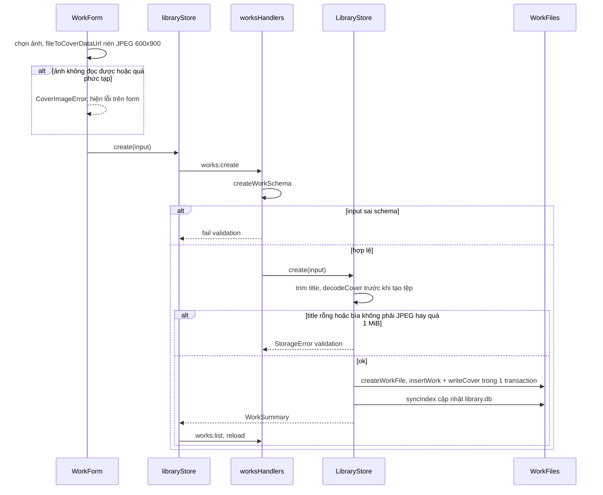

Đọc sơ đồ:
- Bìa được **nén ở renderer** (`coverImage.ts`: thử chất lượng 0.85 → 0.45 tới khi ≤ 700 KB, nền trắng cho
  PNG trong suốt). Main chỉ kiểm lại bằng `decodeCover` (JPEG, ≤ 1 MiB).
- `LibraryStore.create` decode bìa **trước** khi tạo tệp, nên bìa hỏng không để lại tệp tác phẩm rác.
- Đổi bìa sau đó có hai lối: `works:update` với `patch.cover` (form sửa, metadata + bìa cùng transaction) và
  `works:cover:set` (`setCover`, nút đổi bìa ở chi tiết tác phẩm).
- `syncIndex` đẩy `coverVersion` mới vào index; `useCoverUrl` cache theo khóa `id:version` nên bìa chỉ tải
  lại khi version đổi.
- Ảnh dán trong bản dịch (`images:put/get/delete`) đi cùng đường `LibraryStore.putImage`: decode, chặn quá
  200 ảnh/tác phẩm, lưu blob trong tệp tác phẩm; bản dịch tham chiếu bằng `![[id]]`.

### 3.2 Nhập raw cho một chương (dán hoặc chọn tệp)

Người dùng mở "Nhập bản gốc"/"Thay bản gốc" ở màn chương → raw được chuẩn hóa, chia segment và lưu vào phía
`source` của chương.

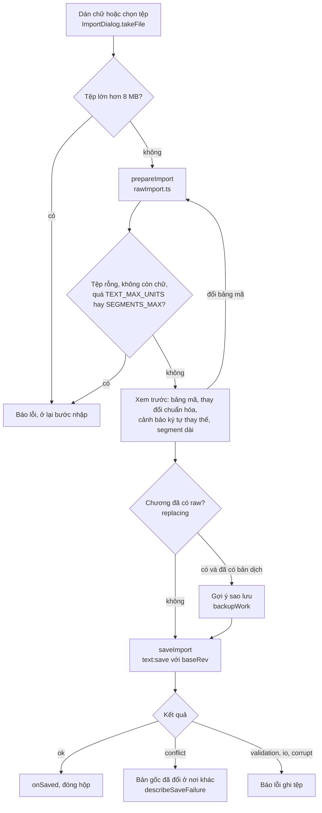

Đọc sơ đồ:
- Toàn bộ chuẩn bị chạy **ở renderer** bằng hàm thuần `prepareImport` (dùng chung với test
  `importFlow.test.ts`): `detectEncoding` (BOM → UTF-8 → đoán theo ngôn ngữ nguồn → bảng mã ít lỗi nhất),
  `normalizeRaw`, `segment`.
- Không có "phát hiện trùng chương" ở đây: import luôn nhắm **một** chương đã chọn. Trùng được xử lý bằng
  revision: `baseRev` lúc mở hộp khác revision hiện tại thì `saveText` trả `conflict`.
- Thay raw tạo segment mới; storage đánh dấu link cũ cần xem lại, phía bản dịch không đổi
  (xem [02](02-luu-tru.md), [04](04-dich-chuong.md)).
- Đánh số chương không nằm trong import: `chapter.number` là vị trí trong danh sách. `extractChapterNumber`
  chỉ dùng để nhảy tới chương theo số trong tiêu đề (`chapterList.ts`) và trong `matching.ts` chưa dùng.

### 3.3 Gắn Bản raw từ URL Kakuyomu

Người dùng dán URL vào tab "URL nguồn mạng" của `AddRawDialog` → một `source_binding` được tạo trong tệp tác
phẩm. Chưa tải nội dung chương nào.

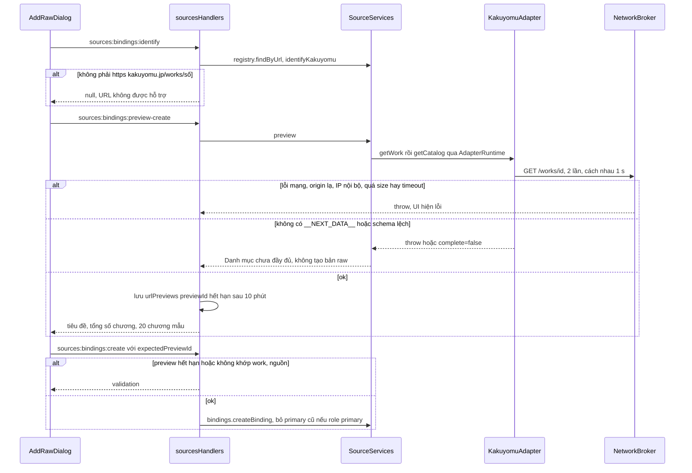

Đọc sơ đồ:
- `identifyKakuyomu` không gọi mạng; chỉ nhận `https://kakuyomu.jp/works/<id>` hoặc `/episodes/<id>`, cấm
  user/password và port lạ.
- `previewId` là bằng chứng "người dùng đã xem trước đúng tác phẩm này": `create` từ chối nếu preview hết hạn
  hoặc khác `workId/sourceId/remoteWorkId`. Preview lưu trong `Map` ở handler, mất khi app tắt.
- Thư mục/tệp đơn đi nhánh khác: `preview-create` trả số 0 (không đọc đĩa), binding tạo ngay; `resolveAdapter`
  dựng adapter cục bộ từ `remoteWorkId` dạng `folder:`/`file:`.

### 3.4 Kiểm tra cập nhật một Bản raw (catalog sync)

Người dùng bấm kiểm tra trên thẻ Bản raw (`SourcesArea` → `sources:sync:start`) → catalog item và
`source_update_event` được cập nhật. Không tải nội dung, không tạo chương.

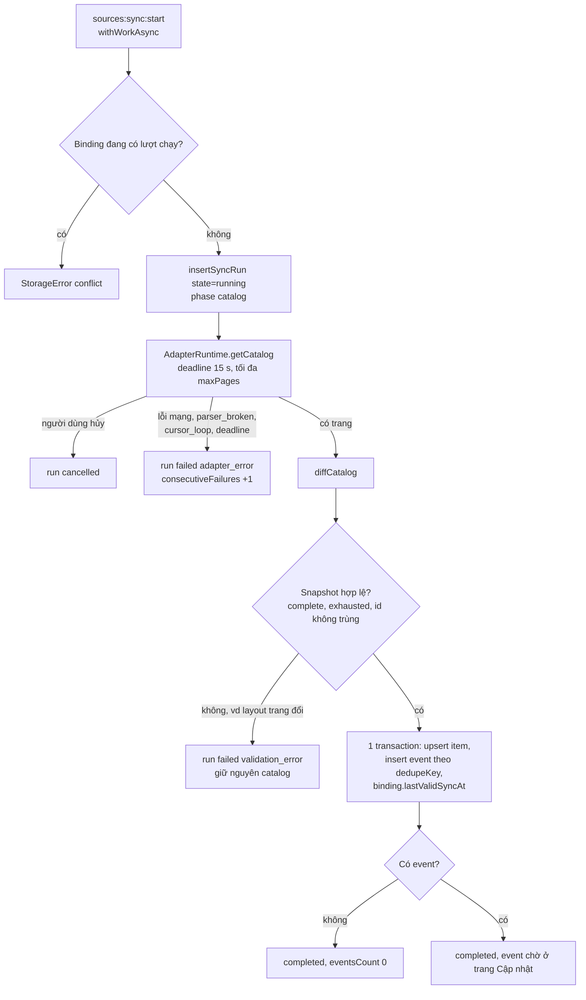

Đọc sơ đồ:
- **Layout trang đổi**: Kakuyomu không có `__NEXT_DATA__` → `getCatalog` trả `complete:false` → `diffCatalog`
  báo `pagination_incomplete` → run `failed/validation_error`, catalog cũ giữ nguyên (fail-closed).
- **Mạng lỗi**: broker ném lỗi → run `failed/adapter_error`. Không retry (`maxAttempts: 1`).
- **Không có gì mới**: snapshot hợp lệ nhưng không event → run `completed`, chỉ cập nhật `lastSeenAt`.
- `diffCatalog` so theo `remoteChapterId`: mới → `added`; đổi tiêu đề/thứ tự/quyền → `renamed/moved/
  access_changed`; vắng đủ 3 snapshot hợp lệ liên tiếp → `missing_remote`; quay lại → `reappeared`.
  Không so nội dung, nên sync **không** phát hiện raw bị sửa.
- `dedupeKey` = sha256(source, work, chapter, kind, signature); `insertUpdateEvent` bỏ qua event trùng nên
  chạy lại sync không nhân đôi thông báo.
- Hủy: `sources:sync:cancel` duyệt mọi tác phẩm tìm `runId`, gọi `controller.abort()`.
- UI (`SourcesArea.handleStartSync`) chỉ reload binding; run `failed` vẫn là `ok` ở IPC nên lỗi **không hiện**
  cho người dùng (xem mục 7).

### 3.5 Tải chương từ danh mục

Người dùng mở "Danh mục chương" và bấm Tải (một chương) hoặc nhập dải "1-20" → chương Mira mới được tạo đúng
vị trí, raw lưu vào phía `source`, catalog item được gắn `chapterId`.

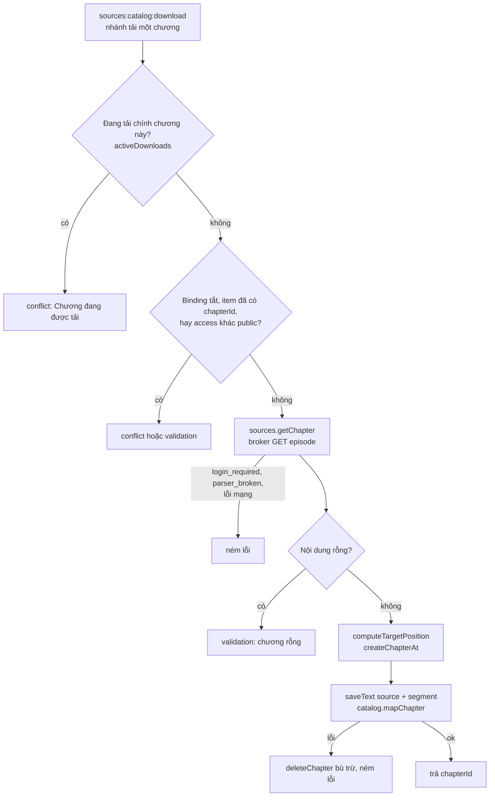

Đọc sơ đồ:
- Nhánh tải một chương kiểm `activeDownloads` và `item.chapterId`. Nhánh tải dải chỉ lọc item public
  chưa có `chapterId` lúc bắt đầu; không dùng `activeDownloads` và không kiểm lại mapping trước từng
  lần tạo chương. Không được suy ra hai lớp chống trùng áp dụng cho cả hai nhánh.
- Dải số là **thứ tự trong catalog nguồn** (`ordinalKey`), không phải số chương Mira; parse bằng
  `parseRangeString`.
- `computeTargetPosition` chèn chương giữa hai chương đã gắn cùng binding theo `ordinalKey`; nút "Sắp theo
  nguồn" (`reorderByCatalog`) sắp lại các chương đã gắn. Chi tiết SQL ở [02](02-luu-tru.md).
- Ba bước tạo chương → lưu text → gắn catalog là ba transaction riêng; lỗi giữa chừng được bù bằng
  `deleteChapter`. Segment được tính ngay khi tải (commit `e489b4b`) để chương dịch được.

#### Tải một dải chương: vòng lặp riêng trong handler

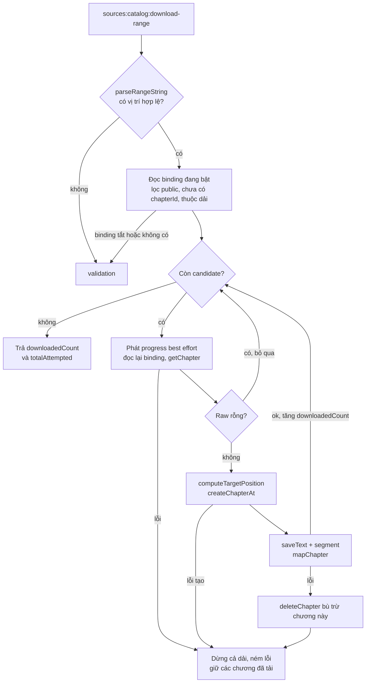

Progress được phát **trước** khi tải từng candidate, không phải bằng chứng chương đã ghi xong. Lỗi gửi
event bị bỏ qua; lỗi tải/ghi dừng cả vòng. Không có transaction chung cho cả dải, cũng không có
`activeDownloads` ở nhánh này (`sources.ts`, handler `download-range`).

### 3.6 Trang Cập nhật và raw bị sửa

Trang "Cập nhật" cấp app liệt kê `source_update_event`, gom theo ngày; với `raw_changed` có hộp xem diff và
nút áp dụng raw mới. Sơ đồ ghi **hành vi thật trong code**, gồm các nhánh đang gãy.

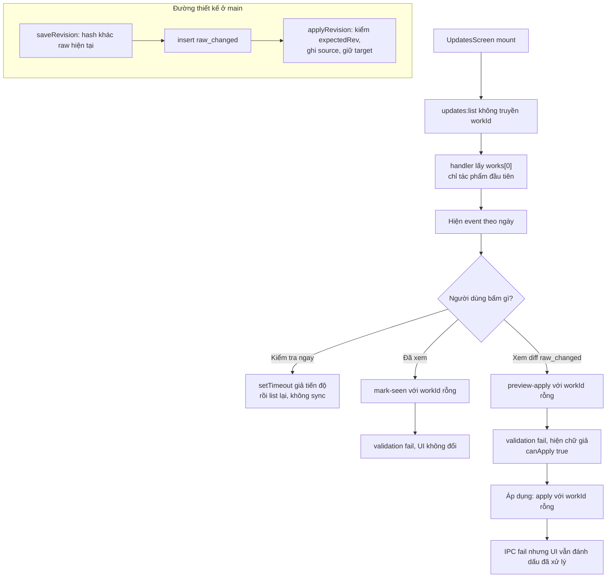

Đọc sơ đồ:
- Đường main (`SourceContentService`) đúng thiết kế: revision theo hash, `raw_changed` có `dedupeKey`, apply
  dùng optimistic revision và **không đụng bản dịch**. Nhưng `saveRevision` chỉ được gọi trong test; không
  luồng nào trong app tạo `raw_changed`.
- Các lời gọi từ `UpdatesScreen` gửi `workId: ''`, mà `sourceOpaqueIdSchema` bắt buộc chuỗi không rỗng.
- `previewApply` trả `currentContent/newContent/expectedRev`; màn hình đọc `oldText/newText/currentRev`.

### 3.7 Xuất bản dịch

Người dùng mở hộp Xuất (menu chương, nút xuất tác phẩm, hoặc thanh chọn nhiều chương) → chọn phạm vi + định
dạng → tệp hoặc thư mục trên đĩa, toast có nút "Mở thư mục".

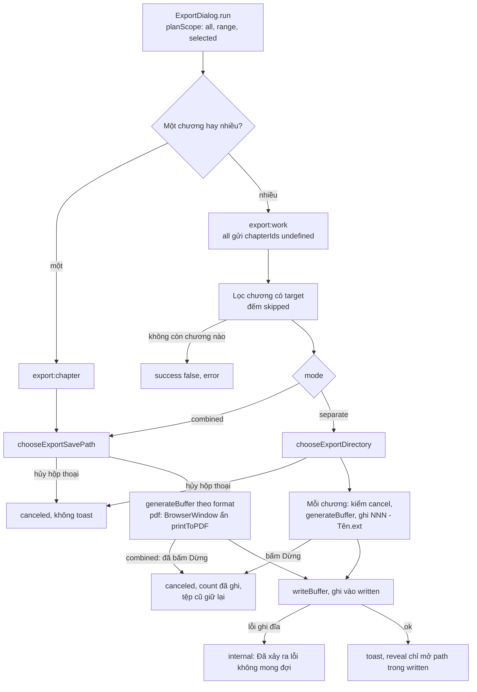

Đọc sơ đồ:
- Định dạng → formatter: `txt`/`md` sinh chuỗi; `docx` dùng thư viện `docx`; `pdf` sinh HTML rồi
  `electronPdfPrinter` mở cửa sổ ẩn (`sandbox`, `contextIsolation`) và `printToPDF` khổ A4/A5.
- Hủy là **hợp tác**: `cancel(workId)` thêm vào `Set`; chế độ tách kiểm trước mỗi chương, chế độ gộp chỉ kiểm
  sau khi sinh buffer, trước khi ghi.
- `exportProgress` đi về đúng cửa sổ đã gọi qua `sink` trong `exportHandlers`.
- `reveal` chỉ mở đường dẫn chính service vừa ghi trong phiên, nên renderer không mở được chỗ tùy ý.
- Tên tệp ở chế độ tách đệm số theo `numberWidth` (≥ 3 chữ số) để thư mục sắp đúng thứ tự.

### 3.8 Khôi phục phiên tab khi mở app

Thư viện tải xong (`library.load === 'ready'`) → `useWorkspaceRestore` gọi `workspace:load` → các tab tác
phẩm/chương mở lại, kèm thông báo nếu có tab bị bỏ.

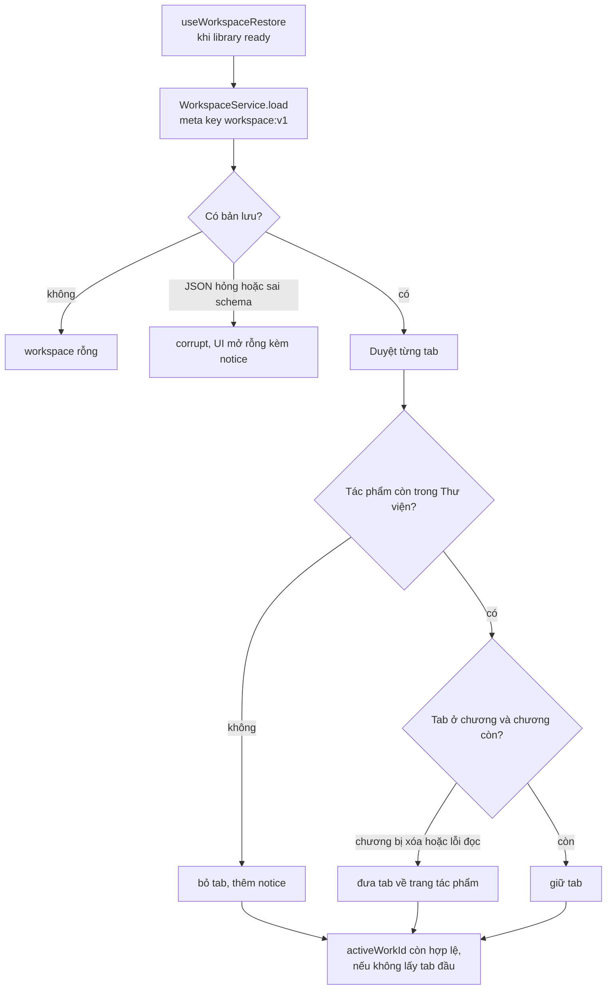

Đọc sơ đồ:
- Lưu: `workspaceStore.saveWorkspace` xếp hàng các lần lưu qua `pendingSave` để không ghi đè lẫn nhau; lỗi
  chỉ hiện notice "Dữ liệu truyện vẫn an toàn".
- `save` từ chối tab trùng `workId` hoặc `activeWorkId` không có trong tab.
- Phiên tab lưu ở `library.db` (cấp app), không ở tệp tác phẩm.

### 3.9 Test crash-safety của thư viện

Đây là **test**, không chạy trong app. `crash.test.ts` chứng minh mỗi thao tác đã được `LibraryStore` trả về
thì còn nguyên sau khi tiến trình chết đột ngột.

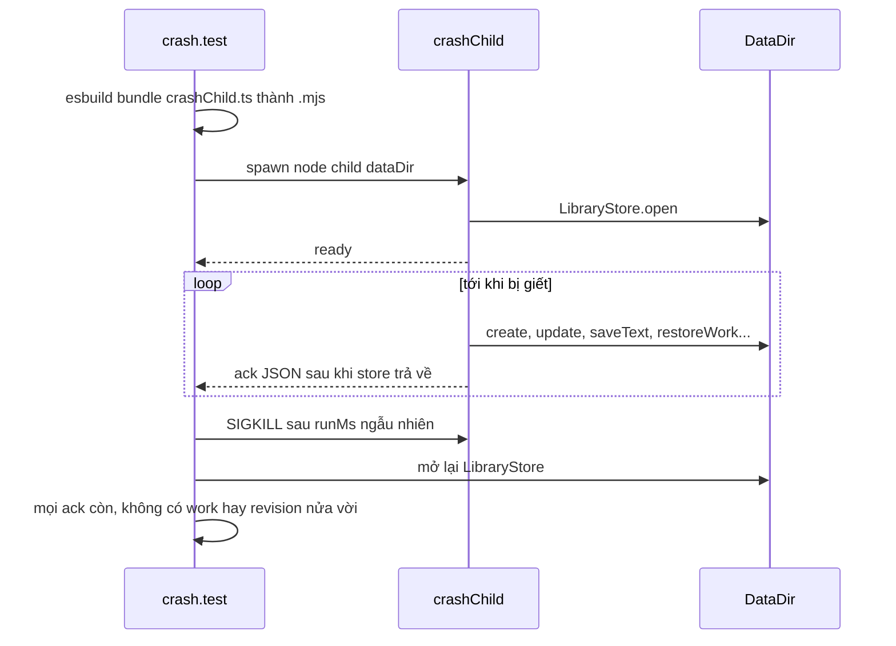

Đọc sơ đồ:
- Bốn biến thể: work + bìa (`crashChild`), chương thêm/đổi tên/chuyển/xóa (`crashChaptersChild`), text +
  segment (`crashTextChild`, nội dung là hàm thuần của revision qua `textForRevision`), restore backup
  (`crashRestoreChild`).
- `crashChaptersChild` báo `deleting` **trước** khi xóa, vì kill có thể rơi sau commit và trước `deleted`.
- Chỉ phủ chết tiến trình, không phủ mất điện (ghi rõ trong comment đầu test). Đây là 1 trong 5 file test
  nhạy thời gian mà `scripts/check.mjs` chạy riêng pha ([09](09-do-luong-va-cong-cu.md)).

## 4. Dữ liệu và trạng thái

| Dữ liệu | Type (file) | Lưu ở đâu | Vòng đời |
| --- | --- | --- | --- |
| Tác phẩm | `WorkSummary`, `CreateWorkInput`, `WorkPatch` ([library.ts](../../src/shared/contracts/library.ts)) | Bảng `work` trong tệp tác phẩm + index `library.db` (`syncIndex`) | Tạo → sửa → backup/restore; tệp không mở được vào `WorkList.problems` |
| Ảnh bìa, ảnh dán | `COVER_MAX_BYTES`, `IMAGE_MAX_PER_WORK` | Blob trong tệp tác phẩm | `coverVersion` tăng mỗi lần đổi |
| Bản raw | `SourceBinding` ([sources.ts](../../src/shared/contracts/sources.ts)), `StoredSourceBinding` | `source_binding` | Một `primary`, còn lại `reference`; xóa binding không xóa chương |
| Catalog item | `CatalogItem` ([domain.ts](../../src/main/sources/domain.ts)), `StoredCatalogItem` | `source_catalog_item` | `chapterId` null tới khi người dùng tải |
| Lượt sync | `StoredSyncRun`, `SourceSyncRun` | `source_sync_run` | Xem state machine dưới |
| Sự kiện cập nhật | `SourceUpdateEvent` | `source_update_event` (`seenAt`, `actedAt`) | Mới → đã xem → đã xử lý |
| Revision raw | `StoredContentRevision` | `source_content_revision` | Theo `contentHash`, idempotent |
| Preview URL | `urlPreviews` Map | Bộ nhớ main | 10 phút hoặc tới khi tạo binding |
| Lượt sync đang chạy | `ActiveSync` | `Map` trong `SourceSyncService` | Xóa trong `finally` |
| Phiên tab | `WorkspaceState` ([workspace.ts](../../src/shared/contracts/workspace.ts)) | `meta` key `workspace:v1` trong `library.db` | Lưu sau mỗi thay đổi tab |
| Tùy chọn xuất | `ExportPrefs` ([exportScope.ts](../../src/renderer/src/modules/export/exportScope.ts)) | `localStorage` | Theo máy |
| Đường dẫn đã xuất | `ExportService.written` | Bộ nhớ main | Mất khi tắt app |

Schema bảng và migration (v8 cho `library.db`, v12+ cho tệp tác phẩm) thuộc [02-luu-tru.md](02-luu-tru.md).

Lượt sync:

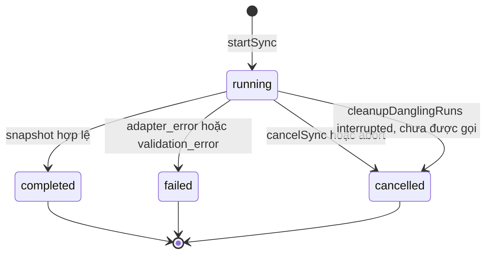

Catalog item trước sự vắng mặt trên nguồn (mỗi bước là một snapshot hợp lệ):

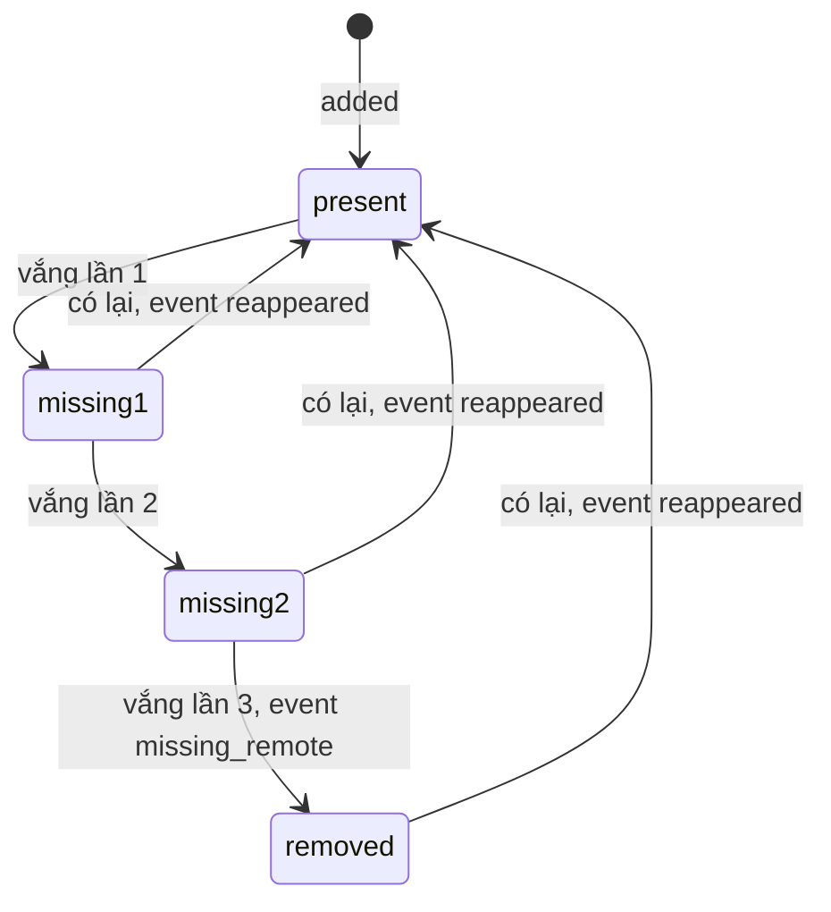

## 5. Tại sao code viết như vậy

- **Một tệp SQLite cho mỗi tác phẩm, `LibraryStore` là cửa duy nhất.** Mọi thay đổi chương đi qua
  `changeChapters`: một transaction rồi `syncIndex`, nên index luôn khớp tệp. **[code]** comment đầu
  `LibraryStore` và `changeChapters`.
- **Decode bìa trước khi tạo tệp.** Bìa hỏng không để lại tác phẩm nửa vời. **[code]** comment trong `create`
  và `update`.
- **Nén bìa ở renderer.** Canvas đọc được nhiều định dạng; main chỉ cần nhận JPEG ≤ 1 MiB. **[code]** comment
  đầu `coverImage.ts`.
- **Write lease cho agent.** `saveText`/`saveRow` từ chối khi target đang bị agent khóa, để người dùng và
  agent không ghi đè nhau. **[code]** `assertNoTargetLease`; luồng agent ở [06](06-tro-ly-agent.md).
- **Crash test bằng tiến trình con thật + SIGKILL.** Chỉ cách này mới chứng minh "đã ack thì không mất".
  **[code]** comment đầu `crash.test.ts` và các `crash*Child.ts`.
- **Nguồn chỉ thông báo, không tự tải, không tự dịch; xác nhận mất chương sau 3 snapshot; không xóa dữ liệu
  địa phương.** **[docs]** quyết định 6–8 ở [system-design.md](../modules/sources/system-design.md#quyết-định-sản-phẩm);
  **[code]** `removalThreshold ?? 3`, comment `NOT linked to chapter automatically!` trong `syncService.ts`.
- **Fail-closed với Kakuyomu.** Parser trả `complete:false` khi schema lệch; snapshot không đầy đủ không được
  dùng để diff. **[code]** comment `parseKakuyomuWorkPage`; **[docs]** [sources/README.md](../modules/sources/README.md).
- **Broker là cổng mạng duy nhất.** Chỉ GET, không cookie/credential, kiểm mọi DNS answer rồi ghim vào Undici
  Agent để chống DNS rebinding, kiểm lại từng redirect, giãn 1 s toàn cục. **[code]** `NetworkBroker.request`;
  **[commit]** `959e620`.
- **Release gate.** `SourceRegistry` che capability khi `releaseGate: 'closed'`; Kakuyomu bật `open` ngày
  2026-10-11 sau smoke live. **[docs]** mục Release Gate ở [sources/README.md](../modules/sources/README.md).
- **`previewId` có hạn.** Bắt người dùng xem trước đúng tác phẩm trước khi gắn. **[commit]** `959e620` ("typed
  preview store"); **[suy luận]** mục đích là chống tạo binding từ dữ liệu cũ.
- **Tải theo yêu cầu, hỗ trợ một chương hoặc một dải.** `download-range` lặp tuần tự qua các item
  được chọn; catalog sync không tự tải nội dung hay tự dịch. **[code]** `sources.ts`, `syncService.ts`.
- **Segment ngay khi tải.** Chương tải về trước đây không có segment nên không dịch được. **[commit]**
  `e489b4b`.
- **Xuất bỏ chương chưa dịch và báo số.** Trước 2026-10-08 chương chưa dịch bị bỏ mà không báo. **[docs]**
  [export-and-bulk.md](../modules/workspace/export-and-bulk.md); **[commit]** `69fbe0a`.
- **`reveal` giới hạn theo `written`.** Renderer không được mở đường dẫn tùy ý. **[code]** comment `reveal`.
- **Picker và PDF printer là interface.** Để `ExportService` và handler test được không cần Electron. **[code]**
  `exportTypes.ts`, comment đầu `libraryHandlers.ts`.

## 6. Đọc code bắt đầu từ đâu

1. [library.ts](../../src/main/services/library/library.ts) — mọi thao tác trên tác phẩm đi qua đây; đọc
   `create`, `changeChapters`, `saveText`.
2. [sources.ts (handler)](../../src/main/ipc/handlers/sources.ts) — bản đồ thật của hệ thống nguồn: kênh nào
   gọi service nào, chỗ nào còn logic nằm trong handler.
3. [syncService.ts](../../src/main/sources/syncService.ts) + [catalogDiff.ts](../../src/main/sources/catalogDiff.ts)
   — lõi "phát hiện chương mới".
4. [kakuyomu/adapter.ts](../../src/main/sources/kakuyomu/adapter.ts) rồi [broker.ts](../../src/main/sources/broker.ts)
   — một adapter mạng hoàn chỉnh và rào an toàn của nó.
5. [exportService.ts](../../src/main/services/export/exportService.ts) — ngắn, đủ thấy hủy, chọn phạm vi và ghi.

## 7. Điểm đáng ngờ / nợ kỹ thuật

1. **Không có gì tạo `raw_changed` trong app.** `SourceContentService.saveRevision` chỉ được gọi trong test;
   `diffCatalog` không so nội dung. Tài liệu module nói "phát hiện raw thay đổi" và "xem trước diff trước khi
   áp dụng" như đã triển khai. Ở `sources:catalog:list`, `contentHash` luôn là `null`.
2. **`UpdatesScreen` gửi `workId: ''`** cho `markSeen`, `previewApply`, `apply` → luôn hỏng validation. Khi
   preview hỏng, màn hình hiện chữ giả với `canApply: true`; khi apply hỏng vẫn đánh dấu đã xử lý trên UI. Tên
   trường lệch contract (`oldText/newText/currentRev` vs `currentContent/newContent/expectedRev`). Nút "Kiểm tra
   ngay" chỉ là `setTimeout`. `updates:list` không có `workId` thì chỉ đọc `works[0]`.
3. **`SourcesScreen` gọi `identify` với `workId: ''`** → mọi URL dán vào ô tìm đều bị coi là "không nhận
   diện". Tab "Đã kết nối" lọc nguồn có `access` `local/account`, tức mọi nguồn builtin (kể cả Kakuyomu),
   không phải các Bản raw đã gắn.
4. **Lỗi sync bị nuốt ở UI.** Run `failed` vẫn trả `ok` qua IPC; `SourcesArea.handleStartSync` chỉ reload,
   không hiện `failure`. `cleanupDanglingRuns` không được gọi ở đâu, nên run bị cắt ngang khi app tắt nằm mãi ở
   `running` trong DB.
5. **Rào "giảm bất thường" đang tắt.** `diffCatalog` dùng `maxDropRatio ?? 1`, `syncService` không truyền giá
   trị → `suspicious_count_drop` không bao giờ bật. Parser Kakuyomu cho phép catalog rỗng ("suspicious but
   allowed"). **[suy luận]** Ba lần sync gặp trang trả danh sách rỗng hợp lệ sẽ phát `missing_remote` cho mọi
   chương, trái quy tắc "catalog lỗi/rỗng không được đánh dấu toàn bộ chương bị gỡ". Adapter cũng không kiểm
   HTTP status trước khi parse.
6. **Tải dải chương:** `parseRangeString` được gọi không có `max`, nên "1-99999999" dựng một `Set` khổng lồ
   **[suy luận: có thể treo main]**. Một lỗi mạng giữa dải dừng cả loạt; contract `downloadRange` khai
   `Result<void>` trong khi handler trả `{downloadedCount, totalAttempted}`. Tạo chương, lưu text và gắn catalog
   là ba transaction; nếu app chết giữa chừng, chương mồ côi không có `chapterId` ở catalog và lần tải sau tạo
   chương thứ hai **[suy luận]**.
7. **Xuất bỏ qua ảnh nhúng.** Formatter không xử lý `![[id]]`, nên ảnh dán trong bản dịch ra tệp thành chuỗi
   thô. Lỗi ghi đĩa (`EACCES`, đĩa đầy) không phải `StorageError` nên người dùng chỉ thấy "Đã xảy ra lỗi không
   mong đợi". Chế độ tách ghi đè tệp trùng tên mà không hỏi.
8. **Code chết hoặc nửa vời:** `matching.ts` (`MatchingPreviewService`) chỉ có test; `AuthProfileService` được
   khởi tạo nhưng không có kênh IPC; `UpdatesScreenMock.tsx` không ai import; tham số `_library` của
   `createSourceServices` không dùng; logic tải chương nằm trong IPC handler thay vì service; nhiều `as any` ở
   `sources:registry:list`.

## 8. Liên kết

- Tài liệu module: [Nguồn và cập nhật](../modules/sources/README.md) ·
  [Thiết kế hệ thống nguồn](../modules/sources/system-design.md) ·
  [Nghiên cứu Cập nhật](../modules/sources/updates-research.md) ·
  [Xuất và chọn nhiều chương](../modules/workspace/export-and-bulk.md) ·
  [Tính năng cấp app](../modules/workspace/app-level-features.md) ·
  [Phiên làm việc theo tác phẩm](../modules/workspace/README.md)
- Code-tour: [README](README.md) · [01 process và IPC](01-process-va-ipc.md) (`guardHandlers`,
  `createServices`, preload) · [02 lưu trữ](02-luu-tru.md) (`WorkFiles`, `sourceStorage`, `textFile`, backup,
  schema) · [04 dịch chương](04-dich-chuong.md) (segment và link sau khi thay raw) ·
  [06 trợ lý](06-tro-ly-agent.md) (write lease, `reconcileStartupOperations`) ·
  [08 giao diện](08-giao-dien-renderer.md) (`AddRawDialog`, `SourcesArea`, `ImportDialog`, `ChaptersArea`) ·
  [09 công cụ](09-do-luong-va-cong-cu.md) (`check.mjs` chạy riêng crash test)
