# Đo lường và công cụ phát triển

> **Một câu:** vùng này đo xem một thay đổi prompt/model/ngữ cảnh có làm bản dịch tốt hơn không (Bộ đo
> `scripts/bench` và Mira Lab `scripts/lab`, logic thuần ở `src/measurement`), và giữ cổng chất lượng
> (`scripts/check.mjs`) cùng cấu hình build/đóng gói của app.
> Cập nhật: 2026-10-15 · Nguồn: đọc code tại commit db2455f.

## 1. Vì sao vùng này tồn tại

Sửa prompt dịch hay đổi model mà chỉ đọc vài đoạn thì dễ thấy cải thiện ở chỗ không có. Bộ đo có hai
harness tái dùng service của app, không phải hai bản chạy lại toàn bộ UI. Bench chạy fixture qua
`ChapterTranslator` (`services.translator`), chấm T0 và có runner T1/T3 riêng. Lab `translate` dùng
`ParagraphTranslator`, cùng service với UI hiện tại, nhưng cố định `policy: 'auto'` và tự điều phối
retry/finalize; UI mặc định `review`. Hai harness đứng ngoài runtime, dựng `createServices` với
thư viện, crypto và fetch riêng. Người đọc dùng số liệu để quyết định giữ/bỏ. Phần còn lại là cổng
chất lượng (`check.mjs`), smoke test và cấu hình build/đóng gói. Ngoài runtime không tự chứng minh
harness và dữ liệu đã bị loại khỏi gói cài; xem mục 7.

## 2. Bản đồ file

**Logic thuần của Bộ đo** (`src/measurement`, chỉ import `src/shared/contracts`, test colocate, chạy
trong `check.mjs`)

| File | Làm gì | Symbol chính |
| --- | --- | --- |
| [labOutcomes.ts](../../src/measurement/labOutcomes.ts) | Kết cục từng đoạn, hai trục Hoàn thành/Chất lượng, đo lặp, lớp phép kiểm, lần chạy hỏng | `batchOutcomes`, `comparableKeys`, `benchChapters`, `decide`, `groupRepeats`, `METRIC_TIERS`, `brokenRunReason` |
| [runRegistry.ts](../../src/measurement/runRegistry.ts) | Sổ đăng ký chỉ thêm (lần chạy, lần đo), so biến thể, sinh `history.md` | `RunRecord`, `MeasurementRecord`, `summarizeRun`, `snapshotOf`, `compareGroups`, `historyMarkdown`, `glossaryOriginOf` |
| [fixtureCheck.ts](../../src/measurement/fixtureCheck.ts) | Định nghĩa đoạn của fixture, kiểm schema/neo assertion/quyền | `extractParagraphs`, `checkWorkFixture`, `LoadedWorkFixture` |
| [nameConsistency.ts](../../src/measurement/nameConsistency.ts) | Tên nhân vật có viết thống nhất không (không cần đáp án) | `nameConsistency`, `overallConsistency` |
| [addressingGaps.ts](../../src/measurement/addressingGaps.ts) | Ô trống trong nhân vật/cặp xưng hô | `addressingGaps`, `isPronounLike` |
| [judgeParser.ts](../../src/measurement/judgeParser.ts) | Đọc phản hồi judge, gộp hai chiều A/B | `parseJudgeResponse`, `evaluateTwoPassVerdicts` |
| [modelFamily.ts](../../src/measurement/modelFamily.ts) | Judge phải khác họ model dịch | `getModelFamily`, `checkJudgeFamily` |
| [statistics.ts](../../src/measurement/statistics.ts) | PRNG có seed, Cohen's kappa, bootstrap CI | `createPrng`, `computeCohenKappa`, `bootstrapWinRateCI` |
| [decisionE6.ts](../../src/measurement/decisionE6.ts) | Policy `legacy-e6` (keep/no-keep/insufficient), chỉ để tái lập báo cáo cũ | `evaluateE6Decision` |
| [secretGuard.ts](../../src/measurement/secretGuard.ts) | Chặn ghi khóa API ra đĩa | `assertNoSecret` |

**Bộ đo cũ** (`scripts/bench`, chạy bằng Vitest riêng, đọc/ghi `fixtures/private/runs/`)

| File | Làm gì | Symbol chính |
| --- | --- | --- |
| [vitest.config.mjs](../../scripts/bench/vitest.config.mjs) | Chỉ nhặt `*.run.ts`, timeout 4 giờ | `include` |
| [fixtures.ts](../../scripts/bench/fixtures.ts) | Nạp `fixtures/public` + `private`, parse bằng valibot | `loadFixtures`, `FIXTURES_ROOT` |
| [translate.run.ts](../../scripts/bench/translate.run.ts) | Dịch fixture qua `createServices`, chấm T0, ghi `config.json`/`report.*` | `counting` fetch, `MIRA_BENCH_*` |
| [rescore.run.ts](../../scripts/bench/rescore.run.ts) | Chấm lại T0 offline, chặn `fetch` | `pickRun`, `rescore.json` |
| [judge.run.ts](../../scripts/bench/judge.run.ts) | T1: so cặp mù hai chiều qua endpoint OpenAI-compatible | `queryJudge`, `MIRA_JUDGE_*` |
| [rate.run.ts](../../scripts/bench/rate.run.ts) | T3: sinh trang HTML chấm mù, nhập đáp án, kappa với T1 | `buildHtmlPage`, `selectStratified`, `MIRA_RATE_ANSWERS` |
| [compare.run.ts](../../scripts/bench/compare.run.ts) | So hai lần chạy trên chương chung, tùy chọn `legacy-e6` | `extractT0FromRun`, `MIRA_BENCH_DECISION_PROFILE` |
| [prompts/](../../scripts/bench/prompts/) | Prompt judge, prompt thử quy ước tiếng Việt | `judge.txt` |

**Mira Lab** (`scripts/lab`, CLI trên truyện thật, đọc/ghi `fixtures/private/lab/`)

| File | Làm gì | Symbol chính |
| --- | --- | --- |
| [mira-lab.mjs](../../scripts/lab/mira-lab.mjs) | Bundle `cli.ts` bằng esbuild vào `node_modules/.cache/mira-lab`, rồi import | `build`, `packages: 'external'` |
| [cli.ts](../../scripts/lab/cli.ts) | Toàn bộ lệnh Lab trong 3.020 dòng | `main`, `HELP`, `translate`, `translateChapter`, `report`, `extract`, `analyze`, `pairs`, `polish`, `compareVariants`, `backfill` |
| [print-pdf.cjs](../../scripts/lab/print-pdf.cjs) | In HTML ra PDF A5 bằng `printToPDF` của Electron | `win.loadFile` |

**Cổng chất lượng, smoke test, script phụ**

| File | Làm gì | Symbol chính |
| --- | --- | --- |
| [check.mjs](../../scripts/check.mjs) | Ranh giới renderer → tsc ×3 → vitest 2 pha → biome → build tùy chọn. Bước nào không có bằng chứng đã chạy thì bị tính là trượt | `step`, `TIMING_SENSITIVE`, `BASELINE_TESTS`, `selfTest` |
| [check-renderer-boundaries.mjs](../../scripts/check-renderer-boundaries.mjs) | Import liên module renderer phải qua `public.ts`, không chu trình | `moduleName`, `resolveSpecifier` |
| [smoke-sqlite.mjs](../../scripts/smoke-sqlite.mjs) | `node:sqlite` chạy trong main của Electron | `pnpm smoke:sqlite` |
| [smoke-net-fetch.mjs](../../scripts/smoke-net-fetch.mjs) | `net.fetch` có stream, hủy, proxy, localhost | `pnpm smoke:net` |
| [smoke-kakuyomu.mjs](../../scripts/smoke-kakuyomu.mjs) | Smoke thật adapter Kakuyomu, opt-in | 5 giai đoạn |
| [capture-provider-fixtures.mjs](../../scripts/capture-provider-fixtures.mjs) | Ghi phản hồi Gemini thật cho test provider | `--dry-run`, `--burst`, `--model` |
| [refresh-model-catalog.mjs](../../scripts/refresh-model-catalog.mjs) | Làm mới bảng model/giá từ models.dev | chạy tay |

**Cấu hình build và test**

| File | Làm gì |
| --- | --- |
| [package.json](../../package.json) | Script `dev`, `build`, `build:win`, `smoke:*`; pin `pnpm@8.9.0`, Node ≥ 24 |
| [vitest.config.ts](../../vitest.config.ts) | Test app: `src/**/*.test.ts`, alias `@renderer`, timeout 30 giây |
| [electron.vite.config.ts](../../electron.vite.config.ts) | Ba bundle main/preload/renderer, plugin CSP `mira-content-security-policy` |
| [electron-builder.yml](../../electron-builder.yml) | `app.mira.desktop`, NSIS `mira-setup.exe`, lọc `files` |
| [tsconfig.node.json](../../tsconfig.node.json) / [tsconfig.web.json](../../tsconfig.web.json) / [tsconfig.scripts.json](../../tsconfig.scripts.json) | main+preload+shared+measurement / renderer / `scripts/**` |
| [fixtures/](../../fixtures/README.md) | `public/<tác phẩm>/{work,glossary,pronouns}.json` + `chapters/NN/{source.txt,meta.json,assertions.json,reference.vi.txt}`. `private/` chứa `ja-irene`, `runs/` (bench), `lab/` (`lab.json`, `glossary/`, `analysis/`, `polish/`, `registry/`, `reports/`; `data/`, `runs/`, `export/` chỉ nằm trên máy) |

## 3. Luồng chính

### 3.1 Bức tranh chung: một thí nghiệm đo chất lượng

Người phát triển bắt đầu bằng một giả thuyết, ví dụ "prompt mới bớt sót đoạn". Kết quả cuối là báo cáo số
liệu, và người quyết định giữ hay bỏ. Repo có hai đường. **Bench** chạy trên fixture có oracle, đủ T0/T1/T3.
**Lab** chạy trên truyện thật, có sổ đăng ký và đo lặp, hiện được dùng nhiều hơn.

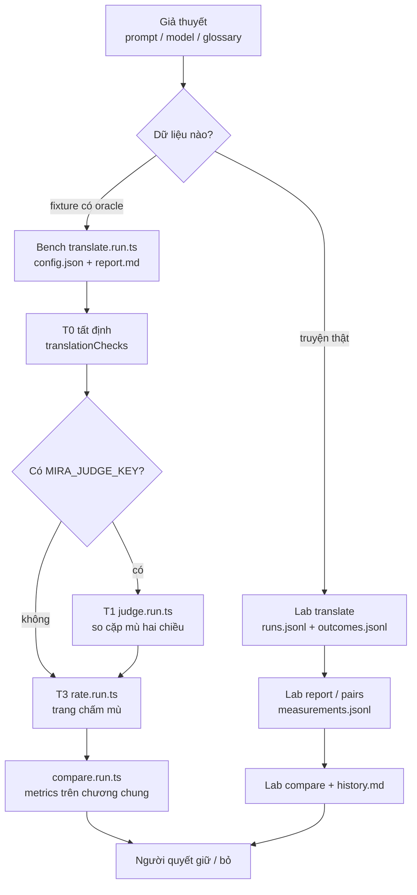

Đọc sơ đồ:
- Không bước nào tự kết luận. `compare.run.ts` chỉ đưa nhãn khuyến nghị khi đặt
  `MIRA_BENCH_DECISION_PROFILE=legacy-e6`. Lab `compare` chỉ nói "khác biệt" khi mỗi bên có ít nhất 2
  lần lặp và khoảng [min, max] của hai bên không chồng nhau (`decide` trong `labOutcomes.ts`).
- Bench và Lab chưa nối vào nhau. Sổ đăng ký Lab không đọc `fixtures/private/runs/`.

### 3.2 Bench: từ fixture đến bản dịch và T0

Lệnh chạy: `node_modules/.bin/vitest run --config scripts/bench/vitest.config.mjs scripts/bench/translate.run.ts`.
Kết quả là `fixtures/private/runs/<runId>-<label>/` gồm bản dịch, `result.json` mỗi lần lặp,
`config.json` và `report.md`.

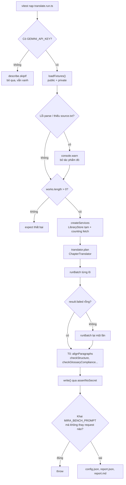

Đọc sơ đồ:
- `counting` (trong `translate.run.ts`) bọc `fetch`. Nó ghi tham số thật gửi đi (`sentParams`), băm mọi
  system prompt **đã gửi** và có thể thay system prompt bằng tệp `MIRA_BENCH_PROMPT`.
- Mỗi lần lặp (`MIRA_BENCH_REPEATS`, mặc định 3) tạo một tác phẩm mới trong thư viện tạm
  (`mkdtempSync`) và tách nguồn bằng `normalizeRaw` → `segment` như lúc nhập truyện trong app.
- Nhánh lỗi provider: `runBatch` trả `failed`, runner gửi lại các đoạn đó **một lần** rồi đi tiếp.
  Runner không ghi refusal hay kết cục từng đoạn, nên phần lỗi chỉ hiện qua số đoạn lệch trong T0.
- Nhánh thiếu fixture: lỗi nạp chỉ in cảnh báo. `issues` của `checkWorkFixture` bị bỏ qua (xem mục 7).
- Phép kiểm T0 nằm trong app ở
  [translationChecks.ts](../../src/shared/translation/translationChecks.ts) và
  [paragraphAlign.ts](../../src/shared/translation/paragraphAlign.ts). Bộ đo chỉ gọi chúng.

### 3.3 Bench: chấm lại, chấm mù và báo cáo

Bốn runner đọc output đã lưu theo `MIRA_RUN_A/B` (hoặc `MIRA_RUN_BASELINE/CANDIDATE`). Kết quả là
`rescore.json`, `judge-*.json`, `rating-<hash>.html` kèm `rating-*.key.json`, `human-*.json` và
`report-compare-*.md`.

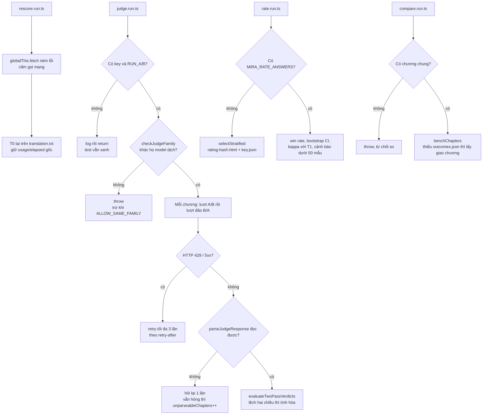

Đọc sơ đồ:
- T1 chỉ so các đoạn mà cả hai bên đều có bản dịch sau khi align. Đoạn chỉ một bên có được đếm vào
  `oneSidedOmissions`.
- T3 giấu tên điều kiện: tên trang là hash (`blindLabel`), mapping A/B nằm riêng trong `key.json`.
  Mẫu được phân tầng theo chương và theo ca bị T0 gắn cờ (`collectT0FlaggedSourceIndexes`).
- `compare.run.ts` luôn in metrics thô. `evaluateE6Decision` chỉ chạy khi đặt profile `legacy-e6`.
  Profile khác `legacy-e6` thì runner `throw`.

### 3.4 Lab `translate`: dịch một biến thể qua `ParagraphTranslator`

Lệnh chạy: `node scripts/lab/mira-lab.mjs translate <ncode> --variants a,b --chapters 1-10`. Kết quả:
bản dịch nằm trong thư viện Lab (mở được bằng app qua `MIRA_DATA_DIR`), cùng `runs/<runId>/*.jsonl`,
`*.outcomes.jsonl`, `context-*.json`, một dòng trong `registry/runs.jsonl` và `history.md` được sinh lại.

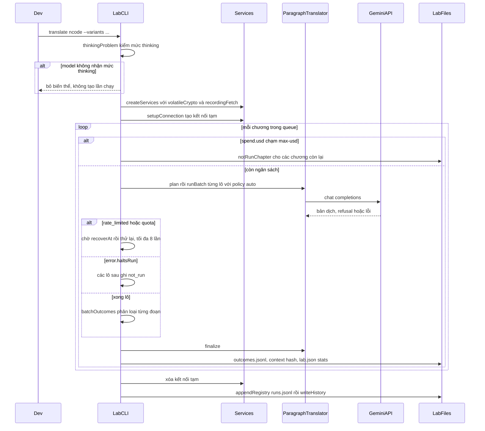

Đọc sơ đồ:
- Lab dùng `policy: 'auto'` và gọi `finalize` sau vòng lặp, kể cả sau lỗi lô. UI mặc định `review`,
  chỉ finalize khi không hủy, không có lỗi dừng và không còn đoạn thiếu. Tái dùng service không có
  nghĩa orchestration giống nhau.
- `translateChapter` bỏ qua chương đã có bản dịch, trừ khi có `--force`, hoặc `--redo-failed` với chương
  còn đoạn thiếu.
- Mỗi đoạn nhận đúng một kết cục theo thứ tự ưu tiên trong `batchOutcomes`: `translated` → `refused` (kèm
  chữ gốc của provider) → `budget_exhausted` → `request_error` (lô `invalid_request`) → `missing`.
  `not_run` do `translateChapter` gán sau lỗi dừng lượt, hoặc do `worker` gán khi chạm `--max-usd`.
- `--schema` tạo một `ParagraphTranslator` riêng với `outputSchema: true`. Sản phẩm mặc định không bật
  chế độ này.
- `--repeat N` gọi `prepareRepeats`, chép N bản `label#1..N` từ cùng bản gốc và in ước tính chi phí.
  Chưa có cơ sở ước tính thì lệnh bắt buộc có `--max-usd`.
- `lane` ghi sổ trong `finally`, nên lần chạy dừng giữa chừng vẫn có bản ghi cho các lời gọi đã gửi.
  Với `--parallel`, lỗi của một luồng chỉ được in ra và không làm dừng các luồng khác
  (`Promise.allSettled`).

### 3.5 Mira Lab CLI theo từng lệnh

`main()` trong `cli.ts` chuyển lệnh tới hàm cùng tên. Thứ tự dùng điển hình:

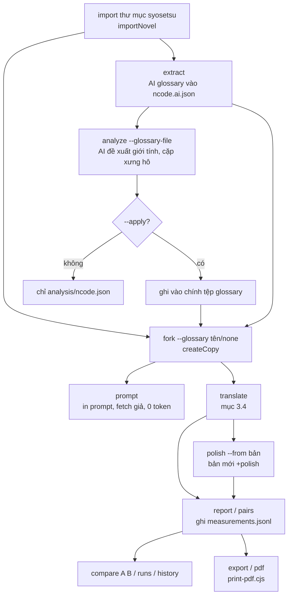

| Lệnh | Gọi mạng | Đọc | Ghi | Ghi chú |
| --- | --- | --- | --- | --- |
| `import` | không | `meta.json` + `plain/*.txt` | thư viện Lab, `lab.json` | Mỗi nhãn biến thể là một tác phẩm riêng |
| `glossary` | không | `glossary/<tên>.json` | DB của mọi bản | `syncGlossary` xóa rồi nạp lại. Mục được gắn `status: approved`, `origin: ai` bất kể nguồn |
| `fork` | không | bản `--from` | bản mới, `lab.json.glossaries` | `--glossary none` là chạy không ngữ cảnh |
| `extract` | có | nguồn chương 1-30 | `glossary/<ncode>.ai.json`, `runs.jsonl` | Không cho `--out` trùng tệp chung. Xem 3.6 |
| `analyze` | có | glossary + nguồn | `analysis/<ncode>.json`, tùy chọn tệp glossary | Dùng `fetch` thường, không ghi sổ |
| `prompt` | không | DB | stdout | `fetch` giả trả mảng rỗng để lộ đúng prompt |
| `translate` | có | DB | xem 3.4 | Chỉ provider `google`, khóa `GEMINI_API_KEY` |
| `report` | không | DB, `outcomes.jsonl` | `reports/`, `measurements.jsonl` | Xem 3.7 |
| `pairs` | không | `runs/*/<ncode>-<nhãn>.jsonl` | `measurements.jsonl` | Lấy nhãn người nói `speaker_to_listener` từ phản hồi cũ |
| `polish` | có | bản nháp + glossary | bản `+polish`, `polish/*.jsonl`, `export/… thay đổi.md` | Xem 3.8 |
| `compare` / `runs` / `history` / `backfill` | không | `registry/` | stdout / `history.md` / `runs.jsonl` | `backfill` đoán commit (`~`) và ghi glossary là `claude-draft` |
| `gaps` / `cost` / `list` / `open` / `name` | không | DB, `lab.json` | stdout / `lab.json` | `open` chỉ in lệnh `electron-vite dev` kèm `MIRA_DATA_DIR` |
| `export` / `pdf` | không | DB | `export/*.txt` / `*.pdf` | `pdf` dùng `formatAsNovelHtml` của module Xuất, rồi spawn Electron |

Nguồn gốc dữ liệu: theo quyết định của chủ sản phẩm ngày 2026-10-06, glossary và xưng hô dùng cho thí
nghiệm phải do luồng AI tạo ra (`extract`, `analyze`), không soạn tay. Hiện chỉ có `n4696dd.ai.json` và
`n4696dd.lite35.json` mang `origin: ai`. Các tệp `<ncode>.json` còn lại là nháp Claude soạn tay;
`glossaryOriginOf` nhận ra chúng qua ghi chú "Nháp do Claude" và sổ ghi là `claude-draft`.

### 3.6 Lab `extract`: AI trích xuất glossary và nhân vật

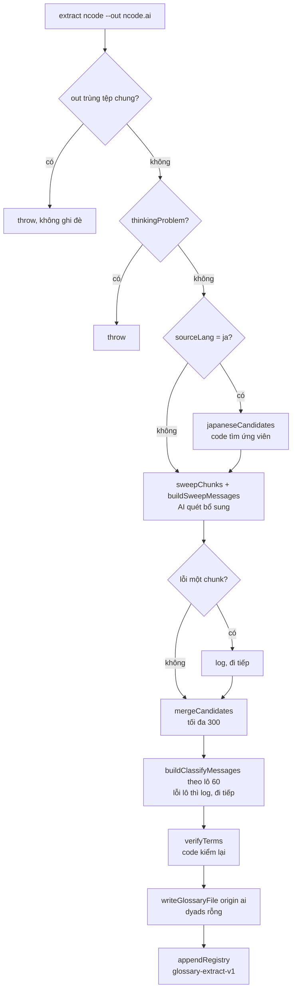

Đọc sơ đồ:
- Các hàm prompt và parse lấy từ
  [glossaryExtraction.ts](../../src/main/services/ai/glossaryExtraction.ts), cũng là nơi
  `ContextExtractionService` của app lấy. Nhưng Lab tự lắp lại trình tự trong `cli.ts`, không gọi chính
  service đó (xem mục 7).
- Mặc định `--thinking off`. Model không tắt được thinking thì dùng `minimal`.

### 3.7 Lab `report` và `compare`: hai trục báo cáo

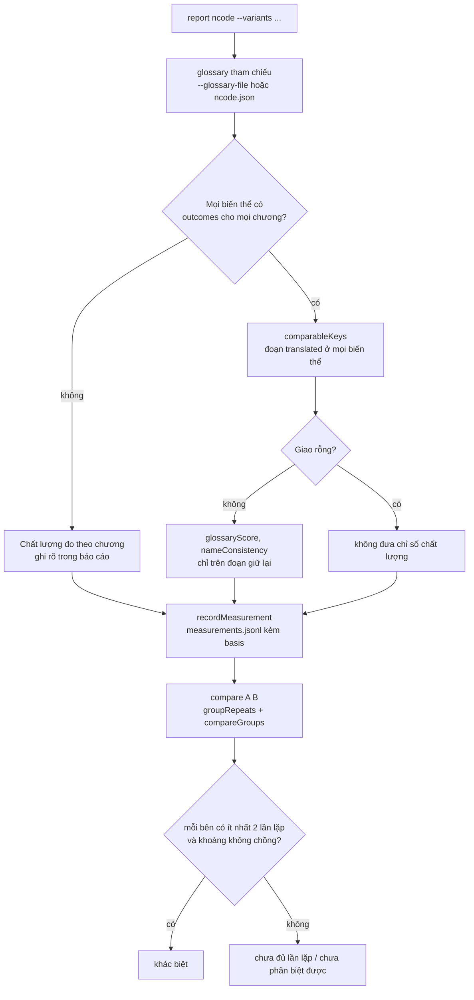

Đọc sơ đồ:
- Phần Hoàn thành tính trên toàn tập. Phần Chất lượng loại đoạn bị chặn ở **mọi** biến thể đem so, để bản
  bị lọc nhiều không trông tốt hơn nhờ chỉ được chấm trên phần dễ.
- Chương lệch số đoạn không được chấm glossary (`glossaryScore` trả 0/0).
- `compare` cảnh báo khi hash ngữ cảnh theo chương khác nhau (`contextDifferences`). `groupRepeats` loại
  khỏi nhóm những lần lặp lệch model, thinking, prompt, ngữ cảnh hoặc tập chương.

### 3.8 Lab `polish`: trau chuốt "soát rồi sửa"

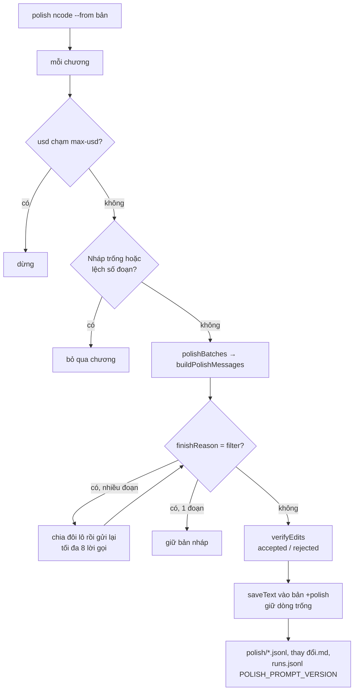

Đọc sơ đồ:
- Nhánh refusal ở đây là `finishReason === 'filter'`. Lô bị chia đôi dần để cô lập đoạn bị chặn, và đoạn
  bị chặn giữ nguyên bản nháp. Lỗi lô khác chỉ được log, các đoạn đó giữ nháp.
- Code (`verifyEdits` trong [polish.ts](../../src/main/services/ai/polish.ts)) loại bản sửa làm sai
  glossary hoặc tên. Bản sửa bị loại vẫn được ghi để người đọc thấy.

### 3.9 `check.mjs`: cổng trước commit/push

Lệnh chạy: `node scripts/check.mjs`, thêm `--build` trước khi push. Kết quả là `RESULT: ok` (thoát 0)
hoặc số bước trượt (thoát 1).

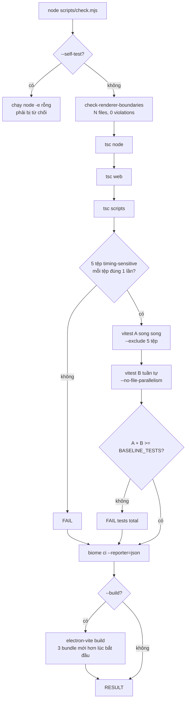

Đọc sơ đồ:
- `step(name, run, proof)` chỉ cho đạt khi **cả hai** điều kiện đúng: mã thoát 0 và `proof` tìm thấy bằng
  chứng trong output. Bằng chứng là `Files: N > 0` cho tsc, dòng `Tests … (N)` cho vitest, JSON report
  có số file > 0 cho biome, và mtime của `out/main/index.js`, `out/preload/index.js`,
  `out/renderer/index.html` mới hơn `startedAt` cho build. Thiếu bằng chứng thì in 40 dòng cuối của
  output.
- Các công cụ được gọi thẳng bằng `node node_modules/<pkg>/bin/...`, không qua `pnpm`.
- Thứ tự thật: kiểm ranh giới renderer đứng **đầu**, trước tsc, rồi tsc có thêm project `scripts`.
  Một bước trượt không dừng các bước sau.
- Pha B chạy tuần tự `rows`, `segmenter`, `segmentMap`, `providers`, `crash` (`.test.ts`). Pha A chạy
  phần còn lại song song. Mỗi test chạy đúng một lần.
- Test Bộ đo (`src/measurement/*.test.ts`) chạy trong pha A. Runner `scripts/bench/*.run.ts` không
  chạy ở đây vì nó gọi provider thật.

### 3.10 Build và đóng gói

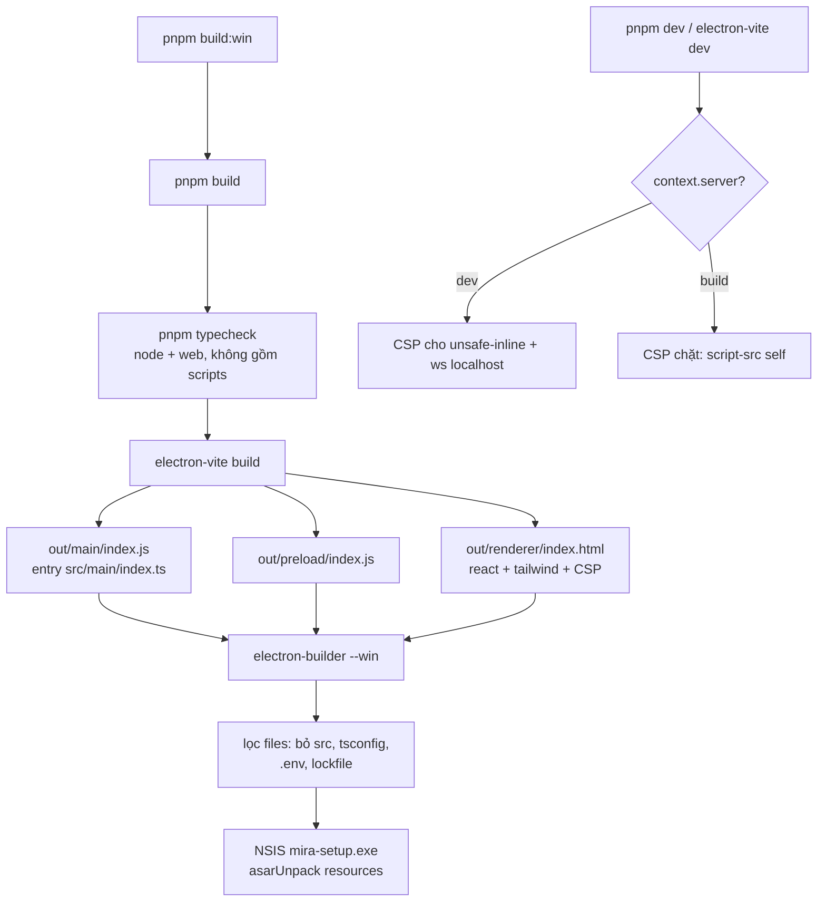

Đọc sơ đồ:
- `src/measurement` và `scripts/` không vào bundle vì không entry nào (`src/main/index.ts`,
  `src/preload/index.ts`, `src/renderer/index.html`) import chúng. Rule Biome chặn import sai hướng.
- `package.json` gọi `pnpm typecheck`. Với pnpm toàn cục mới hơn 8.9.0, lệnh này có thể không chạy gì
  (theo AGENTS.md). Đường kiểm tin được là `node scripts/check.mjs --build`, rồi mới chạy
  `electron-builder`.
- Smoke test `smoke:sqlite` và `smoke:net` chạy bằng binary Electron. Chạy lại chúng sau khi nâng Electron.

## 4. Dữ liệu và trạng thái

| Dữ liệu | Type / file | Lưu ở đâu | Vòng đời |
| --- | --- | --- | --- |
| Fixture | `WorkFixture`, `GlossaryFile`, `AssertionsFile` ([fixture.ts](../../src/shared/contracts/fixture.ts)); `LoadedWorkFixture` ([fixtureCheck.ts](../../src/measurement/fixtureCheck.ts)) | `fixtures/{public,private}/<tác phẩm>/` | Viết tay, commit. Đoạn = mỗi dòng không trống, kể cả dòng chỉ có U+3000 cũng tính là trống |
| Lần chạy Bench | `config.json`, `ch<N>_r<k>/{translation.txt,result.json}` | `fixtures/private/runs/<runId>-<label>/` | Ghi một lần, `rescore` ghi thêm bên cạnh |
| Thư viện Lab | SQLite Mira chuẩn (`LibraryStore`) | `fixtures/private/lab/data` (chỉ trên máy) | Mỗi bản (biến thể) là một tác phẩm. Bản dịch bị `translate --force` ghi đè |
| Manifest Lab | `Manifest`, `NovelEntry`, `ChapterStats` (trong `cli.ts`) | `fixtures/private/lab/lab.json` | `copies` nhãn → workId, `glossaries`, `repeatOf`, `stats[nhãn][chương]` = lần chạy mới nhất |
| Glossary Lab | `GlossaryFile` (trong `cli.ts`), trường `origin` | `lab/glossary/<tên>.json` | `extract` tạo, `analyze --apply` sửa, `glossary`/`fork` nạp vào DB |
| Lời gọi | `CallRecord` (`cli.ts`) | `lab/runs/<runId>/<ncode>-<nhãn>.jsonl` | Đầy đủ messages + response; `pairs` đọc lại |
| Kết cục đoạn | `ChapterOutcomes`, `ParagraphOutcome` ([labOutcomes.ts](../../src/measurement/labOutcomes.ts)) | `lab/runs/<runId>/*.outcomes.jsonl` | Chỉ thêm; dòng sau thắng; dòng hỏng bị bỏ |
| Sổ đăng ký | `RunRecord`, `MeasurementRecord`, `REGISTRY_SCHEMA = 2` ([runRegistry.ts](../../src/measurement/runRegistry.ts)) | `lab/registry/{runs,measurements}.jsonl` | Chỉ thêm, sinh [history.md](../modules/measurement/history.md) |
| Khóa API | `volatileCrypto` (XOR khóa ngẫu nhiên của tiến trình) | bảng kết nối trong DB Lab | Kết nối bị xóa trong `finally`; tiến trình chết thì bản mã không giải được |

Vòng đời một **bản** (biến thể) trong Lab:

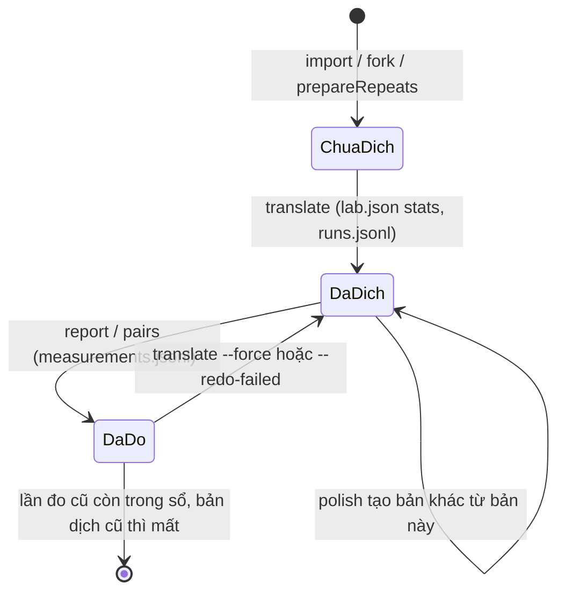

Lần đo trỏ về lần chạy qua `runIdsOf` (`lab.json` lúc đo). Lần dịch sau ghi đè bản dịch, vì thế sổ tách
"lần chạy" khỏi "lần đo" để giữ được số đo cũ.

## 5. Tại sao code viết như vậy

- **Measurement đứng ngoài app runtime.** Bộ đo gọi provider thật, đọc raw có bản quyền và chạy hàng giờ.
  Ranh giới runtime không chứng minh nội dung gói cài; chưa kiểm artifact để kết luận harness và
  dữ liệu riêng tư đã bị loại khỏi bản cài. Biome chặn `src/shared`, `src/renderer`, `src/main/infra`,
  `src/main/services` import `**/measurement/**`, còn `src/measurement` không được import main, renderer,
  preload hay React. **[code]** [biome.json](../../biome.json), **[docs]**
  [ARCHITECTURE.md](../../ARCHITECTURE.md). Code chỉ dùng cho harness được tách khỏi
  `src/shared/algorithms` sang `src/measurement` ở **[commit]** 7ed2220.
- **Chia hai tầng: `src/measurement` thuần, `scripts/` làm lớp ghép.** Thuật toán đo (outcomes, sổ, thống
  kê) là hàm thuần có test chạy trong `check.mjs`. Phần đọc tệp, gọi mạng và dựng service nằm ở
  `scripts/`, nơi Biome không lint (`files.includes` chỉ có `src/**`), nhưng `tsc -p tsconfig.scripts.json`
  vẫn typecheck. **[code]** đầu [labOutcomes.ts](../../src/measurement/labOutcomes.ts): "Hàm thuần, không
  đọc tệp; Lab đọc và ghi".
- **Tái dùng app thay vì viết đường dịch thứ hai.** `createServices` nhận `library`, `crypto`, `fetch`
  qua tham số. Comment trong code nói không truyền `fetch` thì dùng fetch toàn cục, "which is what tests
  and any non-Electron caller want". Lab tái dùng lớp `ParagraphTranslator` như UI, nhưng
  `policy: 'auto'` là lựa chọn của Lab, không phải mặc định của UI (`review`); orchestration không đồng nhất. **[code]** [createServices.ts](../../src/main/services/createServices.ts),
  [running-experiments.md](../modules/measurement/running-experiments.md). Code app được tái dùng gồm
  `normalizeRaw`, `segment`, `paragraphUnits`, `translationChecks`, `paragraphAlign`, `LibraryStore`,
  `GlossaryService`, `AddressingService`, `glossaryExtraction`, `addressingAnalysis`, `polish`,
  `costEstimate`, `modelCatalog`/`checkThinkingLevel`, `getRunContext`, `formatAsNovelHtml`.
- **Bench chạy bằng Vitest, Lab bundle bằng esbuild.** Vitest cho phép chạy TypeScript của app với
  timeout dài. Config riêng chỉ nhặt `*.run.ts` để `check.mjs` không bao giờ chạy nó. Lab cần lệnh con
  và cờ nên dùng esbuild với `packages: 'external'`, và bundle được đặt trong `node_modules/.cache` để
  vẫn tìm thấy `node_modules`. **[code]** comment đầu [vitest.config.mjs](../../scripts/bench/vitest.config.mjs)
  và [mira-lab.mjs](../../scripts/lab/mira-lab.mjs).
- **Hash prompt lấy từ request thật.** Bench trước đây băm prompt MVP của provider, trong khi request mang
  prompt của lõi dịch. **[commit]** a28d4c9, **[code]** comment trong `translate.run.ts`.
- **Hoàn thành và Chất lượng tách nhau; cần lặp mới được kết luận.** Lần chạy bị lọc nhiều có thể trông
  tốt hơn vì chỉ được chấm trên phần dịch được, và một lần chạy mỗi bên chưa đủ để gọi bên thắng.
  **[commit]** f9c101a, **[docs]** [metrics-and-judging.md](../modules/measurement/metrics-and-judging.md).
- **Kiểm thinking trước lời gọi đầu tiên.** Mục đích là để sổ không có lần chạy toàn lỗi 400 với giá $0.
  **[code]** `thinkingProblem`. `gitState` chỉ xét `src/` vì dữ liệu Lab trong `fixtures/` đổi sau mỗi lần
  chạy, nên không phải tín hiệu. **[code]**
- **`extract` không ghi đè tệp chung và luôn ghi `origin`.** Số đo trên glossary soạn tay đẹp hơn thực tế
  vì bỏ qua bước trích xuất. Quyết định của chủ sản phẩm (2026-10-06) là dữ liệu ngữ cảnh phải do luồng AI
  tạo ra. **[docs]** [running-experiments.md](../modules/measurement/running-experiments.md), **[code]**
  `glossaryOriginOf`.
- **Judge phải khác họ model và chấm cả hai chiều.** Hai việc này giảm thiên vị cùng họ và thiên vị vị
  trí. Phản hồi không đọc được bị ghi là "không chấm được", không đổi thành hòa. **[docs]**
  [metrics-and-judging.md](../modules/measurement/metrics-and-judging.md).
- **`check.mjs` đòi bằng chứng.** Trên máy chủ repo, `pnpm test/lint/typecheck` in cảnh báo về trường
  pnpm rồi thoát 0 mà không chạy gì. **[commit]** 264f0e0.
- **Test chia hai pha.** Năm tệp kiểm thời gian thực hoặc giết tiến trình con theo timer. Chạy song song
  toàn bộ thì trượt ngẫu nhiên (đỏ, đỏ, xanh trong ba lần), còn chạy hai pha thì xanh 3/3. Danh sách khớp
  theo tên tệp để không vỡ khi di chuyển file. `BASELINE_TESTS` chỉ được tăng, để phát hiện test bị xóa
  ngoài ý muốn. **[commit]** 264f0e0, **[code]**.
- **PDF in bằng một cửa sổ và nạp từ tệp.** `data:` URL bị giới hạn 2 MB. Cửa sổ thứ hai tạo sau khi hủy
  cửa sổ đầu thì báo `ERR_FAILED`. HTML tạm có tên ASCII vì Chromium từng lỗi với đường dẫn chứa chữ Nhật.
  **[code]** [print-pdf.cjs](../../scripts/lab/print-pdf.cjs), `exportPdfs`.

## 6. Đọc code bắt đầu từ đâu

1. [running-experiments.md](../modules/measurement/running-experiments.md): lệnh, biến môi trường, sổ
   đăng ký; đọc trước để biết mỗi lệnh phải tạo ra gì.
2. [cli.ts](../../scripts/lab/cli.ts): đọc `HELP` và `main()`, rồi `translate` → `translateChapter`.
   Đây là đường đo đang được dùng.
3. [labOutcomes.ts](../../src/measurement/labOutcomes.ts): `batchOutcomes`, `comparableKeys`, `decide`.
   Đây là quy tắc kết luận.
4. [runRegistry.ts](../../src/measurement/runRegistry.ts): `RunRecord`, `summarizeRun`,
   `historyMarkdown`. File này cho biết mỗi dòng của `history.md` đến từ đâu.
5. [check.mjs](../../scripts/check.mjs): `step` và `main`. File ngắn, quyết định commit có được đi tiếp
   không.

## 7. Điểm đáng ngờ / nợ kỹ thuật

1. **Bench không còn đi đường dịch của UI.** `translate.run.ts` gọi `services.translator` (lớp
   `ChapterTranslator`, kênh `ai:translate:plan`/`batch`). Preload chỉ phơi kênh
   `aiTranslateParagraph*`, và renderer dùng `ParagraphTranslator` (`useParagraphTranslate.ts`). Tài
   liệu và comment đầu file vẫn nói "quy trình dịch thực tế của ứng dụng".
2. **`benchChapters` không bao giờ loại chương.** `compare.run.ts` đọc `outcomes.json`, nhưng
   `translate.run.ts` không ghi tệp này. Mọi lần so của Bench vì thế rơi vào nhánh "Chỉ lấy giao chương,
   chưa loại đoạn bị từ chối".
3. **Judge luôn tự nhận là A/A.** `judge.run.ts` tính
   `isAATest = configA.label === configB.label || …`, nhưng `config.json` không có trường `label`.
   `undefined === undefined` là đúng, nên mọi báo cáo T1 đều ghi "A/A (mức nhiễu)".
4. **`legacy-e6` không thể ra `keep`.** `compare.run.ts` lấy `judgeData.stats.winRateCI`, nhưng
   `judge.run.ts` không ghi trường này. `humanWinRateCI` cũng không được truyền vào. Kết quả chỉ có thể là
   `no-keep` (nếu T0 xấu đi) hoặc `insufficient`.
5. **Lỗi fixture bị nuốt.** `loadFixtures` trả `issues` (sai số đoạn, thiếu quyền, neo assertion hỏng),
   nhưng không runner nào đọc. Lỗi parse hay thiếu `source.txt` chỉ thành `console.warn` và tác phẩm bị bỏ
   qua. Trong `check.mjs` cũng không có test nào chạy `checkWorkFixture` trên `fixtures/public` thật.
6. **Lab `extract`/`analyze` chưa hẳn là "luồng AI của Mira".** `extract` tự lắp lại trình tự từ
   `glossaryExtraction` thay vì gọi `ContextExtractionService.extract`. Nó thiếu cờ `scriptMismatch`,
   không đề xuất cặp xưng hô (`dyads: []`) và không có lịch sử quét chương. `analyze` dùng `fetch` thường,
   nên lời gọi và chi phí không vào `runs/` hay sổ. `--apply` sửa thẳng tệp glossary mà không đổi
   `origin`. `syncGlossary` luôn gắn `origin: 'ai'` trong DB, kể cả với tệp `claude-draft`. Hai luồng có
   thể lệch nhau mà không ai thấy, trái với quyết định ngày 2026-10-06.
7. **Dấu vết vibecode trong `cli.ts` (3.020 dòng, một file).** `createCopy` luôn gọi
   `segment(text, 'ja')`, bất kể `sourceLang`. Lab chỉ hỗ trợ `providerId: 'google'` + `GEMINI_API_KEY`.
   Hai doc comment bị lạc chỗ: comment về khóa của `volatileCrypto` nằm trên mục "sổ đăng ký", và
   comment "Đặt tên tiếng Việt…" của `nameCopy` nằm trên mục "trau chuốt". `recordingFetch` không ghi
   request ném lỗi mạng, nên `calls`/`httpErrors` thiếu các lần đó. Trong `polish`, `setupConnection`
   chạy trước `try`, nên nếu nó lỗi thì thư viện không được đóng.
8. **[suy luận] `electron-builder.yml` có thể đóng gói quá nhiều.** `files` chỉ loại `src/*`, tsconfig,
   `.env` và lockfile. Nó không loại `fixtures/` (gồm `private/`, raw có bản quyền, và `lab/data` khoảng
   324 MB nếu có trên máy), `scripts/`, `docs/` hay `openspec/`. Chưa build để kiểm. Muốn xác minh thì
   chạy `npx asar list dist/win-unpacked/resources/app.asar`.

## 8. Liên kết

- Module: [Bộ đo](../modules/measurement/README.md),
  [Fixture](../modules/measurement/fixtures.md),
  [Phép đo và chấm](../modules/measurement/metrics-and-judging.md),
  [Vận hành thí nghiệm](../modules/measurement/running-experiments.md),
  [Kết quả](../modules/measurement/results.md),
  [Lịch sử đo](../modules/measurement/history.md) (sinh tự động),
  [fixtures/README.md](../../fixtures/README.md).
- Quy tắc: [ARCHITECTURE.md](../../ARCHITECTURE.md) (measurement ngoài runtime),
  [AGENTS.md](../../AGENTS.md) (check.mjs, pnpm).
- Code-tour liên quan:
  [01 Process và IPC](01-process-va-ipc.md) (`createServices`, kênh `ai:translate:*`),
  [02 Lưu trữ](02-luu-tru.md) (`LibraryStore`, `getRunContext`),
  [03 Kết nối AI](03-ket-noi-ai.md) (`ConnectionService`, `checkThinkingLevel`, bảng giá),
  [04 Dịch chương](04-dich-chuong.md) (`ParagraphTranslator`, `ChapterTranslator`, refusal, ngân sách
  lời gọi, polish, `translationChecks`),
  [05 Ngữ cảnh dịch](05-ngu-canh-dich.md) (`glossaryExtraction`, `addressingAnalysis`,
  `ContextExtractionService`),
  [07 Thư viện, nguồn, xuất](07-thu-vien-nguon-xuat.md) (`formatAsNovelHtml`, smoke Kakuyomu),
  [08 Giao diện](08-giao-dien-renderer.md) (ranh giới renderer mà `check-renderer-boundaries` kiểm).
