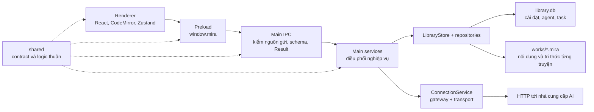
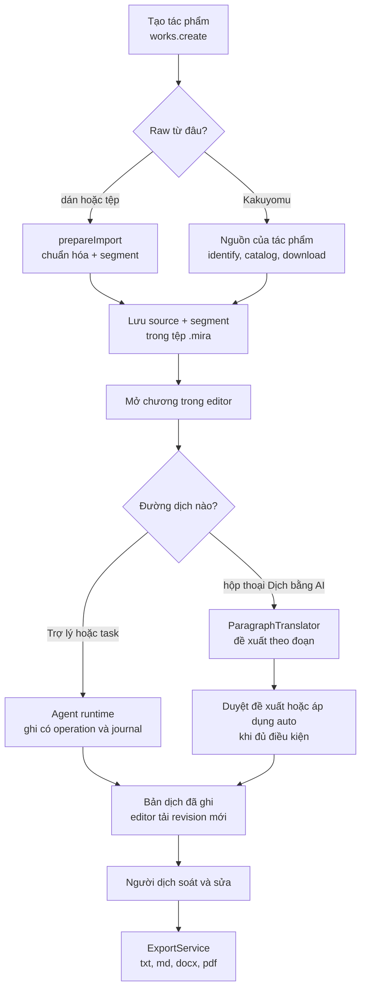
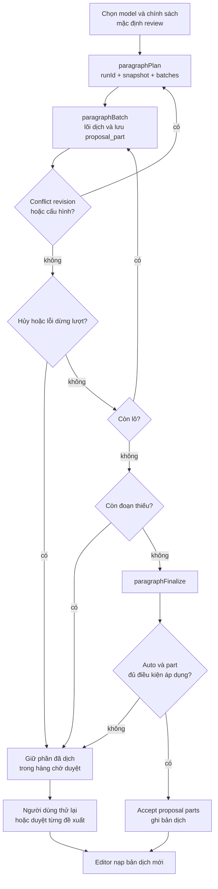
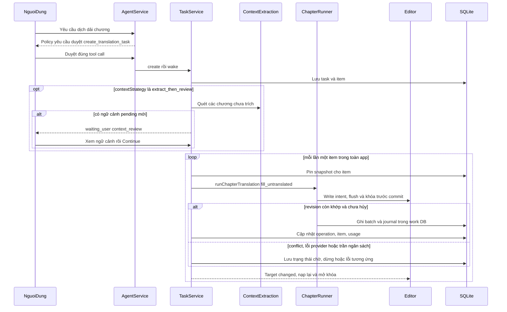
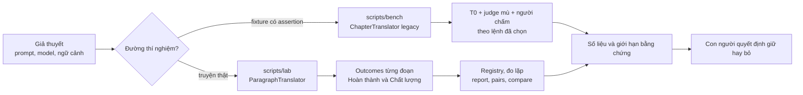

# Đọc lại Mira từ code

> **Mục đích:** nối lại bức tranh từ thao tác người dịch đến UI, IPC, service, model và dữ liệu trên đĩa.
> Cập nhật: 2026-10-15 · Nguồn: code tại commit `db2455f`.
> Đây là bản đồ đọc code, **không phải đặc tả sản phẩm hay danh sách chức năng đã nghiệm thu**.

## 1. Cách đọc mà không bị ngợp

Đừng bắt đầu bằng cách đọc hết mọi file. Chọn một hành trình, đi theo tên hàm trong sơ đồ rồi mở code.
Mỗi tài liệu chi tiết có cùng tám mục: vì sao tồn tại → bản đồ file → luồng có rẽ nhánh → dữ liệu/trạng
thái → vì sao thiết kế như vậy → điểm bắt đầu đọc code → nợ kỹ thuật → liên kết.

- **Muốn hiểu lại việc dịch:** đọc mục 3–5 ở đây, rồi [08 Giao diện](08-giao-dien-renderer.md) →
  [04 Dịch chương](04-dich-chuong.md) → [05 Ngữ cảnh](05-ngu-canh-dich.md).
- **Muốn hiểu app chạy ra sao:** [01 Process và IPC](01-process-va-ipc.md) →
  [02 Lưu trữ](02-luu-tru.md) → [03 Kết nối AI](03-ket-noi-ai.md).
- **Muốn hiểu Trợ lý và dịch nhiều chương:** [06 Trợ lý và task](06-tro-ly-agent.md). Không lấy vòng
  lặp của hộp thoại Dịch để suy ra vòng đời task.
- **Muốn đổi prompt/model và biết có tốt hơn không:** [09 Đo lường](09-do-luong-va-cong-cu.md), sau đó
  đọc tài liệu vận hành ở module Bộ đo.

**Cách hiểu nhãn bằng chứng:** `[code]` là quan sát implementation; `[docs]` là quyết định hoặc mô tả
trong tài liệu được dẫn; `[commit]` là lịch sử; `[suy luận]` là giả thuyết chưa kiểm chứng bằng chạy thật.
Mục “Điểm đáng ngờ” không đồng nghĩa với lỗi đã tái hiện, và không phải phê duyệt để sửa chức năng.

## 2. Bản đồ chín vùng

| Vùng | Câu hỏi nó trả lời | Điểm vào nên tìm |
| --- | --- | --- |
| [01 Process và IPC](01-process-va-ipc.md) | Ai có quyền làm gì? `window.mira` đi đâu? App mở/tắt thế nào? | `index.ts`, `registerLibraryHandlers`, `createLibraryHandlers`, `DesktopApi` |
| [02 Lưu trữ](02-luu-tru.md) | Dữ liệu nằm đâu? Ghi, migration, backup và crash recovery bảo vệ gì? | `LibraryStore`, `WorkFiles`, `openIndex`, `saveText` |
| [03 Kết nối AI](03-ket-noi-ai.md) | Chọn model, lấy credential, gọi HTTP, retry và đổi khóa thế nào? | `ConnectionService`, `Gateway`, các transport |
| [04 Dịch chương](04-dich-chuong.md) | Raw trở thành request rồi bản dịch như thế nào? Thiếu đoạn, từ chối, hủy xử lý ra sao? | `ParagraphTranslator`, `runChapterTranslation`, `executeTranslateBatch` |
| [05 Ngữ cảnh dịch](05-ngu-canh-dich.md) | Thuật ngữ/nhân vật/xưng hô đến từ đâu, ai duyệt, mục nào vào prompt? | `ContextExtractionService`, `GlossaryService`, `takeContextSnapshot` |
| [06 Trợ lý và task](06-tro-ly-agent.md) | Model gọi tool nào, ai quyết quyền ghi, task/Undo/restart hoạt động ra sao? | `AgentService`, `decideToolCall`, `AgentTaskService`, `AgentWriteCoordinator` |
| [07 Thư viện, nguồn, xuất](07-thu-vien-nguon-xuat.md) | Tạo truyện, nhập raw, tải Kakuyomu, xuất tệp, khôi phục phiên thế nào? | `LibraryStore`, `createSourceServices`, `ExportService`, `WorkspaceService` |
| [08 Giao diện renderer](08-giao-dien-renderer.md) | Màn/component/store nối với editor và dịch như thế nào? | `AppContent`, `useWorkspaceStore`, `EditorSession`, `useParagraphTranslate` |
| [09 Đo lường và công cụ](09-do-luong-va-cong-cu.md) | Chạy thí nghiệm và kiểm chất lượng repo bằng gì? | `scripts/lab/cli.ts`, `src/measurement`, `scripts/check.mjs` |

### Ranh giới kiến trúc

Mũi tên liền là đường gọi chính; nét đứt là phụ thuộc contract/logic. Renderer không import service main
và không trực tiếp đọc SQLite hay khóa API. `shared` không sở hữu I/O.

Sơ đồ mô tả hướng kiến trúc, không khẳng định mọi handler đã mỏng: một số đường nguồn, session và
proposal còn gọi thẳng infra. Ngoại lệ và ba kênh `app:*` ngoài `Result` được chỉ rõ ở file 01.
Quy tắc chuẩn vẫn là [ARCHITECTURE.md](../../ARCHITECTURE.md), không phải sơ đồ giản lược này.

## 3. Hành trình từ truyện mới đến tệp xuất

Đây là hành trình tổng, không phải một transaction: lỗi ở bước sau không hoàn tác mọi bước trước.
Nhánh lỗi tệp/mạng/hủy xuất ở [07](07-thu-vien-nguon-xuat.md); conflict khi sửa/lưu ở
[08](08-giao-dien-renderer.md); retry/refusal của model ở [04](04-dich-chuong.md). Xuất đọc bản đã lưu
trong DB, không đọc trực tiếp editor; các điểm mở Xuất không bảo đảm đã lưu thành công bản đang sửa.

Ngữ cảnh **không tự trích ở mọi lần bấm Dịch**. Hộp thoại chụp phần đã duyệt đang có. Task có chiến
lược riêng để trích rồi chờ duyệt; phân biệt hai đường dưới đây.

## 4. Đường A: hộp thoại “Dịch bằng AI”

Điểm vào: [useParagraphTranslate.ts](../../src/renderer/src/modules/workspace/translation/useParagraphTranslate.ts).
Vòng từng lô nằm ở **renderer**, `ParagraphTranslator` ở main xử lý từng lần invoke.

- Lập kế hoạch lại khi conflict **không có nghĩa tự dịch lại ngay**; hook tải plan mới, người dùng quyết
  định bước tiếp theo. Mũi tên quay lại chỉ nói cần một plan khớp dữ liệu mới.
- Mỗi đơn vị là một **dòng không trống**. Lõi dựng ID tạm → request → parse → reconcile → hỏi lại phần
  thiếu; không phải lúc nào cũng chạy `paragraphAlign`. Align Gale–Church chủ yếu thuộc Bộ đo.
- `CallBudget` giới hạn mọi lời gọi phụ. Model trả thiếu, phản hồi bị lọc, hết ngân sách và lỗi mạng là
  những kết cục khác nhau; không gom tất cả thành “dịch thất bại”.
- Hủy chỉ ngăn gửi **lô tiếp theo**, không abort HTTP đang chạy của hộp thoại. Phần đã thành proposal
  vẫn còn. `finalize` không được gọi khi còn đoạn thiếu, đã hủy hoặc có lỗi dừng lượt.
- `review` là mặc định. `auto` không đồng nghĩa luôn ghi đè bản dịch đang có: part vẫn phải qua kiểm
  neo/placement và revision. Xem luồng finalize và proposal ở [04](04-dich-chuong.md), [06](06-tro-ly-agent.md).
- Nút tiếp tục với model dự phòng cần thao tác người dùng và lỗi cho phép fallback; không phải Trợ lý
  mới cũng tự đổi model theo cách này.

## 5. Đường B: Trợ lý và task dịch nhiều chương

Điểm vào: [AgentService](../../src/main/services/agent/agentService.ts),
[AgentTaskService](../../src/main/services/agent/taskService.ts). Trợ lý có thể gọi `translate_chapter`
cho một chương; `create_translation_task` tạo công việc bền nhiều chương sau khi người dùng duyệt.

- Model chọn capability; **code** kiểm policy, chạy scheduler và bảo vệ ghi. Tên đích đi qua handle,
  không tin ID do model tự bịa.
- Task không có glossary mặc định chọn `extract_then_review`; có glossary thì `approved_only`.
  `contextStrategy` có thể được chỉ định tường minh, nên “chưa có glossary” không phải luật ép buộc.
  Task có ứng viên mới thì chờ, nhưng `Continue` **không kiểm đã duyệt hết**: mục pending vẫn không
  vào prompt, và task có thể dịch với phần đã duyệt khi mọi chương đã được đánh dấu quét.
- Runner dịch theo **hàng câu/segment**, khác cỡ đơn vị của hộp thoại. Cùng dùng lõi
  `executeTranslateBatch`, nhưng khác cách ghi: operation/journal thay vì proposal.
- Hai lớp khóa khác nhau: coordinator chờ editor flush/ack; write lease bảo vệ ghi trong main.
  Không phải chỉ khóa nút trên UI là đủ an toàn.
- QA của task là **cảnh báo**, không phải chứng minh bản dịch đúng nghĩa. Undo chỉ ghi khi revision
  hiện tại còn khớp operation, không đè bản người dịch đã sửa tiếp.
- Task được lưu bền nhưng **không tự chạy tiếp sau restart**: về paused, chờ người dùng Continue.
  Trợ lý mới không tự fallback model. Chat/proposal legacy vẫn còn một đường chạy riêng.
- Điều chỉnh chỉ dẫn từ một chương trở đi là luồng riêng: chỉ tác động từ item queued chưa ghim
  snapshot; xem steering ở [06](06-tro-ly-agent.md). Trần token/chi phí so số đã báo, không phải
  bảo đảm dự trù để tuyệt đối không vượt sau request kế tiếp.

Các state machine turn, operation, task, item; nhánh từ chối quyền, cần xác nhận, hủy, retry và reconcile
được tách ở [06 Trợ lý và task](06-tro-ly-agent.md), không ép vào một sơ đồ khổng lồ.

## 6. Đường C: đo xem một thay đổi có tốt hơn không

Measurement đứng ngoài app runtime. `scripts/` dựng service và làm I/O; `src/measurement` giữ hàm đo
thuần. Không suy kết quả Bench cũ thành hành vi UI hiện tại: Bench còn dùng `ChapterTranslator`, Lab
mới gọi `ParagraphTranslator`, nhưng Lab cố định `auto` và tự điều phối retry/finalize, còn UI mặc định
`review` và chỉ finalize khi lượt sạch. Các khoảng lệch giữa harness và sản phẩm được ghi ở
[09 Đo lường](09-do-luong-va-cong-cu.md).

Glossary/xưng hô dùng cho phép đo end-to-end phải có nguồn gốc từ luồng AI của Mira, không dùng dữ liệu
người viết tài liệu tự soạn rồi nhận là kết quả sản phẩm. Một lần chạy không đủ để tuyên bố biến thể thắng.

## 7. Dữ liệu nào sống qua lần tắt app?

| Dữ liệu | Owner/nơi lưu | Điều không nên hiểu nhầm |
| --- | --- | --- |
| Thư viện, kết nối AI, session/turn/task agent | `library.db` | Không còn chỉ là cache có thể xóa tùy ý |
| Raw, bản dịch, segment/link, ngữ cảnh, proposal, snapshot và journal | `works/<id>.mira` của từng tác phẩm | Backup một truyện không đồng nghĩa backup mọi thiết lập ứng dụng |
| Khóa API/tài khoản | Lưu được bảo vệ bằng `SecretStore`/Electron `safeStorage` | Không phơi credential thô cho renderer |
| Lời gọi AI phục vụ đối chiếu | Tệp log theo tác phẩm | Là dữ liệu nhạy cảm; không chia sẻ cả log khi chưa rà nội dung |
| Vị trí/phiên workspace đã lưu | `library.db`, bảng `meta`, khóa `workspace:v1` qua `WorkspaceService` | Trạng thái editor đang gõ chưa chắc đã được lưu cùng phiên |
| Trạng thái hiển thị, delta, draft, budget/lease trong RAM | Zustand hoặc main memory | Không tự biến thành dữ liệu bền; xem cơ chế phục hồi cụ thể từng owner |

Đọc [02 Lưu trữ](02-luu-tru.md) để biết migration/backup bảo vệ gì; [08 Giao diện](08-giao-dien-renderer.md)
để hiểu lưu có revision và bản sửa chưa lưu; [06](06-tro-ly-agent.md) để hiểu journal/reconcile.

## 8. Tra cứu nhanh theo triệu chứng

| Điều cần lần theo | Đọc trước | Ranh giới cần nhớ |
| --- | --- | --- |
| Chọn model đúng nhưng request sai hoặc không gọi được | [03](03-ket-noi-ai.md) | gateway/transport/key retry khác fallback model |
| Thiếu đoạn, tên sai, dấu thoại mất, bị chặn nội dung | [04](04-dich-chuong.md), [05](05-ngu-canh-dich.md) | snapshot chọn gì, prompt gửi gì, parser giữ gì |
| Dịch xong nhưng editor chưa đổi | [08](08-giao-dien-renderer.md), [06](06-tro-ly-agent.md) | proposal chưa accept khác operation đã commit nhưng chưa reload |
| Task dừng, restart không chạy tiếp | [06](06-tro-ly-agent.md) | waiting_user/paused/failed khác nhau; kiểm reason và journal |
| Nguồn/Cập nhật có UI nhưng thao tác không tới dữ liệu | [07](07-thu-vien-nguon-xuat.md) | phân biệt mock, contract lệch và đường thật của nguồn từng tác phẩm |
| Điểm đo đẹp nhưng người đọc thấy kém | [09](09-do-luong-va-cong-cu.md) | phần Hoàn thành, tập giao Chất lượng, nguồn glossary, số lần lặp |

Trong các file chi tiết, `legacy` nghĩa là đường cũ cần truy vết consumer; không có nghĩa an toàn để xóa.
`mock`/“chưa triển khai” không được đọc như một cam kết đã có tính năng. Những quan sát nợ kỹ thuật cần
được kiểm chứng và đưa về module sở hữu trước khi lập change sửa; bộ tài liệu này không sửa các lỗi đó.

## 9. Mermaid và Excalidraw

Giữ Mermaid trong `.md` làm nguồn dễ review/diff. Đọc bằng trình Markdown có hỗ trợ Mermaid; sơ đồ tổng
ở đây để định hướng, sơ đồ trong chín file giữ nhánh chi tiết. Không dồn toàn bộ hệ thống vào một hình.

Theo [tài liệu Excalidraw+ MCP](https://plus.excalidraw.com/docs/mcp) và
[danh sách tool](https://plus.excalidraw.com/docs/mcp/tools) đã kiểm ngày 2026-10-15:

- `create_diagram` nhận **semantic nodes, edges và groups**, tự layout; có hướng `DOWN`/`RIGHT`.
- Không có tool nhận trực tiếp chuỗi Mermaid được tài liệu hóa trên trang đó. Đây không phải kết luận
  rằng MCP không vẽ được luồng: cần chuyển sơ đồ sang input semantic của tool.
- MCP dùng Streamable HTTP và bearer API key của Excalidraw Plus. Việc cài/kết nối và ghi scene là công
  việc riêng; không cần nó để đọc bộ Mermaid này.

## 10. Nguồn chuẩn và cách giữ tài liệu không lệch code

- [ARCHITECTURE.md](../../ARCHITECTURE.md): quy tắc ownership/import/process.
- [DESIGN.md](../../DESIGN.md): quy tắc giao diện/tương tác.
- [Tài liệu theo module](../modules/README.md): quyết định, nghiên cứu và trạng thái sản phẩm.
- [AGENTS.md](../../AGENTS.md): quy tắc repo và kiểm tra trước commit/push.

Khi thay đổi luồng, sửa tài liệu chi tiết của vùng đó và sơ đồ tổng nếu đường giao giữa module đổi.
Giữ nhãn bằng chứng, consumer hiện tại và commit nguồn rõ ràng; không đổi một đề xuất thành “đã làm”
chỉ vì nó có sơ đồ. Chạy `node scripts/check.mjs` cho code; kiểm cú pháp Mermaid và đích liên kết riêng,
vì cổng code hiện không kiểm Markdown/Mermaid.
