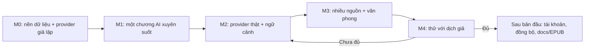

# Roadmap theo điều kiện hoàn thành

Cập nhật: 2026-09-29 sau [ADR-002](../decisions/0002-ai-first-translation.md) · Trạng thái: **quy trình đã chốt** (chủ sản phẩm ủy quyền chọn cách làm tốt nhất trong trao đổi ngày 2026-09-29); mốc là điều kiện, không là ngày phát hành. Chủ trì: product + engineering. Mã yêu cầu ở [mapping](../research/feature-map.md).

## Nguyên tắc quy trình

1. **Giao diện xem được sớm, nhưng trên dữ liệu thật mỏng.** Chủ sản phẩm muốn thấy giao diện trước. Để không làm hai lần, mỗi màn hình mới đọc/ghi qua kho SQLite thật ngay từ đầu, không dựng state giả trong renderer như thư viện mẫu hiện tại.
2. **Provider giả lập (mock) offline** là một provider hợp lệ: trả bản dịch giả định theo segment, có độ trễ và lỗi giả lập. Nhờ đó toàn luồng AI xem và kiểm thử được khi chưa có khóa API hoặc mạng.
3. **Một chương xuyên suốt trước khi mở rộng**: nhập → AI dịch → soát → sửa → xuất trên một chương trước; sau đó mới nhiều chương, nhiều nguồn, văn phong.
4. Mỗi mốc qua cổng bằng bằng chứng (bài kiểm chứng), không bằng số màn hình.

## Trình tự

| Mốc | Đầu ra cụ thể | Điều kiện qua mốc | Tài liệu cập nhật |
| --- | --- | --- | --- |
| M0 — nền | Smoke-test `node:sqlite` trong Electron; `library.db` + file mỗi tác phẩm; mô hình text + segment + link; IPC có kiểu; interface provider + provider giả lập; thư viện nối kho thật | Tạo tác phẩm/chương, đóng/mở còn nguyên; backup/restore một file tác phẩm; ADR storage | ADR storage, current-state |
| M1 — một chương AI | Nhập raw TXT/MD → chia segment → job dịch (giả lập) có tiến trình, dừng/tiếp tục → mode Từng câu soát → mode Toàn văn sửa → quay lại → xuất TXT/MD | V01–V05 trên fixture; job bị ngắt giữa chừng tiếp tục đúng chỗ; sửa hai mode không mất/nhân đôi chữ | Spec AI job, alignment, current-state |
| M2 — AI thật + ngữ cảnh | Adapter tương thích OpenAI (OpenRouter, DeepSeek, Ollama), Anthropic, Gemini; lưu khóa bằng `safeStorage`; glossary (+ import `Names.txt`); **màn xem ma trận xưng hô**; ước lượng chi phí; QA tên/xưng hô/dòng thiếu; nguồn gốc bản dịch | Dịch được chương thật với 2 provider; không ánh xạ sai segment khi model trả thiếu/thừa dòng; QA bắt lỗi glossary cài sẵn | Spec dữ liệu gửi đi, chi phí, lỗi |
| M3 — nhiều nguồn + văn phong | Thêm nguồn raw phụ, ghép chương giữa nguồn, căn chỉnh Bậc 0 nguồn ↔ nguồn và bản cũ ↔ raw; ví dụ văn phong trong prompt; AI đề xuất cập nhật ma trận xưng hô | Đo chất lượng với/không có nguồn phụ và ví dụ văn phong trên corpus; người dùng duyệt được đề xuất xưng hô | Báo cáo kiểm chứng, alignment |
| M4 — thử nghiệm | Build Windows, máy sạch, phiên quan sát với 5–8 dịch giả (ưu tiên người đang dịch bằng AI) | Không lỗi mất nội dung đã lưu; người dùng tự hoàn tất vòng; kết quả theo cặp ngôn ngữ | Validation, release notes |

**Hiện tại:** M0 đạt **một phần** (2026-09-29). Xong: kho SQLite hai tầng, IPC có kiểu, thư viện thật với ảnh bìa, test crash. Còn lại của M0: chương và màn chi tiết truyện (change `work-detail-screen`), nội dung dịch + sao lưu/khôi phục + provider giả lập (change `content-backup-provider`).

## Công việc gần nhất

1. ~~Smoke-test `node:sqlite`, kho dữ liệu và IPC cho tác phẩm, thư viện nối kho thật~~ — xong (`m0-storage-foundation`).
2. Màn chi tiết truyện và danh sách chương (`work-detail-screen`).
3. Nội dung dịch (văn bản, segment, liên kết), sao lưu/khôi phục, interface provider + provider giả lập (`content-backup-provider`).
4. Spike CodeMirror: ánh xạ segment qua chỉnh sửa, undo chung hai mode, **thử tay IME tiếng Việt Telex/VNI và Pinyin trong Electron 44** (lỗi Chromium 149+ mất lần gõ IME đầu tiên ở contenteditable chưa được loại trừ cho Chromium 152).
5. Bộ fixture: vài chương mỗi cặp ngôn ngữ có quyền sử dụng, kèm bản dịch tham chiếu.

## Điều kiện dừng mở rộng

Nếu văn bản bị mất/nhân đôi, bản dịch AI gắn sai segment âm thầm, hoặc restore không đáng tin: sửa lõi trước. Nếu job AI không tiếp tục được sau lỗi mạng/giới hạn tốc độ: sửa hàng đợi trước khi thêm provider. Nếu người dùng không soát theo segment: xem lại đầu tư cho mode Từng câu trước khi thêm panel mới.

---

[Mục lục handbook](../README.md)
