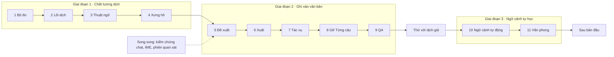

# Lộ trình theo module

Cập nhật: **2026-10-03**, lần 2 trong ngày: ưu tiên chất lượng dịch trước luồng ghi. Bản sáng cùng ngày theo [ADR-005](../decisions/0005-ai-first-proposals-no-sentence-mode.md); trước đó (2026-09-29) theo mốc M0–M4 sau [ADR-002](../decisions/0002-ai-first-translation.md).

**Trạng thái:**
- **Hướng ưu tiên đã chốt** (chủ sản phẩm, 2026-10-03): cải thiện khả năng dịch trước khi làm kỹ luồng áp dụng đề xuất; đo trước khi cải tiến; thuật ngữ trước xưng hô; cache là phép đo, không phải tính năng riêng.
- **Cách chia module, đầu ra và điều kiện qua là đề xuất**, chốt từng module khi viết change openspec của nó.
- Mốc là điều kiện, không phải ngày phát hành.

**Chủ trì:** product + engineering.

**Căn cứ:** [chất lượng dịch](../research/translation-quality.md), [ngữ cảnh truyện đợt 1](../research/story-context.md) và [đợt 2](../research/context-system.md), [chia lô](../research/chunking-translation.md), [lõi AI](../research/ai-core-architecture.md). Ràng buộc kỹ thuật mà mọi thứ tự phải giữ nằm ở [kiến trúc AI-first mục 10](../engineering/ai-first-architecture.md#10-lộ-trình-theo-module). Mã yêu cầu ở [mapping](../research/feature-map.md) và [scope](../product/scope.md).

## Vì sao đổi thứ tự

- **Bản dịch là chỗ hở lớn nhất.** MVP đã dịch được một chương, nhưng không gửi chút ngữ cảnh nào (`chapterTranslation.ts:134-138`). System prompt chỉ có năm câu chung chung, và không gửi tham số nào ([chất lượng dịch](../research/translation-quality.md) Quan sát 0).
- **Chưa có cách đo.** Không có fixture, không có baseline, không có chỉ số. Thêm glossary hay bật thinking lúc này chỉ là đoán.
- **Luồng áp dụng đề xuất chỉ đáng làm kỹ khi thứ được áp dụng đã tốt.** Làm đường ghi trước không làm bản dịch tốt hơn.
- **Đổi thứ tự không phá ràng buộc nào của ADR-005.** Đề xuất vẫn đi trước Gỡ Từng câu, vì đường dịch MVP ghi theo hàng. Lõi của `context-core` (khớp, lắp, kiểm) nghiệm thu được bằng mock trước khi có đề xuất hay tác vụ; chỉ việc lưu băm phải chờ.

## Nguyên tắc quy trình

1. **MVP đã dựng xong để thử nghiệm; từ đây làm lại hoàn chỉnh từng module.** Mã MVP là tham chiếu, không phải ràng buộc.
2. **Mỗi module là một change openspec riêng**, xong khi có spec, test và nghiệm thu. Chỉ sang module kế khi module trước xong. Module thay mã MVP thì xóa mã MVP và spec cũ trong cùng change, không để chế độ ẩn.
3. **Đo trước, dựng sau.** Mọi thay đổi nhằm nâng chất lượng dịch phải có số trên Bộ đo, trước và sau. Bộ đo không thấy lợi thì không dựng tiếp phần đó, và ghi kết quả âm vào nghiên cứu.
4. **Giao diện xem được sớm, nhưng trên dữ liệu thật mỏng.** Mỗi màn mới đọc/ghi qua kho SQLite thật, không dựng state giả trong renderer.
5. **Provider giả lập offline là một provider hợp lệ.** Toàn luồng AI xem và kiểm thử được khi chưa có khóa API hay mạng. Riêng Bộ đo cần gọi thật.
6. **Một chương xuyên suốt trước khi mở rộng sang nhiều chương.** Một chương phải đi trọn nhập → dịch → duyệt → sửa → xuất (Giai đoạn 1 và module 5–6) rồi mới tới tác vụ nhiều chương, ngữ cảnh tự học và nhiều nguồn.
7. **Mỗi mốc qua cổng bằng bằng chứng** (bài kiểm chứng), không bằng số màn hình.

## Kết quả của bản MVP

Đã dựng và chạy được trong Electron. Chi tiết, bằng chứng và số đo ở [hiện trạng](../engineering/current-state.md).

- **Nền dữ liệu:** kho SQLite hai tầng, IPC có kiểu, thư viện thật, danh sách chương, backup/restore, test kill tiến trình.
- **Editor:** hai pane CodeMirror 6, Live Preview nhẹ, nhúng ảnh. IME Telex/VNI/Pinyin đã thử tay trên bản tối thiểu.
- **AI:**
  - Kết nối ba tầng (transport, gateway, mặt tiền); model là mục có cài đặt riêng.
  - Dịch một chương bằng vòng lặp lô ở renderer.
  - Panel Hỏi AI có streaming và duyệt đề xuất tại chỗ.
- **Mode Từng câu:** đã dựng, đã ẩn khỏi giao diện, **bị hủy** ở ADR-005.
- **Cấu trúc mã nguồn:** bốn tầng, luật ranh giới do lint ép.

**Đã kiểm với nhà cung cấp thật:**
- Gemini thật được gọi một lần qua lớp kết nối (9 kịch bản).
- Đo tham số trên Gemini 3.x.
- Một ảnh chụp chat chạy trong Electron, có `usage` thật.

**Chưa kiểm chứng:**
- Hộp thoại dịch chương chưa chạy với nhà cung cấp thật.
- Chưa có fixture văn bản thật.
- Chưa có phép đo chất lượng bản dịch nào.

## Trình tự

**Số là thứ tự, tên mới là mã.** Các trang khác gọi module bằng tên (ví dụ "module Đề xuất") để lần đổi thứ tự sau không phải sửa lại. Bảng ánh xạ số cũ nằm ở [cuối trang](#số-module-cũ).

| # | Module | Đầu ra (tóm tắt) | Điều kiện qua | Trạng thái |
| --- | --- | --- | --- | --- |
| 1 | **Bộ đo** | Fixture ZH/JA/EN, kiểm tất định, giám khảo LLM so cặp mù, lệnh chạy thí nghiệm, baseline; chốt định nghĩa đoạn | A/A đo được mức nhiễu; baseline có số; định nghĩa đoạn qua V14 | Chưa làm; **chờ fixture** |
| 2 | **Lõi dịch** | Prompt tầng A theo quy ước tiếng Việt, chia lô có trần số đoạn, ID tạm `[n]`, parse khoan dung, `max_tokens` có tính thinking, dịch lại đúng đoạn bị cờ; thay mã dịch MVP | Trên Bộ đo: T0 không xấu đi, T1 không thua baseline; mã MVP trong mặt tiền đã xóa | Chưa làm |
| 3 | **Thuật ngữ** | Lát 1 của `context-core`: mục thuật ngữ, tầng khớp, chèn tầng C, kiểm tuân thủ; màn Thuật ngữ thật; nhập `Names.txt` | Tuân thủ thuật ngữ tăng rõ so với không glossary; mục chưa duyệt không rời máy | Chưa làm |
| 4 | **Xưng hô** | Lát 2 của `context-core`: nhân vật, cặp xưng hô có hiệu lực theo chương, tầng B; màn Xưng hô | Số đại từ sai cặp giảm so với không ma trận (V3) | Chưa làm |
| 5 | **Đề xuất** | `proposal` + `text_snapshot`; đơn vị đổi sang đoạn; pane trống ghi thẳng, đã có chữ thì thành đề xuất duyệt tại chỗ; lưu `contextHash` và danh sách mục đã gửi | V11, V12 | Chưa làm |
| 6 | **Xuất** | `.md`/`.txt` từ hàm chiếu Markdown | Xuất rồi nhập lại giữ nguyên chữ | Chưa làm |
| 7 | **Tác vụ** | `JobRunner` trong main, lưu bền; sổ `usage`; trần chi phí; khu vực Tác vụ thật; lịch gửi giữ cache | V13 | Chưa làm; **chặn bởi Q4** |
| 8 | **Gỡ Từng câu** | Gỡ `segment`/`link`/`link_member`/`provenance`, thêm `ai_mark`; nhập raw chỉ chuẩn hóa; gỡ mã mode và kênh `links:*`/`rows:*` | Test kho, editor, crash qua; mở được tệp v5; V03, V15 | Chưa làm |
| 9 | **QA** | Hiện cờ T0 theo đoạn; dịch lại đoạn bị cờ thành đề xuất | Bắt được lỗi cài sẵn trên fixture | Chưa làm |
| — | **Thử với dịch giả** | Build Windows, máy sạch, phiên quan sát 5–8 dịch giả | Không mất nội dung; người dùng tự đi hết vòng; kết quả theo cặp ngôn ngữ | Sau module 9 |
| 10 | **Ngữ cảnh tự động** | Tóm tắt song ngữ mỗi chương, trích mục mới vào hàng chờ duyệt, tên chốt theo lần dịch đầu, đánh dấu "nên xem lại" | Bước 3, 5 của ngữ cảnh đợt 1; V6 của đợt 2 | Chưa làm |
| 11 | **Văn phong** | Ví dụ lấy từ đề xuất đã duyệt, ghi chú văn phong rút từ chỗ sửa | V4, V5 của ngữ cảnh đợt 2 | Chưa làm |

## Giai đoạn 1 — Chất lượng dịch

Cả bốn module làm trên **một chương mỗi lần**, dùng đường dịch hiện có trong app và Bộ đo ngoài app. Hai thứ chưa đổi trong giai đoạn này: đường ghi (vẫn theo hàng, tới module Đề xuất) và đơn vị gửi của app (vẫn là segment).

### 1. Bộ đo

Thay module "Đoạn" cũ và thêm phần đo. Căn cứ: [chất lượng dịch](../research/translation-quality.md) E1–E7.

- **Fixture:**
  - **Riêng tư:** bắt đầu 4 chương (2 ZH: một thoại dày, một dày thuật ngữ; 1 JA; 1 EN), mỗi chương kèm glossary viết tay 30–50 mục và cặp xưng hô viết tay. Nâng lên khoảng 12 chương trước khi dùng kết quả để quyết định. Raw có bản quyền để **ngoài repo**.
  - **Công khai:** khoảng 50 đoạn literary của WMT24++ `en-vi_VN` (Apache-2.0) được vào repo.
  - **Định dạng:** theo E1.
- **Hàm chia đoạn dùng chung** theo ADR-005 (mỗi dòng không trống), đặt ở `src/shared/algorithms/`. Nơi khác chuyển sang dùng nó khi module của chúng được làm lại.
- **T0 kiểm tất định**, hàm thuần dùng lại ở QA: số đoạn, đoạn rỗng hoặc trùng nguồn, chữ Hán/kana còn sót, tỷ lệ độ dài theo băng, vòng lặp, tuân thủ thuật ngữ và term cấm, xưng hô (chỉ cảnh báo).
- **T1 giám khảo LLM so cặp mù:** cả chương vào, phán theo đoạn, chạy hai chiều, judge khác họ model dịch, cố định model và prompt, có kiểm A/A.
- **T3 người chấm mù:** chủ sản phẩm chấm 60–80 cặp mỗi thí nghiệm. T2 (MetricX) là tùy chọn, chỉ để chẩn đoán.
- **Lệnh chạy thí nghiệm:**
  - Lưới điều kiện × chương × 3 lần lặp.
  - Ghi `usage` thật và kết quả dạng máy đọc được.
  - Theo khuôn `liveGemini.test.ts`: chỉ chạy khi có biến môi trường và khóa.
- **Đếm tỷ lệ đoạn trùng** trong fixture, để biết có cần cache kết quả theo đoạn không.
- **Baseline:** prompt MVP trên ma trận model R6 (B0, B1, B7 của nghiên cứu).
- **Điều kiện qua:**
  - Đo được mức nhiễu nền bằng A/A.
  - Đo được đồng thuận judge–người trên ít nhất 50 cặp.
  - Báo cáo baseline có số và tái hiện được bằng một lệnh.
  - V14 (số đoạn hai bên khớp) qua trên fixture; nếu không qua thì sửa Q3 của ADR-005.
- **Không làm:** BLEU hay COMET làm thước đo quyết định; judge cùng họ với model dịch; dùng CometKiwi/XCOMET khi chưa rà giấy phép NC.

### 2. Lõi dịch

Tách từ module "Đề xuất" cũ phần prompt, chia lô và ánh xạ ID. Căn cứ: [chất lượng dịch](../research/translation-quality.md) G1–G6 và R2; [chia lô](../research/chunking-translation.md) C1–C6; [lõi AI](../research/ai-core-architecture.md) D1, D3.

- **Thay mã dịch MVP** trong mặt tiền (`openAiCompatible.ts`) bằng `services/ai/translate/`, trong cùng change. Không giữ hai đường dịch.
- **Lõi nhận đơn vị bất kỳ có ID** và tự đổi sang ID tạm `[n]` khi gửi model. Hôm nay app vẫn gửi segment; module Đề xuất đổi sang đoạn.
- **Chia lô:** `planBatches` là hàm thuần, có trần số đoạn cộng ngân sách token nguồn; ranh giới lô tính từ nguồn. Cỡ lô chọn bằng số đo (bước 1 của chia lô). Điểm cắt ưu tiên (C4) chỉ thêm nếu đo thấy lợi.
- **Prompt tầng A** theo G1–G3: brief, hợp đồng `[n]`, quy ước tiếng Việt, phụ lục theo ngôn ngữ nguồn. Chỗ còn tranh cãi (dùng "y", kiểu thoại, kính ngữ) là cài đặt. Tuần tự hóa xác định.
- **Khung `buildContext` ba tầng** (hàm thuần, có `contextHash`). Tầng B, C lúc này chỉ có đoạn liền trước, gửi dạng cặp nguồn + bản dịch (C5).
- **Tham số:** mức suy luận và temperature mặc định cho tác vụ dịch chọn bằng B3, hiện trong hộp thoại. Luôn gửi `max_tokens`, có cộng ngân sách thinking. Gặp `length` hoặc đầu ra rỗng thì chia nhỏ lô.
- **Parse khoan dung** theo G5. Định dạng đầu ra chọn bằng B4.
- **Thang lỗi nội dung tách khỏi lỗi hạ tầng** (C6). Đoạn trượt T0 được hỏi lại một lần, kèm lỗi cụ thể (R2).
- **Đo cache lần 1** (V1 của [đợt 2](../research/context-system.md)) với tầng A. Đo trên OpenAI/DeepSeek và Gemini 2.5. Trên Gemini 3.x thì tầng A một mình dưới ngưỡng 4.096 token, nên chờ lần đo thứ hai ở module Xưng hô. Kèm B5: endpoint Gemini nhận tham số nào, `usage` có tách thinking không.
- **Điều kiện qua:**
  - Trên Bộ đo, T0 không xấu đi so với baseline (không lệch đoạn, không còn chữ nguồn nhiều hơn).
  - Cận dưới khoảng tin cậy của tỷ lệ thắng T1 không dưới 50%.
  - Tỷ lệ phản hồi hỏng ID hoặc sót đoạn không tăng.
  - Mã dịch MVP trong mặt tiền đã xóa; mọi test qua.

### 3. Thuật ngữ

Lát 1 của change `context-core`; change đó được tách khi bắt đầu module này. Căn cứ: [ngữ cảnh đợt 1](../research/story-context.md) đề xuất 1, 10, 11; [đợt 2](../research/context-system.md) K4, K7; scope S2.3.

- **Bảng mục ngữ cảnh** theo D1 của `context-core` (một bảng cho mọi kiểu), nhưng chỉ mở kiểu `term`: alias, term cấm, hiệu lực theo chương, trạng thái duyệt. Số version schema chốt lúc làm.
- **Tầng khớp:** khớp dài trước, chuỗi con cho ZH/JA, biên từ cho EN, chặn mục quá ngắn, khớp qua alias.
- **Chèn mục đã khớp ở đầu tầng C**, chỉ mục đã duyệt (K4).
- **Kiểm tuân thủ** (hàm từ Bộ đo) chạy sau mỗi lô. Đoạn thiếu thuật ngữ được hỏi lại một lần, kèm danh sách mục chưa thỏa (R2).
- **Kênh IPC và màn Thuật ngữ thật** trong khu vực Ngữ cảnh: danh sách, tìm, thêm/sửa/xóa, alias, term cấm, nhập `Names.txt`/`VietPhrase.txt` (S2.3). Tab Thuật ngữ thôi là minh họa.
- **Panel Hỏi AI đọc thuật ngữ** qua cùng `buildContext`.
- **Thí nghiệm quyết định** (bước 1 của ngữ cảnh đợt 1): nhồi cả glossary vào tầng A so với lọc theo đoạn ở tầng C. Thí nghiệm này trả lời mục 13 "điều có thể bác bỏ".
- **Điều kiện qua:**
  - Tuân thủ thuật ngữ (T0) tăng rõ so với không glossary, có khoảng tin cậy; T1 không xấu đi về độ tự nhiên.
  - Test "mục chưa duyệt không rời máy" qua.
  - Người dùng quản lý được thuật ngữ trên màn thật, và dịch trong app dùng thuật ngữ đã duyệt.
- **Để sau:** AI tự trích (module 10); đánh dấu "nên xem lại" khi mục đổi (cần `proposal`/`job_item`).

### 4. Xưng hô

Lát 2 của `context-core`. Căn cứ: [ngữ cảnh đợt 1](../research/story-context.md) đề xuất 3–5; [đợt 2](../research/context-system.md) K5; scope S2.4.

- **Kiểu `character`** (giới tính, một dòng vai) và **kiểu `dyad`** (người nói → người nghe, tự xưng, gọi, mức, từ chương nào).
- **Dàn nhân vật của chương**, và **tầng B** gồm các cặp có hiệu lực cho dàn đó. Cặp chưa khai thì gửi chỉ dẫn trung tính và gắn cờ.
- **Màn Xưng hô:** xem và sửa ma trận ("màn xem ưu tiên trước", câu hỏi P0).
- **Kiểm xưng hô chỉ ở mức cảnh báo** (K5).
- **Thí nghiệm V2/V3** của đợt 2. Chỉ dựng lượt gán người nói/người nghe mỗi chương nếu V3 cho thấy nó hơn rõ ma trận theo dàn nhân vật.
- **Đo cache lần 2:** tầng A + B trên Gemini 3.x.
- **Điều kiện qua:**
  - V3: ma trận giảm số đại từ sai cặp so với không ma trận.
  - Người dùng xem và sửa được ma trận.
  - Mục chưa duyệt không vào prompt.
- **Ngoại lệ thứ tự:** nếu bước 3 của ngữ cảnh đợt 1 (tóm tắt chương trước) cho lợi rõ trên Bộ đo, phần tóm tắt của module 10 được kéo lên ngay sau module này.

## Giai đoạn 2 — Ghi vào văn bản, rồi nhiều chương

### 5. Đề xuất

Đây là luồng áp dụng mà chủ sản phẩm thấy cần cải thiện. Căn cứ: [kiến trúc AI-first](../engineering/ai-first-architecture.md) mục 5.1; scope S1.9.

- **Điều kiện vào:**
  - Ghi lại các điểm chủ sản phẩm thấy chưa ổn ở luồng áp dụng hiện tại.
  - Chạy lại bảng ca IME cho merge view.
  - Nên có kết quả phiên quan sát của ADR-005 ("có soát theo câu không?"). Nếu phiên đó cho thấy cần soát theo câu thì mở lại Q2.
- **Bảng `proposal` và `text_snapshot`.** Đơn vị gửi đổi từ segment sang đoạn.
- **Dịch một chương:** pane trống thì ghi thẳng; đã có chữ thì gom thành một đề xuất và duyệt từng khối bằng `chatReview.ts`. Cách này thay "Dùng bản AI / Giữ bản của tôi" theo hàng.
- **Lưu `contextHash` và danh sách id + phiên bản các mục ngữ cảnh đã gửi** (K8 của đợt 2) ở `proposal`.
- **Điều kiện qua:** V11, V12. Dịch đè lên chương đã có chữ không đổi chữ nào khi người dùng bỏ hết đề xuất.

### 6. Xuất

- Xuất `.md`/`.txt` từ hàm chiếu Markdown (S1.8); ảnh theo giả định Q7.
- Module này khép vòng một chương (nguyên tắc 6).
- **Điều kiện qua:** xuất rồi nhập lại giữ nguyên chữ.

### 7. Tác vụ

- **`JobRunner` trong main, lưu bền:** `job`, `job_item` (lưu `contextHash` và danh sách mục đã gửi).
- **Sổ `usage`** ở `library.db`.
- **Trần chi phí mỗi tác vụ:** chặn bởi Q4.
- **Khu vực Tác vụ thật.**
- **Lịch gửi giữ cache** (K2): lô đầu của mỗi chương gửi một mình; `prompt_cache_key` hoặc `session_id` theo provider.
- **Ước lượng chi phí** biết thinking, giá theo ngày hiệu lực, giá theo giờ của DeepSeek, hệ số tokenizer (R7).
- **Điều kiện qua:** V13. Kill app giữa tác vụ, mở lại thì tiếp tục đúng chương và đúng lô, không dịch lại đoạn đã ghi.

### 8. Gỡ Từng câu

- Gỡ `segment`, `link`, `link_member`, `provenance` và trigger; thêm `ai_mark`.
- Nhập raw chỉ chuẩn hóa và lưu.
- Gỡ mã mode Từng câu, kênh `links:*`/`rows:*`, `targetIds` của chat, cùng các mục minh họa của mode trong backlog.
- **Điều kiện qua:**
  - Mọi test của kho, editor và crash qua.
  - Mở được tệp `.mira` v5 cũ (V15).
  - V03 qua.
  - Không còn tham chiếu tới mode đã bỏ.

### 9. QA

- Hiện cờ T0 theo đoạn, trong editor và ở khu vực Tác vụ (S2.5).
- "Dịch lại đoạn bị cờ" tạo **đề xuất**, không ghi thẳng.
- Nếu B6 cho thấy lượt soát chọn lọc thắng về độ đúng nghĩa theo người chấm, thêm tùy chọn đó kiểu Diagnose-then-Repair, mặc định tắt (R3).
- **Điều kiện qua:** bắt được lỗi cài sẵn trên fixture; không cờ nào tự sửa chữ.

**Thử với dịch giả** là cổng sau module 9: build Windows, máy sạch, phiên quan sát với 5–8 dịch giả, ưu tiên người đang dịch bằng AI ([kế hoạch kiểm chứng](validation.md)). Kết quả quyết định thứ tự trong Giai đoạn 3.

## Giai đoạn 3 — Ngữ cảnh tự học

### 10. Ngữ cảnh tự động

- **Lượt sau mỗi chương:**
  - Tóm tắt song ngữ đưa vào tầng B.
  - Trích thuật ngữ, nhân vật và cặp xưng hô mới vào hàng chờ duyệt (K7, không tự duyệt).
  - Tên chốt theo lần dịch đầu (đợt 1, đề xuất 9).
- **Đánh dấu "nên xem lại"** khi một mục đổi, theo danh sách mục đã gửi (K8). Cần `proposal`/`job_item`.
- **Điều kiện qua:** bước 3 và 5 của đợt 1; V6 của đợt 2.

### 11. Văn phong

- Ví dụ lấy từ đề xuất đã duyệt (BM25, 3–5 cặp).
- Ghi chú văn phong rút từ chỗ người sửa, vào hàng chờ duyệt (K6).
- Cách này trả lời câu hỏi mở P1 mà không cần căn chỉnh.
- **Điều kiện qua:** V4, V5 của đợt 2. Cần vài chương đã duyệt.

## Sau bản đầu

- **Nhiều nguồn raw** (S3.1).
- **AI ngoài** qua MCP/CLI: cần ADR riêng, Q6.
- **Lượt refine toàn chương:** không làm, trừ khi có số đo mới (R1).
- **Batch API**, **chuỗi chuyển kết nối khi cạn khóa**, **OAuth OpenRouter**: xem [backlog](backlog.md).

## Việc song song, không chặn

| Việc | Trước module nào | Ghi chú |
| --- | --- | --- |
| Kiểm chứng chat: fixture SSE thật, lái tay có hệ thống, đo tỷ lệ `Ctrl+Z` sau khi nhận (task 1.x, 10.2, 10.3, 12.5 của change `ai-chat`) | Đề xuất | Change `ai-chat` đã bị gỡ khỏi `openspec/changes/` ngày 2026-10-03; các task chuyển về đây |
| `ai-provider-live-verification`: thân 429 thật, mốc reset theo ngày | Tác vụ | Tài liệu Google ghi hạn mức theo project, không theo khóa ([chất lượng dịch](../research/translation-quality.md) Quan sát 5) |
| Chạy lại bảng ca IME cho Live Preview ẩn dấu, ảnh, merge view | Đề xuất | [imeCases.md](../../../src/renderer/src/features/editor/imeCases.md) |
| Phiên quan sát của ADR-005: dịch giả có soát theo câu không | Đề xuất | Có thể làm với bản MVP hiện tại |
| Màn Cài đặt nói rõ free tier của Gemini dùng dữ liệu để cải thiện sản phẩm | Lõi dịch | R8; một phần câu hỏi mở "dữ liệu nào được gửi đi" |

## Bộ đệm (cache) nằm ở đâu

Có hai thứ cùng gọi là "cache". Không thứ nào là một module riêng.

1. **Bộ đệm prompt của nhà cung cấp** tự động khớp theo tiền tố. Nó giảm tiền đọc tiền tố còn khoảng 0,1 lần, nhưng không làm bản dịch tốt hơn.
   - Mira chỉ cần xếp tiền tố ổn định (tầng A → B → C, tuần tự hóa xác định; module Lõi dịch).
   - Đo `cached_tokens` thật: lần 1 ở Lõi dịch, lần 2 ở Xưng hô, vì Gemini 3.x cần tiền tố ≥ 4.096 token.
   - Lịch gửi giữ cache thuộc module Tác vụ.
   - Không dựng `cache_control` hay `cachedContents` ở bản đầu (K3).
2. **Cache kết quả theo đoạn** (đoạn giống hệt thì dùng lại bản dịch cũ) **chưa làm**. Bộ đo đếm tỷ lệ đoạn trùng trước. Việc "không dịch lại đoạn đã ghi" khi tiếp tục tác vụ thuộc module Tác vụ, không phải cache.

## Số module cũ

Bảng module 0–9 viết sáng 2026-10-03 (ADR-005) ánh xạ sang thứ tự này như sau. Changelog và các trang nghiên cứu cùng ngày còn dùng số cũ.

| Số cũ | Module cũ | Nay |
| --- | --- | --- |
| 0 | Chat Hỏi/Sửa: kiểm chứng | Việc song song |
| 1 | Quyết định ADR-005 | Xong 2026-10-03 |
| 2 | Đoạn | 1 Bộ đo |
| 3 | Đề xuất | 2 Lõi dịch (prompt, chia lô, ID) và 5 Đề xuất (đường ghi, đơn vị đoạn) |
| 4 | Tác vụ | 7 Tác vụ |
| 5 | Kho v6, gỡ Từng câu | 8 Gỡ Từng câu (số version schema chốt lúc làm) |
| 6 | Ngữ cảnh (`context-core`) | 3 Thuật ngữ, 4 Xưng hô, 10 Ngữ cảnh tự động, 11 Văn phong |
| 7 | QA | 9 QA; hàm kiểm dựng từ module 1 |
| 8 | Xuất | 6 Xuất |
| 9 | AI ngoài | Sau bản đầu |

## Công việc gần nhất

1. **Chủ sản phẩm chọn 4 chương thử** (2 ZH, 1 JA, 1 EN), kèm glossary viết tay 30–50 mục. Quyết định fixture riêng tư để ở đâu (thư mục bị ignore hay repo riêng). Cùng lúc ghi lại các điểm chưa ổn của luồng áp dụng hiện tại, để dùng ở module Đề xuất.
2. **Viết change openspec cho Bộ đo**, gồm định dạng fixture, T0, T1, lệnh chạy và quy tắc quyết định E6.
3. **Chạy B0 (A/A) và B1 (baseline)**, ghi số vào trang nghiên cứu.
4. **Viết change cho Lõi dịch.** Khi tới module Thuật ngữ thì tách `context-core` thành hai change Thuật ngữ và Xưng hô.

## Điều kiện dừng mở rộng

- **Lõi phải sửa trước:** văn bản bị mất hoặc nhân đôi khi nhận/bỏ đề xuất; bản dịch AI gắn sai đoạn âm thầm; restore không đáng tin.
- **Hàng đợi phải sửa trước khi thêm provider:** tác vụ AI không tiếp tục được sau lỗi mạng hay giới hạn tốc độ.
- **Mở lại Q2 của ADR-005 trước khi thêm tính năng mới:** phiên quan sát cho thấy dịch giả cần soát và đánh dấu theo từng câu.
- **Không dựng tiếp phần cải tiến:** Bộ đo cho thấy cải tiến đó không hơn baseline (T0 xấu đi, hoặc cận dưới khoảng tin cậy của tỷ lệ thắng không quá 50%). Ghi kết quả âm và chuyển sang mục kế.

---

[Mục lục handbook](../README.md)
