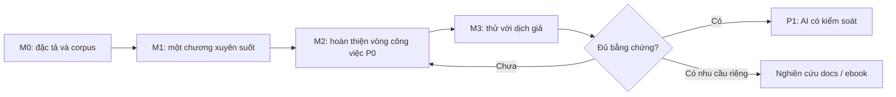

# Roadmap theo điều kiện hoàn thành

Cập nhật: 2026-09-29 · Trạng thái: **đề xuất thứ tự phát triển**, không là kế hoạch ngày phát hành. Chủ trì: product + engineering. Mã yêu cầu ở [mapping](../research/feature-map.md).

## Trình tự

| Mốc | Đầu ra cụ thể | Điều kiện qua mốc | Tài liệu cập nhật |
| --- | --- | --- | --- |
| M0 — chuẩn bị | Chọn corpus, spec Markdown/encoding, thử mô hình văn bản + range, quyết định storage có luận cứ | Có ví dụ cho 1:n/n:1, sửa nguồn, đảo đoạn, Unicode; đo được tiêu chí | Open questions, architecture, ADR kỹ thuật |
| M1 — vertical slice | Một tác phẩm/chương; nhập gốc/dịch, sửa toàn văn, đề xuất liên kết offline, sửa hàng, quay lại, đóng/mở và backup/restore | MIR-02/03/05 vượt bài dữ liệu; vùng chưa chắc được review; không nhân đôi chữ | Hiện trạng, alignment, báo cáo kiểm chứng |
| M2 — vòng P0 hoàn chỉnh | Nối thư viện thật, chương, glossary thủ công, tìm/lọc, trạng thái, source correction, TXT/MD | MIR-01/04/06/07/08 và toàn [scope](../product/scope.md) được kiểm tra | Spec chức năng + hướng dẫn thật |
| M3 — thử nghiệm sử dụng | Build Windows, chạy offline/máy sạch, phiên quan sát với dịch giả | Không còn lỗi mất nội dung đã lưu; người dùng tự hoàn tất vòng; ghi kết quả theo cặp ngôn ngữ | Validation, current-state, release notes |
| P1 — hỗ trợ thông minh | Đề xuất AI theo vùng/ngữ cảnh, diff và kiểm soát áp dụng | P0 tin cậy; chốt provider/quyền/chi phí trước tích hợp | ADR AI + spec dữ liệu gửi đi |
| Sau P0 — định dạng/nội dung mới | EPUB/docs hoặc import glossary nếu bằng chứng nhu cầu đủ | Có corpus riêng; không phá lõi đã nghiệm thu | Nghiên cứu và scope mới |

**Hiện tại:** chưa đạt M0; có scaffold và thư viện mẫu. Handbook 0.1 hoàn thành việc đóng cấu trúc tài liệu, không nghĩa là app đạt 0.1 usable.

## Công việc gần nhất

1. Đặc tả round-trip TXT/MD: encoding, newline, phần Markdown hỗ trợ, thứ bị từ chối và thông báo preview.
2. Làm bộ chương mẫu do dự án tự viết hoặc được phép sử dụng; người đánh giá gắn các nhóm liên kết kỳ vọng.
3. Spike transaction sửa văn bản + cập nhật range/version; so sánh lưu chung DB và package project bằng cùng bài backup/restore.
4. Spike căn chỉnh offline trên corpus; đo công review thay vì chỉ tỷ lệ liên kết tự động.
5. Đóng thành một lát cắt end-to-end rồi nối với thư viện hiện có.

Không cần chờ logo hoặc quyết định kinh doanh để làm các spike. Nếu thay ràng buộc đã chốt, ghi đề xuất và xin quyết định trên bằng chứng; không âm thầm đưa AI, cloud hoặc EPUB vào P0.

## Điều kiện dừng mở rộng

Nếu văn bản bị mất/nhân đôi, liên kết trỏ sai âm thầm hoặc restore không đáng tin: sửa lõi trước. Nếu auto alignment yếu, giữ văn bản và cải thiện luồng kiểm tra; không tuyên bố bỏ yêu cầu đề xuất offline mà chưa có quyết định. Nếu chuyển mode không giúp công việc thật, quay lại giả thuyết UX trước khi thêm panel mới.

---

[Mục lục handbook](../README.md)
