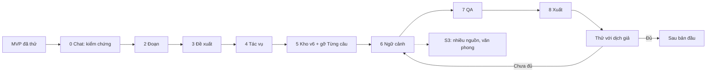

# Lộ trình theo module

Cập nhật: **2026-10-03** theo [ADR-005](../decisions/0005-ai-first-proposals-no-sentence-mode.md) (trước đó: 2026-09-29, theo mốc M0–M4 sau [ADR-002](../decisions/0002-ai-first-translation.md)) · Trạng thái: **thứ tự đã chốt**; mốc là điều kiện, không là ngày phát hành. Chủ trì: product + engineering. Mã yêu cầu ở [mapping](../research/feature-map.md); thiết kế từng module ở [kiến trúc AI-first](../engineering/ai-first-architecture.md).

## Nguyên tắc quy trình

1. **MVP đã dựng xong để thử nghiệm; từ đây làm lại hoàn chỉnh từng module.** Mã MVP là tham chiếu, không phải ràng buộc.
2. **Mỗi module là một change openspec riêng**, xong khi có spec, test và nghiệm thu. Chỉ sang module kế khi module trước xong. Module thay mã MVP thì xóa mã MVP và spec cũ cùng change, không để chế độ ẩn.
3. **Giao diện xem được sớm, nhưng trên dữ liệu thật mỏng.** Mỗi màn mới đọc/ghi qua kho SQLite thật, không dựng state giả trong renderer.
4. **Provider giả lập (mock) offline là một provider hợp lệ**: toàn luồng AI xem và kiểm thử được khi chưa có khóa API hoặc mạng.
5. **Một chương xuyên suốt trước khi mở rộng**: nhập → AI dịch → duyệt → sửa → xuất trên một chương, rồi mới nhiều chương, nhiều nguồn, văn phong.
6. Mỗi mốc qua cổng bằng bằng chứng (bài kiểm chứng), không bằng số màn hình.

## Kết quả của bản MVP

Đã dựng và chạy được trong Electron (chi tiết, bằng chứng và số đo ở [hiện trạng](../engineering/current-state.md)):

- **Nền dữ liệu** (2026-09-29 đến 10-01): kho SQLite hai tầng (`library.db` + một tệp `.mira` mỗi tác phẩm), IPC có kiểu, thư viện thật, danh sách chương, backup/restore, test kill tiến trình.
- **Editor**: hai pane CodeMirror 6, Live Preview nhẹ, nhúng ảnh (Reading view đã bị gỡ khỏi giao diện); IME Telex/VNI/Pinyin đã thử tay ngày 2026-10-01 trên bản tối thiểu ([ADR-003](../decisions/0003-technology-stack.md)).
- **AI**: kết nối bằng API key (một adapter tương thích OpenAI, nhiều khóa), dịch một chương (vòng lặp ở renderer), panel Hỏi AI có streaming và duyệt đề xuất tại chỗ.
- **Mode Từng câu**: đã dựng, đã ẩn khỏi giao diện, **bị hủy** ở ADR-005.
- **Cấu trúc mã nguồn** (2026-10-03): bốn tầng `infra` < `services` < `ipc` < `electron`, luật ranh giới do lint ép.

**Chưa kiểm chứng:** chưa gọi nhà cung cấp AI thật lần nào (hình dạng lỗi 429 và SSE trong test là giả định); chưa ai nhìn thấy panel Hỏi AI và hộp thoại dịch chạy trong Electron thật; chưa có fixture văn bản thật.

## Trình tự

Số module trùng với [kiến trúc AI-first mục 10](../engineering/ai-first-architecture.md#10-lộ-trình-theo-module), nơi có việc chi tiết và điều kiện xong đầy đủ. Bảng này chỉ tóm tắt và là nơi theo dõi trạng thái giao hàng.

| Module | Đầu ra | Điều kiện qua | Trạng thái |
| --- | --- | --- | --- |
| 0 Chat Hỏi/Sửa | Panel Hỏi AI chạy thật, đã kiểm chứng với nhà cung cấp thật | Bảy task còn mở của change `ai-chat` đóng: fixture SSE thật, lái tay Electron, đo tỷ lệ `Ctrl+Z` | Code xong (52/59 task), **chưa kiểm chứng** |
| 1 Quyết định | ADR-005 và tài liệu theo nó | Chủ sản phẩm chốt Q1–Q3 | **Xong 2026-10-03** |
| 2 Đoạn | Định nghĩa đoạn (mỗi dòng không trống) và nhập raw chỉ chuẩn hóa | Số đoạn hai bên khớp sau khi AI dịch trên fixture ZH/JA/EN | Chưa làm |
| 3 Đề xuất | Bảng `proposal` + `text_snapshot`; dịch một chương ghi thẳng khi pane trống, thành đề xuất khi đã có chữ; duyệt bằng `chatReview.ts` | Dịch đè lên chương có chữ không đổi chữ nào khi người dùng bỏ hết đề xuất | Chưa làm |
| 4 Tác vụ | `JobRunner` trong main, lưu bền; sổ `usage`; trần chi phí; khu vực Tác vụ thật | Kill app giữa tác vụ, mở lại thì tiếp tục đúng chương, đúng lô, không dịch lại đoạn đã ghi | Chưa làm |
| 5 Kho v6, gỡ Từng câu | Bỏ `segment`/`link`/`link_member`/`provenance`, thêm `ai_mark`; xóa mã mode Từng câu và kênh `links:*`/`rows:*` | Test kho, editor, crash qua; mở được tệp v5 cũ; không còn tham chiếu tới mode đã bỏ | Chưa làm |
| 6 Ngữ cảnh | `context-core`: thuật ngữ, xưng hô, văn phong; `buildContext` dùng chung; lượt sau mỗi chương | Bước kiểm chứng của [nghiên cứu ngữ cảnh](../research/story-context.md#bước-kiểm-chứng); người dùng duyệt được đề xuất xưng hô | Chưa làm (0/41 task) |
| 7 QA | Kiểm tất định: tên sai glossary, xưng hô lệch, số đoạn, độ dài bất thường, còn chữ nguồn | Bắt được lỗi cài sẵn trên fixture | Chưa làm |
| 8 Xuất | `.md`/`.txt` từ hàm chiếu Markdown; xuất để đăng | Xuất rồi nhập lại giữ nguyên chữ | Chưa làm |
| Thử nghiệm | Build Windows, máy sạch, phiên quan sát với 5–8 dịch giả (ưu tiên người đang dịch bằng AI) | Không lỗi mất nội dung đã lưu; người dùng tự hoàn tất vòng; kết quả theo cặp ngôn ngữ | Sau module 8 |
| S3 | Nhiều nguồn raw, văn phong từ bản dịch cũ, xưng hô và glossary tự cập nhật | Đo chất lượng với/không có nguồn phụ và ví dụ văn phong trên corpus | Sau module 6; **văn phong và căn chỉnh bản cũ chưa có thiết kế** (ADR-005) |
| 9 AI ngoài | Cổng MCP/CLI, chỉ đề xuất | Cần ADR riêng; một agent ngoài đề xuất sửa được mà không ghi thẳng được | Tùy chọn, sau bản đầu |

## Công việc gần nhất

1. **Đóng bảy task của `ai-chat`**: gọi Gemini thật để lấy fixture SSE và hình dạng lỗi giữa dòng (1.1–1.4), lái tay panel trong Electron (10.2, 12.5), đo tỷ lệ `Ctrl+Z` sau Áp dụng (10.3).
2. **Thu bộ fixture** văn bản thật ZH/JA/EN có quyền sử dụng, kèm bản dịch tham chiếu, để chốt Q3 và làm bài kiểm chứng của module 2.
3. **Viết change cho module 2 và 3** (đoạn, đề xuất) sau khi có fixture.
4. Chạy lại bảng ca IME ([imeCases.md](../../../src/renderer/src/features/editor/imeCases.md)) cho các phần mới của editor: Live Preview ẩn dấu, nhúng ảnh, review đề xuất. Rủi ro IME của phần ẩn dấu chưa được đo bằng tay.

## Điều kiện dừng mở rộng

Nếu văn bản bị mất/nhân đôi khi nhận/bỏ đề xuất, bản dịch AI gắn sai đoạn âm thầm, hoặc restore không đáng tin: sửa lõi trước. Nếu tác vụ AI không tiếp tục được sau lỗi mạng/giới hạn tốc độ: sửa hàng đợi trước khi thêm provider. Nếu phiên quan sát cho thấy dịch giả cần soát và đánh dấu theo từng câu: mở lại Q2 của ADR-005 trước khi thêm tính năng mới.

---

[Mục lục handbook](../README.md)
