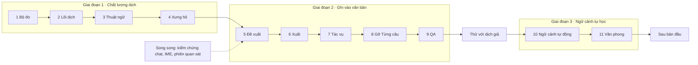

# Lộ trình theo module

Cập nhật: **2026-10-04**: chi tiết hóa module Lõi dịch sau khi Bộ đo hoàn tất phần hạ tầng offline. Thứ tự ưu tiên được chốt ngày 2026-10-03 theo [ADR-005](../decisions/0005-ai-first-proposals-no-sentence-mode.md).

**Trạng thái:**
- **Hướng ưu tiên đã chốt** (chủ sản phẩm, 2026-10-03): cải thiện khả năng dịch trước khi làm kỹ luồng áp dụng đề xuất; đo trước khi cải tiến; thuật ngữ trước xưng hô; cache là phép đo, không phải tính năng riêng.
- **Cách chia module, đầu ra và điều kiện qua là đề xuất**, chốt từng module khi viết change openspec của nó.
- Mốc là điều kiện, không phải ngày phát hành.

**Chủ trì:** product + engineering.

**Căn cứ:** [chất lượng dịch](../research/translation-quality.md), [ngữ cảnh truyện đợt 1](../research/story-context.md) và [đợt 2](../research/context-system.md), [chia lô](../research/chunking-translation.md), [lõi AI](../research/ai-core-architecture.md). Ràng buộc kỹ thuật mà mọi thứ tự phải giữ nằm ở [kiến trúc AI-first mục 10](../engineering/ai-first-architecture.md#10-lộ-trình-theo-module). Mã yêu cầu ở [mapping](../research/feature-map.md) và [scope](../product/scope.md).

## Vì sao đổi thứ tự

- **Bản dịch là chỗ hở lớn nhất.** Luồng hiện chạy một chương nhưng `ChapterTranslator` chưa gửi
  ngữ cảnh truyện vào request; prompt dịch vẫn mỏng. Mục model chưa đặt gì không gửi tham số sinh
  riêng ([hiện trạng](../engineering/current-state.md), [chất lượng dịch](../research/translation-quality.md)).
- **Bộ đo đã có phần hạ tầng offline.** B1/B2a/B3 là bằng chứng khởi điểm; T1 chưa hiệu chuẩn, nên quyết định chất lượng của Lõi dịch cần T0 và người chấm mù trên dữ liệu được khai báo trước.
- **Luồng áp dụng đề xuất chỉ đáng làm kỹ khi thứ được áp dụng đã tốt.** Làm đường ghi trước không làm bản dịch tốt hơn.
- **Đổi thứ tự không phá ràng buộc nào của ADR-005.** Đề xuất vẫn đi trước Gỡ Từng câu, vì đường dịch MVP ghi theo hàng. Lõi của `context-core` (khớp, lắp, kiểm) nghiệm thu được bằng mock trước khi có đề xuất hay tác vụ; chỉ việc lưu băm phải chờ.

## Nguyên tắc quy trình

1. **MVP đã dựng xong để thử nghiệm; từ đây làm lại hoàn chỉnh từng module.** Mã MVP là tham chiếu, không phải ràng buộc.
2. **Mỗi module là một change openspec riêng**, xong khi có spec, test và nghiệm thu. Chỉ sang module kế khi module trước xong. Module thay mã MVP thì xóa mã MVP và spec cũ trong cùng change, không để chế độ ẩn.
3. **Đo trước, dựng sau.** Mọi thay đổi nhằm nâng chất lượng dịch phải có số trên Bộ đo, trước và sau. Bộ đo không thấy lợi thì không dựng tiếp phần đó, và ghi kết quả âm vào nghiên cứu.
4. **Giao diện xem được sớm, nhưng trên dữ liệu thật mỏng.** Mỗi màn mới đọc/ghi qua kho SQLite thật, không dựng state giả trong renderer.
5. **Provider giả lập offline là một provider hợp lệ.** Toàn luồng AI xem và kiểm thử được khi chưa có khóa API hay mạng. Riêng Bộ đo cần gọi thật.
6. **Một chương xuyên suốt trước khi mở rộng sang nhiều chương.** Một chương phải đi trọn nhập → dịch → duyệt → sửa → xuất (Giai đoạn 1 và module 5–6) rồi mới tới tác vụ nhiều chương, ngữ cảnh tự học và nhiều nguồn.
7. **Mỗi mốc qua cổng bằng bằng chứng** (bài kiểm chứng), không bằng số màn hình.

## Kết quả của bản MVP

Đã dựng và chạy được trong Electron. Chi tiết, bằng chứng và số đo ở [hiện trạng](../engineering/current-state.md).

- **Nền dữ liệu:** kho SQLite hai tầng, IPC có kiểu, thư viện thật, danh sách chương, backup/restore, test kill tiến trình.
- **Editor:** hai pane CodeMirror 6, Live Preview nhẹ, nhúng ảnh. IME Telex/VNI/Pinyin đã thử tay trên bản tối thiểu.
- **AI:**
  - Kết nối ba tầng (transport, gateway, mặt tiền); model là mục có cài đặt riêng.
  - Dịch một chương bằng vòng lặp lô ở renderer.
  - Panel Hỏi AI có streaming và duyệt đề xuất tại chỗ.
- **Mode Từng câu:** đã dựng, đã ẩn khỏi giao diện, **bị hủy** ở ADR-005.
- **Cấu trúc mã nguồn:** bốn tầng, luật ranh giới do lint ép.

**Đã kiểm với nhà cung cấp thật:**
- Gemini thật được gọi một lần qua lớp kết nối (9 kịch bản).
- Đo tham số trên Gemini 3.x.
- Một ảnh chụp chat chạy trong Electron, có `usage` thật.

**Chưa kiểm chứng:**
- Hộp thoại dịch chương chưa chạy trọn đường với nhà cung cấp thật trong Electron.
- Chưa có phép A/A live bằng judge ngoài họ model dịch hoặc bộ chấm người đủ để đặt ngưỡng T1.

**Đã có cho bước kế:** fixture ZH/JA/EN, output B1/B2a/B3 có thể chấm lại, công cụ T0/T3 và V14;
xem [kết quả Bộ đo](../../modules/measurement/results.md). Runner `translate.run.ts` cần cập nhật
theo API thư viện/translator hiện hành rồi chạy kiểm bằng mock trước khi tạo baseline mới.

## Trình tự

**Số là thứ tự, tên mới là mã.** Các trang khác gọi module bằng tên (ví dụ "module Đề xuất") để lần đổi thứ tự sau không phải sửa lại. Bảng ánh xạ số cũ nằm ở [cuối trang](#số-module-cũ).

| # | Module | Đầu ra (tóm tắt) | Điều kiện qua | Trạng thái |
| --- | --- | --- | --- | --- |
| 1 | **Bộ đo** | Fixture ZH/JA/EN, analyzer T0, runner tái hiện, T1/T3 tùy chọn và báo cáo so sánh | Phần offline tái hiện được; V14 có bằng chứng; T1 luôn ghi trạng thái hiệu chuẩn | **Hoàn thành phần hạ tầng offline (2026-10-04):** xem [module Bộ đo](../../modules/measurement/README.md). T1 chưa được hiệu chuẩn A/A live và chưa là cổng quyết định sản phẩm |
| 2 | **Lõi dịch** | Một đường dịch trong service: lập lô, ID tạm, prompt, parse, đối soát và xử lý lỗi; adapter cho dữ liệu hiện tại | Chạy thật một chương; không mất/sai ID hoặc ghi đè chữ người; bằng chứng T0 và chấm mù theo [roadmap chi tiết](#2-lõi-dịch) | **Hoàn thành triển khai L0–L6 (2026-10-04):** lõi dịch độc lập trong `services/ai/translate/`, adapter `ChapterTranslator`, đối soát ID tạm `[n]`, parser khoan dung, chia lô theo token/đơn vị, vòng hỏi lại (repair) và phân tầng prompt |
| 3 | **Thuật ngữ** | Lát 1 của `context-core`: mục thuật ngữ, tầng khớp, chèn tầng C, kiểm tuân thủ; màn Thuật ngữ thật; nhập `Names.txt` | Tuân thủ thuật ngữ tăng rõ so với không glossary; mục chưa duyệt không rời máy | **Hoàn thành (2026-10-04):** Schema v6 (`context_entry`, `context_alias`), CRUD theo chương, `namesParser` (`Names.txt`), `contextMatching` (longest-match CJK, word-boundary Latin), `glossaryCompliance`, tiêm Layer C vào Prompt Builder, privacy guard cho mục unapproved, UI `GlossaryScreen` thật nối IPC |
| 4 | **Xưng hô** | Lát 2 của `context-core`: nhân vật, cặp xưng hô có hiệu lực theo chương, tầng B; màn Xưng hô | Số đại từ sai cặp giảm so với không ma trận (V3) | **Hoàn thành (2026-10-04):** Nhân vật và bí danh (`character`), quan hệ có chiều độc lập (`dyad`), hiệu lực theo chương, tiêm Layer B (`formatAddressingLayerB`) vào Prompt Builder, kiểm tra tuân thủ thuần (`addressingCompliance.ts`), privacy guard cho mục unapproved, UI `AddressingScreen` thật nối IPC |
| 5 | **Đề xuất** | Đường duyệt cho mọi kết quả AI, kể cả pane trống; phiên và hàng chờ theo tác phẩm/chương; xem [module](../../modules/proposals/README.md) | V11, V12 | Chưa làm |
| 6 | **Xuất** | `.md`/`.txt` từ hàm chiếu Markdown | Xuất rồi nhập lại giữ nguyên chữ | Chưa làm |
| 7 | **Tác vụ** | `JobRunner` trong main, lưu bền; sổ `usage`; trần chi phí; khu vực Tác vụ thật; lịch gửi giữ cache | V13 | Chưa làm; **chặn bởi Q4** |
| 8 | **Gỡ Từng câu** | Gỡ `segment`/`link`/`link_member`/`provenance`, thêm `ai_mark`; nhập raw chỉ chuẩn hóa; gỡ mã mode và kênh `links:*`/`rows:*` | Test kho, editor, crash qua; mở được tệp v5; V03, V15 | Chưa làm |
| 9 | **QA** | Hiện cờ T0 theo đoạn; dịch lại đoạn bị cờ thành đề xuất | Bắt được lỗi cài sẵn trên fixture | Chưa làm |
| — | **Thử với dịch giả** | Build Windows, máy sạch, phiên quan sát 5–8 dịch giả | Không mất nội dung; người dùng tự đi hết vòng; kết quả theo cặp ngôn ngữ | Sau module 9 |
| 10 | **Ngữ cảnh tự động** | Tóm tắt song ngữ mỗi chương, trích mục mới vào hàng chờ duyệt, tên chốt theo lần dịch đầu, đánh dấu "nên xem lại" | Bước 3, 5 của ngữ cảnh đợt 1; V6 của đợt 2 | Chưa làm |
| 11 | **Văn phong** | Ví dụ lấy từ đề xuất đã duyệt, ghi chú văn phong rút từ chỗ sửa | V4, V5 của ngữ cảnh đợt 2 | Chưa làm |

## Giai đoạn 1 — Chất lượng dịch

Cả bốn module làm trên **một chương mỗi lần**. Trước module Đề xuất, đường app còn lưu/ghi theo
segment; phép đo của Lõi dịch phải có nhánh gửi đoạn thật theo ADR-005. Điều này được ghi rõ ở
[ranh giới chuyển tiếp](#2-lõi-dịch).

### 1. Bộ đo

Hạ tầng offline đã có fixture, T0, runner/rescore/compare và công cụ T3. V14 giữ định nghĩa đoạn
ADR-005. T1 cần A/A ngoài họ model dịch và đối chiếu người trước khi đặt ngưỡng tin. Contract,
giới hạn và kết quả hiện nằm tại [module Bộ đo](../../modules/measurement/README.md). Riêng đường
dịch live của runner phải được cập nhật theo API app ở mốc L0 bên dưới; `check.mjs` hiện không biên
dịch tệp `scripts/bench/*.run.ts`.

### 2. Lõi dịch

**Mục tiêu:** mỗi đoạn nguồn được gửi và nhận về dưới một ID tạm, có thể giải thích đoạn nào thành
công, đoạn nào cần thử lại và tiền đã dùng. Thay phần prompt/chia lô/parse/đối soát đang nằm trong
`openAiCompatible.ts`; giữ gateway và transport hiện có. Căn cứ:
[chất lượng dịch](../research/translation-quality.md#prompt-và-tham-số-module-lõi-dịch) G1–G6,
[chia lô](../research/chunking-translation.md#suy-luận-cho-mira) C1–C6 và
[lõi AI](../research/ai-core-architecture.md#các-thay-đổi-cụ-thể) D1/D3/D5.

**Ranh giới chuyển tiếp:** dữ liệu tác phẩm và `ChapterTranslator` hiện còn dùng segment/row;
[ADR-005](../decisions/0005-ai-first-proposals-no-sentence-mode.md) đã chốt đoạn là mỗi dòng không
trống. Lõi mới nhận các đơn vị `{id, text}` và giữ ánh xạ ID nội bộ; adapter của luồng đang chạy có
thể cấp segment ID để giữ an toàn dữ liệu. Thí nghiệm chất lượng phải gửi **đoạn thật** từ fixture.
Module Đề xuất mới chuyển đường ghi của app sang đoạn. Vì thế không dùng kết quả adapter segment để
tuyên bố đã giải quyết lỗi gộp câu theo đoạn.

| Mốc | Việc làm và đầu ra | Bằng chứng để đi tiếp |
| --- | --- | --- |
| **L0 · Làm sạch đường đo và khóa hợp đồng** | Chấm lại output B1 như mốc lịch sử; cập nhật `scripts/bench/translate.run.ts` theo API hiện hành (`LibraryStore.create`, `ChapterTranslator.plan/runBatch` nhận object) và thêm kiểm chạy bằng mock vào gate. Sau đó tạo baseline mới với revision fixture, tập chỉnh/tập đánh giá, cấu hình và chỉ số chính đã khai báo. Đặc tả input `{id, text}`, ánh xạ `[n]`, output theo ID, usage và lỗi; ghi trạng thái `draft` của oracle. | Runner bench chạy được bằng mock và typecheck riêng; baseline mới có hồ sơ tái hiện. Có ca 1–1, sót, trùng, đảo thứ tự, ID lạ, đoạn dài và hủy; report chỉ ghi metric. |
| **L1 · Tách một đường dịch** | Chuyển prompt, planner, parser, đối soát và vòng sửa lỗi sang `services/ai/translate/`. `openAiCompatible.ts` còn gọi transport/gateway và chat; `ChapterTranslator` dùng lõi qua adapter hiện tại. Xóa đường dịch MVP trùng sau khi thay xong. | Mock provider và test hồi quy cho plan → một lô → lưu/giữ đề xuất qua; hủy và xung đột revision không ghi đè chữ người; chat không đổi hành vi. |
| **L2 · Bảo toàn đoạn và lô** | Planner thuần cắt theo nguồn bằng cả trần token và trần số đoạn, có xử lý một đoạn quá dài bằng mảnh tạm rồi ráp về đúng ID gốc. Gửi ID tạm `[n]` theo từng request; parser khoan dung trong các sửa lỗi cú pháp xác định được, đối soát đúng tập ID. | Chạy spike cỡ lô C1 trên ZH/JA/EN; không có gán nhầm ID, mất nội dung im lặng hoặc lô vượt trần đã khai. Ghi tỉ lệ thiếu/trùng ID, đầu ra bị cắt, số lượt gọi và usage. |
| **L3 · Prompt và ngữ cảnh tối thiểu** | Dựng prompt có version/hash: brief, yêu cầu dịch đủ, hợp đồng đoạn, quy ước tiếng Việt chung và phụ lục theo nguồn. Tách chỗ nhận A ổn định, B theo chương, C theo lô; tính `contextHash` từ payload thực gửi, để Context nối adapter về sau. Đầu vào riêng cho quy ước người dịch; Nhật không có lựa chọn thì giữ hậu tố gắn tên theo [quyết định hiện hành](../product/decisions.md). Chỉ gửi ngữ cảnh liền trước nếu thí nghiệm C5 cho thấy ích lợi. | B2 so từng biến với baseline trên cùng fixture và repeat; T0 không xuất hiện sót/trùng nghiêm trọng, người chấm mù đánh giá nghĩa và tự nhiên. Giữ riêng kết quả không chắc/âm. |
| **L4 · Tham số và định dạng** | B3 đo thinking, temperature, trần output có dự phòng thinking theo từng model/endpoint; B4 so định dạng đầu ra sau khi parser ổn. Tham số người dùng đặt vẫn có hiệu lực; giá trị mặc định theo tác vụ chỉ được gửi khi đã chọn và hiển thị trong plan. B5 kiểm endpoint bằng lời gọi thật có cấu hình tường minh. | Report có tham số thực gửi, `finishReason`, usage, thời gian, lỗi rỗng/`length` và chi phí. Không suy mặc định của mọi model từ B3 trên Gemini 2.5 Flash. |
| **L5 · Sửa đúng phần lỗi** | Tách lỗi hạ tầng (gateway chịu retry/cooldown) khỏi lỗi nội dung. Lõi chấp nhận mục hợp lệ, hỏi lại đúng ID thiếu/hỏng có lý do một lần; khi lô bị cắt thì chia nhỏ phần chưa xong. T0 chỉ gắn cờ nghi vấn; lần dịch lại có nguồn và kết quả được đối soát trước khi chọn. | Fixture lỗi có 429/timeout, JSON hỏng, `length`, một đoạn “độc” và hủy giữa lô; không chia nhỏ chỉ vì 429, không lặp vô hạn, cộng usage của mọi lượt đã gọi. Mục lẻ hỏng được báo rõ để người xem. |
| **L6 · Nối app và nghiệm thu** | Chạy một chương trọn đường với mock rồi provider thật trong Electron; hộp thoại cho thấy cấu hình thực gửi, tiến độ, mục thất bại và chi phí/usage biết được. Xóa import mã dịch cũ, cập nhật tài liệu và baseline mới. | `node scripts/check.mjs --build` đạt; thử hủy, sửa tay giữa lúc chạy và dịch lại chương có chữ; báo cáo T0/T3 trên tập đánh giá độc lập, không lộ truyện riêng tư. |

**Cổng chất lượng:** đăng ký trước phép so sánh và dùng cùng chương/cấu hình/repeat. Chỉ dùng baseline
mới qua L0 cho so sánh trực tiếp; B1/B2a/B3 là bằng chứng lịch sử. T0 là cổng an
toàn cho thiếu, trùng, sai ID; chữ nguồn còn sót, cờ độ dài, glossary nháp và khác kiểu thoại cần
người xem lại. T3 chấm mù có phân tầng theo chương/ca khó, báo cả hòa và khoảng tin cậy. Bản dịch
AI cũ không được coi là bản tham chiếu của người dịch. Nếu dữ
liệu chưa đủ tách thắng/thua, ghi **chưa đủ bằng chứng** và bổ sung mẫu thay vì tự đổi ngưỡng. T1
chỉ là tín hiệu phụ cho tới khi A/A ngoài họ model dịch và đối chiếu người hoàn tất ở
[Bộ đo](../../modules/measurement/metrics-and-judging.md#t1--judge-llm-tùy-chọn). So nghĩa, độ tự nhiên,
lỗi cấu trúc, chi phí và độ trễ cùng nhau; không dùng một điểm tổng duy nhất.

**Không thuộc change Lõi dịch:** schema/màn Glossary và Xưng hô, người duyệt đề xuất theo đoạn,
job nhiều chương bền vững, QA UI, tự trích ngữ cảnh, refine cả chương. Các module sau gọi cùng lõi
dịch qua interface đã ổn định. Cache chỉ đo trên payload thật; tối ưu cache khi tầng ngữ cảnh đủ
dữ liệu, không kéo dài prompt để đạt ngưỡng.

**Chỗ cần chốt trong OpenSpec trước khi code:** kích thước lô sau spike L2; cách ráp một đoạn quá
dài; những biến thể JSON parser được sửa an toàn; policy ưu tiên tham số tác vụ so với mục model;
quy ước nào có UI/cấu hình ngay ở L3. Những câu này là lựa chọn triển khai, chưa tự thành quyết
định sản phẩm chỉ vì có trong roadmap.

### 3. Thuật ngữ (Đã hoàn thành 2026-10-04)

Lát 1 của change `context-core`; change đó được tách khi bắt đầu module này. Căn cứ: [ngữ cảnh đợt 1](../research/story-context.md) đề xuất 1, 10, 11; [đợt 2](../research/context-system.md) K4, K7; scope S2.3.

- **Bảng mục ngữ cảnh** theo D1 của `context-core` (một bảng cho mọi kiểu), nhưng chỉ mở kiểu `term`: alias, term cấm, hiệu lực theo chương, trạng thái duyệt. Số version schema chốt lúc làm.
- **Tầng khớp:** khớp dài trước, chuỗi con cho ZH/JA, biên từ cho EN, chặn mục quá ngắn, khớp qua alias.
- **Chèn mục đã khớp ở đầu tầng C**, chỉ mục đã duyệt (K4).
- **Kiểm tuân thủ** (hàm từ Bộ đo) chạy sau mỗi lô. Đoạn thiếu thuật ngữ được hỏi lại một lần, kèm danh sách mục chưa thỏa (R2).
- **Kênh IPC và màn Thuật ngữ thật** trong khu vực Ngữ cảnh: danh sách, tìm, thêm/sửa/xóa, alias, term cấm, nhập `Names.txt`/`VietPhrase.txt` (S2.3). Tab Thuật ngữ thôi là minh họa.
- **Panel Hỏi AI đọc thuật ngữ** qua cùng `buildContext`.
- **Thí nghiệm quyết định** (bước 1 của ngữ cảnh đợt 1): nhồi cả glossary vào tầng A so với lọc theo đoạn ở tầng C. Thí nghiệm này trả lời mục 13 "điều có thể bác bỏ".
- **Điều kiện qua:**
  - Tuân thủ thuật ngữ (T0) tăng rõ so với không glossary, có khoảng tin cậy; T1 không xấu đi về độ tự nhiên.
  - Test "mục chưa duyệt không rời máy" qua.
  - Người dùng quản lý được thuật ngữ trên màn thật, và dịch trong app dùng thuật ngữ đã duyệt.
- **Để sau:** AI tự trích (module 10); đánh dấu "nên xem lại" khi mục đổi (cần `proposal`/`job_item`).

### 4. Xưng hô

Lát 2 của `context-core`. Căn cứ: [ngữ cảnh đợt 1](../research/story-context.md) đề xuất 3–5; [đợt 2](../research/context-system.md) K5; scope S2.4.

- **Kiểu `character`** (giới tính, một dòng vai) và **kiểu `dyad`** (người nói → người nghe, tự xưng, gọi, mức, từ chương nào).
- **Dàn nhân vật của chương**, và **tầng B** gồm các cặp có hiệu lực cho dàn đó. Cặp chưa khai thì gửi chỉ dẫn trung tính và gắn cờ.
- **Màn Xưng hô:** xem và sửa ma trận ("màn xem ưu tiên trước", câu hỏi P0).
- **Kiểm xưng hô chỉ ở mức cảnh báo** (K5).
- **Thí nghiệm V2/V3** của đợt 2. Chỉ dựng lượt gán người nói/người nghe mỗi chương nếu V3 cho thấy nó hơn rõ ma trận theo dàn nhân vật.
- **Đo cache lần 2:** tầng A + B trên Gemini 3.x.
- **Điều kiện qua:**
  - V3: ma trận giảm số đại từ sai cặp so với không ma trận.
  - Người dùng xem và sửa được ma trận.
  - Mục chưa duyệt không vào prompt.
- **Ngoại lệ thứ tự:** nếu bước 3 của ngữ cảnh đợt 1 (tóm tắt chương trước) cho lợi rõ trên Bộ đo, phần tóm tắt của module 10 được kéo lên ngay sau module này.

## Giai đoạn 2 — Ghi vào văn bản, rồi nhiều chương

### 5. Đề xuất

Yêu cầu, quyết định, luồng duyệt, dữ liệu và các câu hỏi kỹ thuật nằm tại
[Module Đề xuất và phiên AI](../../modules/proposals/README.md). Phần việc của mốc này là đường
đề xuất cho mọi kết quả AI, phiên/lịch sử theo tác phẩm và hàng chờ điều hướng giữa chương. Kiểm
[V11–V12](validation.md) và [bảng ca IME](../../../src/renderer/src/features/editor/imeCases.md)
trước nghiệm thu. Chạy và phục hồi tác vụ dịch nhiều chương thuộc mốc 7.

### 6. Xuất

- Xuất `.md`/`.txt` từ hàm chiếu Markdown (S1.8); ảnh theo giả định Q7.
- Module này khép vòng một chương (nguyên tắc 6).
- **Điều kiện qua:** xuất rồi nhập lại giữ nguyên chữ.

### 7. Tác vụ

- **`JobRunner` trong main, lưu bền:** `job`, `job_item` (lưu `contextHash` và danh sách mục đã gửi).
- **Sổ `usage`** ở `library.db`.
- **Trần chi phí mỗi tác vụ:** chặn bởi Q4.
- **Khu vực Tác vụ thật.**
- **Lịch gửi giữ cache** (K2): lô đầu của mỗi chương gửi một mình; `prompt_cache_key` hoặc `session_id` theo provider.
- **Ước lượng chi phí** biết thinking, giá theo ngày hiệu lực, giá theo giờ của DeepSeek, hệ số tokenizer (R7).
- **Điều kiện qua:** V13. Kill app giữa tác vụ, mở lại thì tiếp tục đúng chương và đúng lô, không dịch lại đoạn đã ghi.

### 8. Gỡ Từng câu

- Gỡ `segment`, `link`, `link_member`, `provenance` và trigger; thêm `ai_mark`.
- Nhập raw chỉ chuẩn hóa và lưu.
- Gỡ mã mode Từng câu, kênh `links:*`/`rows:*`, `targetIds` của chat, cùng các mục minh họa của mode trong backlog.
- **Điều kiện qua:**
  - Mọi test của kho, editor và crash qua.
  - Mở được tệp `.mira` v5 cũ (V15).
  - V03 qua.
  - Không còn tham chiếu tới mode đã bỏ.

### 9. QA

- Hiện cờ T0 theo đoạn, trong editor và ở khu vực Tác vụ (S2.5).
- "Dịch lại đoạn bị cờ" tạo **đề xuất**, không ghi thẳng.
- Nếu B6 cho thấy lượt soát chọn lọc thắng về độ đúng nghĩa theo người chấm, thêm tùy chọn đó kiểu Diagnose-then-Repair, mặc định tắt (R3).
- **Điều kiện qua:** bắt được lỗi cài sẵn trên fixture; không cờ nào tự sửa chữ.

**Thử với dịch giả** là cổng sau module 9: build Windows, máy sạch, phiên quan sát với 5–8 dịch giả, ưu tiên người đang dịch bằng AI ([kế hoạch kiểm chứng](validation.md)). Kết quả quyết định thứ tự trong Giai đoạn 3.

## Giai đoạn 3 — Ngữ cảnh tự học

### 10. Ngữ cảnh tự động

- **Lượt sau mỗi chương:**
  - Tóm tắt song ngữ đưa vào tầng B.
  - Trích thuật ngữ, nhân vật và cặp xưng hô mới vào hàng chờ duyệt (K7, không tự duyệt).
  - Tên chốt theo lần dịch đầu (đợt 1, đề xuất 9).
- **Đánh dấu "nên xem lại"** khi một mục đổi, theo danh sách mục đã gửi (K8). Cần `proposal`/`job_item`.
- **Điều kiện qua:** bước 3 và 5 của đợt 1; V6 của đợt 2.

### 11. Văn phong

- Ví dụ lấy từ đề xuất đã duyệt (BM25, 3–5 cặp).
- Ghi chú văn phong rút từ chỗ người sửa, vào hàng chờ duyệt (K6).
- Cách này trả lời câu hỏi mở P1 mà không cần căn chỉnh.
- **Điều kiện qua:** V4, V5 của đợt 2. Cần vài chương đã duyệt.

## Sau bản đầu

- **Nhiều nguồn raw** (S3.1).
- **AI ngoài** qua MCP/CLI: cần ADR riêng, Q6.
- **Lượt refine toàn chương:** không làm, trừ khi có số đo mới (R1).
- **Batch API**, **chuỗi chuyển kết nối khi cạn khóa**, **OAuth OpenRouter**: xem [backlog](backlog.md).

## Việc song song, không chặn

| Việc | Trước module nào | Ghi chú |
| --- | --- | --- |
| Kiểm chứng chat: fixture SSE thật, lái tay có hệ thống, đo tỷ lệ `Ctrl+Z` sau khi nhận (task 1.x, 10.2, 10.3, 12.5 của change `ai-chat`) | Đề xuất | Change `ai-chat` đã bị gỡ khỏi `openspec/changes/` ngày 2026-10-03; các task chuyển về đây |
| `ai-provider-live-verification`: thân 429 thật, mốc reset theo ngày | Tác vụ | Tài liệu Google ghi hạn mức theo project, không theo khóa ([chất lượng dịch](../research/translation-quality.md) Quan sát 5) |
| Chạy lại bảng ca IME cho Live Preview ẩn dấu, ảnh, merge view | Đề xuất | [imeCases.md](../../../src/renderer/src/features/editor/imeCases.md) |
| Phiên quan sát của ADR-005: dịch giả có soát theo câu không | Đề xuất | Có thể làm với bản MVP hiện tại |
| Màn Cài đặt nói rõ free tier của Gemini dùng dữ liệu để cải thiện sản phẩm | Lõi dịch | R8; một phần câu hỏi mở "dữ liệu nào được gửi đi" |

## Bộ đệm (cache) nằm ở đâu

Có hai thứ cùng gọi là "cache". Không thứ nào là một module riêng.

1. **Bộ đệm prompt của nhà cung cấp** tự động khớp theo tiền tố. Nó giảm tiền đọc tiền tố còn khoảng 0,1 lần, nhưng không làm bản dịch tốt hơn.
   - Mira chỉ cần xếp tiền tố ổn định (tầng A → B → C, tuần tự hóa xác định; module Lõi dịch).
   - Đo `cached_tokens` thật: lần 1 ở Lõi dịch, lần 2 ở Xưng hô, vì Gemini 3.x cần tiền tố ≥ 4.096 token.
   - Lịch gửi giữ cache thuộc module Tác vụ.
   - Không dựng `cache_control` hay `cachedContents` ở bản đầu (K3).
2. **Cache kết quả theo đoạn** (đoạn giống hệt thì dùng lại bản dịch cũ) **chưa làm**. Bộ đo đếm tỷ lệ đoạn trùng trước. Việc "không dịch lại đoạn đã ghi" khi tiếp tục tác vụ thuộc module Tác vụ, không phải cache.

## Số module cũ

Bảng module 0–9 viết sáng 2026-10-03 (ADR-005) ánh xạ sang thứ tự này như sau. Changelog và các trang nghiên cứu cùng ngày còn dùng số cũ.

| Số cũ | Module cũ | Nay |
| --- | --- | --- |
| 0 | Chat Hỏi/Sửa: kiểm chứng | Việc song song |
| 1 | Quyết định ADR-005 | Xong 2026-10-03 |
| 2 | Đoạn | 1 Bộ đo |
| 3 | Đề xuất | 2 Lõi dịch (prompt, chia lô, ID) và 5 Đề xuất (đường ghi, đơn vị đoạn) |
| 4 | Tác vụ | 7 Tác vụ |
| 5 | Kho v6, gỡ Từng câu | 8 Gỡ Từng câu (số version schema chốt lúc làm) |
| 6 | Ngữ cảnh (`context-core`) | 3 Thuật ngữ, 4 Xưng hô, 10 Ngữ cảnh tự động, 11 Văn phong |
| 7 | QA | 9 QA; hàm kiểm dựng từ module 1 |
| 8 | Xuất | 6 Xuất |
| 9 | AI ngoài | Sau bản đầu |

## Công việc gần nhất

*(Cập nhật 2026-10-04.)* Bộ đo đã có hạ tầng offline và kết quả B1/B2a/B3; T1 còn chờ hiệu chuẩn.
Tiếp theo là viết change OpenSpec cho **Lõi dịch** theo L0–L6 ở trên, khóa hợp đồng và các phép
đo trước khi sửa đường dịch. Việc thẩm định oracle do người dịch làm song song; mục chưa duyệt
được gắn trạng thái nháp trong report. Khi tới Thuật ngữ, tách và rà lại change `context-core`
theo [roadmap module Ngữ cảnh](../../modules/context/roadmap.md).

## Điều kiện dừng mở rộng

- **Lõi phải sửa trước:** văn bản bị mất hoặc nhân đôi khi nhận/bỏ đề xuất; bản dịch AI gắn sai đoạn âm thầm; restore không đáng tin.
- **Hàng đợi phải sửa trước khi thêm provider:** tác vụ AI không tiếp tục được sau lỗi mạng hay giới hạn tốc độ.
- **Mở lại Q2 của ADR-005 trước khi thêm tính năng mới:** phiên quan sát cho thấy dịch giả cần soát và đánh dấu theo từng câu.
- **Không dựng tiếp phần cải tiến chất lượng:** lỗi mất/sai ID hoặc ghi đè chữ người xuất hiện; hoặc
  phép so đã đăng ký trước cho thấy hại rõ về nghĩa/cấu trúc mà lợi ích không bù được. Kết quả
  chưa đủ mẫu được ghi là chưa đủ bằng chứng, rồi đo thêm hoặc thu hẹp thay đổi.

---

[Mục lục handbook](../README.md)
