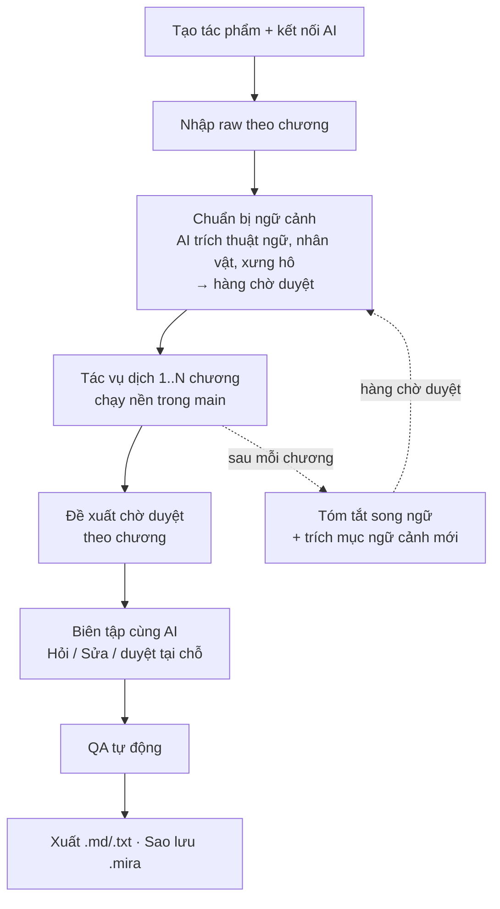
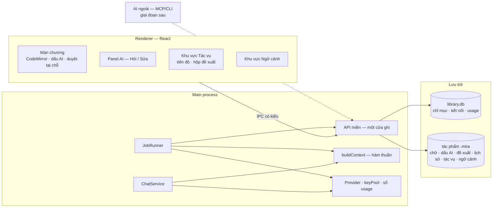

# Luồng làm việc và kiến trúc AI-first

Ngày: **2026-10-03** · Trạng thái: **hướng kiến trúc đã chốt ([ADR-005](../decisions/0005-ai-first-proposals-no-sentence-mode.md), 2026-10-03); thiết kế chi tiết của từng module vẫn là đề xuất cho tới khi change của module đó được duyệt.** Phần ghi *Quan sát* có nguồn (code hoặc URL, đọc 2026-10-03); phần ghi *Đề xuất* là thiết kế chờ làm thật và có thể đổi khi làm. · Chủ trì: product + engineering · Liên quan: [ADR-002](../decisions/0002-ai-first-translation.md), [ADR-003](../decisions/0003-technology-stack.md), [ADR-004](../decisions/0004-ai-provider-layer.md), [hiện trạng](current-state.md), [ngữ cảnh truyện](../research/story-context.md), [lộ trình theo module](../delivery/roadmap.md), change `ai-chat`, `context-core`.

> Đường ghi và vòng đời hội thoại của trang này được [Module Đề xuất](../../modules/proposals/decisions.md)
> cập nhật ngày 2026-10-04. Mục 5.1 nay chỉ còn đường dẫn; mô hình tổng thể khác giữ làm bối cảnh.

**Câu hỏi trang này trả lời:** chủ sản phẩm **bỏ mode Từng câu** và lấy **làm việc cùng AI** làm trọng tâm, với ý định ban đầu là "trình gõ như Obsidian, AI tác động được vào văn bản để đọc và sửa". Vậy luồng sử dụng và kiến trúc của Mira nên là gì?

**Quan hệ với ADR-005.** ADR-005 là bản ghi quyết định (bỏ Từng câu, đơn vị là đoạn, AI chỉ đề xuất, làm lại theo module). Trang này là **thiết kế đứng sau quyết định đó**: luồng, kiến trúc, mô hình dữ liệu, ba động cơ AI, lộ trình. Repo hiện tại là **bản MVP để thử nghiệm**; kiến trúc dưới đây là đích của việc làm lại từng module, không phải mô tả mã đang chạy (mã đang chạy ở [hiện trạng](current-state.md)). Các câu hỏi còn lại ở [mục 11](#11-quyết-định-và-câu-còn-mở).

---

## Tóm tắt

1. **Đơn vị làm việc là chương, bên trong là đoạn.** Bỏ ID bền cho từng câu và liên kết n:m giữa câu gốc và câu dịch. Đó là phần phức tạp nhất của kho, và chỉ mode Từng câu cần nó.
2. **Một nguồn sự thật có cấu trúc: SQLite (`.mira`), giữ nguyên.** Markdown là *cách chiếu* dữ liệu ra (cho editor, cho AI, để xuất), không phải nơi lưu. Notion làm vậy, và Logseq cũng phải quay về cách này.
3. **Một đường ghi duy nhất: người gõ thì ghi, AI thì đề xuất.**
   - Bản dịch đang trống: AI điền thẳng, kèm *dấu AI* đánh dấu vùng AI viết.
   - Bản dịch đã có chữ: AI tạo *đề xuất*, người duyệt từng khối ngay trong pane.
   - Luật này đã có trong chat (D12–D14 của `ai-chat`), nay áp cho mọi nguồn AI.
4. **Ba động cơ AI dùng chung một bộ dựng ngữ cảnh và một sổ chi phí:**
   - *Tác vụ dịch*: chạy trong main, lưu bền, dịch nhiều chương.
   - *Hỏi/Sửa*: panel chat.
   - *Ngữ cảnh*: thuật ngữ, nhân vật, xưng hô, tóm tắt.
5. **Một API miền, nhiều nơi gọi:** renderer qua IPC, AI trong app qua tool, và giai đoạn sau là AI ngoài (Claude Code, Cursor…) qua MCP/CLI. AI ngoài cũng chỉ đề xuất.
6. **Giữ Electron và `node:sqlite`.** Không chuyển Tauri, không đổi sang tệp làm nguồn sự thật, không dùng CRDT.
7. **Thứ tự làm:** chuyển tác vụ dịch sang đường đề xuất *trước*, rồi mới gỡ segment và liên kết, vì đường dịch hiện vẫn ghi theo hàng (`saveRow`). Từ 2026-10-03 lộ trình đặt **chất lượng dịch** (bộ đo, lõi dịch, thuật ngữ, xưng hô) trước cả hai. Ràng buộc kỹ thuật ở [mục 10](#10-lộ-trình-theo-module), thứ tự ở [lộ trình](../delivery/roadmap.md).

---

## 1. Bối cảnh: điều gì vừa đổi

### 1.1 Quyết định trước ADR-005 (Quan sát)

Ba quyết định dưới đây là nền lúc viết trang này. **ADR-005 thay hai ý của hai quyết định đầu** (hai mode, segment ID); luật "AI không âm thầm ghi đè" và ranh giới agent mode giữ nguyên.

- [ADR-002](../decisions/0002-ai-first-translation.md) chốt luồng chính: *nhập raw → chia segment → **AI dịch theo segment có ID** → soát ở Từng câu / sửa ở Toàn văn → QA → xuất.* ADR này giữ ràng buộc "hai mode" và "dữ liệu nội bộ có xuất/backup".
- [Quyết định hiện hành](../product/decisions.md) có dòng **Hai mode**: Toàn văn và Từng câu (kiểu Smartcat), cùng luật **"AI không âm thầm ghi đè văn bản người dùng đã sửa"**.
- [ADR-004](../decisions/0004-ai-provider-layer.md) đặt **agent mode** (AI tự chạy nhiều bước trên dữ liệu truyện) ra ngoài scope.

### 1.2 Định hướng mới (2026-10-03, đã ghi thành [ADR-005](../decisions/0005-ai-first-proposals-no-sentence-mode.md))

- Bỏ dịch từng câu, vì mục tiêu chính là làm việc với AI nhiều hơn.
- Ý định ban đầu: trình gõ kiểu Obsidian, AI đọc và sửa được văn bản.
- Repo tới nay là bản MVP để thử nghiệm; sắp tới làm lại hoàn chỉnh từng module theo trang này.

### 1.3 Code đang có liên quan (Quan sát)

| Mảnh | Ở đâu | Ghi chú |
| --- | --- | --- |
| Kho một tệp mỗi tác phẩm | [`workSchema.ts`](../../../src/main/infra/storage/workSchema.ts) | schema v5: `chapter_text`, `segment`, `link`, `link_member`, `provenance`, `cover`, `image` |
| Editor Toàn văn | [`TextEditor.tsx`](../../../src/renderer/src/features/editor/TextEditor.tsx) | CodeMirror 6, Live Preview nhẹ, ảnh `![[id]]` |
| Ánh xạ segment khi gõ | [`segmentMap.ts`](../../../src/shared/algorithms/segmentMap.ts), [`resegmenter.ts`](../../../src/renderer/src/features/editor/resegmenter.ts) | chia lại câu khi người dùng dừng gõ, chờ IME gõ xong |
| Mode Từng câu | [`SentenceMode.tsx`](../../../src/renderer/src/features/chapter/SentenceMode.tsx), [`sentenceRows.ts`](../../../src/main/infra/storage/sentenceRows.ts) | các kênh `links:list`, `rows:*` |
| Dịch chương bằng AI | [`useAiTranslate.ts`](../../../src/renderer/src/features/chapter/useAiTranslate.ts), [`chapterTranslation.ts`](../../../src/main/services/ai/chapterTranslation.ts) | **vòng lặp lô ở renderer**; ghi từng hàng qua `saveRow` theo ID segment; hàng người đã viết trả về để chọn |
| Chat Hỏi/Sửa | [`chatService.ts`](../../../src/main/services/ai/chatService.ts), [`chatTools.ts`](../../../src/main/services/ai/chatTools.ts), [`chatContext.ts`](../../../src/renderer/src/features/chapter/chatContext.ts) | stream qua `ai:chat:chunk`; 2 tool chỉ đọc; ngữ cảnh dựng ở renderer từ chữ đang mở |
| Duyệt đề xuất tại chỗ | [`chatReview.ts`](../../../src/renderer/src/features/editor/chatReview.ts) | `@codemirror/merge`, nhận/bỏ từng khối, không dựng lại editor nên giữ được undo |
| Phạm vi một lượt chat | [`chatRange.ts`](../../../src/renderer/src/features/editor/chatRange.ts) | đọc `segmentsField` để tính `targetIds` (kiểu `TargetRange`, `ChatRange` ở [`aiChat.ts`](../../../src/shared/contracts/aiChat.ts)). Trường này **chỉ được tạo ra, không nơi nào trong chat đọc** (grep ngày 2026-10-03), nên gỡ khi bỏ segment là việc nhỏ |
| Provider | [`openAiCompatible.ts`](../../../src/main/infra/providers/openAiCompatible.ts), [`keyPool.ts`](../../../src/main/infra/providers/keyPool.ts), [`classifyError.ts`](../../../src/main/infra/providers/classifyError.ts) | một adapter, nhiều khóa `fill-first`; `usage` chưa lưu (task 4.7b) |

Grep ngày 2026-10-03 thấy **37 tệp không phải test và 24 tệp test** nhắc tới segment, liên kết, hàng hoặc mode Từng câu (đếm rộng, nên là cận trên: có chữ trùng nghĩa khác, như lô gửi AI). Không phải tệp nào cũng bị xóa, nhưng đó là diện ảnh hưởng.

---

## 2. Học từ sản phẩm khác (Quan sát)

| | Obsidian | Notion | Logseq bản cũ (tệp) | Logseq 2.0 (DB) |
| --- | --- | --- | --- | --- |
| **Nguồn sự thật** | Tệp `.md` trong vault | DB block trên server | Tệp Markdown/Org | SQLite cục bộ |
| **Đơn vị có ID bền** | Tệp; khối phải chèn `^id` vào chữ | Mỗi block (UUID) | Khối, nhưng ID phải ghi `id::` vào tệp | Mỗi node |
| **Cách ghi** | Ghi đè tệp; `vault.process()` đọc-sửa-ghi nguyên tử | Operation gom thành transaction; server kiểm quyền và nhất quán | Ghi lại cả tệp | Transaction trong DB worker |
| **AI vào bằng** | Sửa tệp trực tiếp, hoặc Obsidian CLI (app phải chạy) | MCP: trang chiếu thành "Notion-flavored Markdown" | — | Xuất EDN/SQLite/Markdown |
| **Sửa đồng thời** | Tự gộp 3 chiều khi tệp đổi ngoài | CRDT (RGA + Peritext), triển khai 7/2025 | Mất dữ liệu khi sync nhiều máy | Đồng bộ RTC |

**Rút ra cho Mira:**

1. **Hai nguồn sự thật là gốc của mất dữ liệu.** Logseq bản cũ có tệp trên đĩa và DataScript trong RAM đuổi theo nhau. Đội Logseq tự liệt kê: thêm một khối phải ghi lại cả tệp, đổi tên trang phải sửa mọi tệp trỏ tới nó, không có ID và timestamp bền, sync nhiều máy mất dữ liệu, undo không tin được. Họ chuyển hẳn sang SQLite. Obsidian vẫn đứng được vì không cần ID dưới mức tệp, nhưng phải trả giá bằng loạt lỗi "modified externally, merging changes".
2. **Markdown là giao diện cho AI, không phải kho.** Notion không cho AI chạm vào block; AI đọc và viết Markdown, server mới đổi thành thao tác. Lý do họ nêu: tốn ít token và cần ít lần gọi tool hơn JSON.
3. **Mọi lần ghi là một thao tác qua một cửa** (transaction của Notion, `process()` của Obsidian), nên kiểm tra được, hoàn tác được và gộp được.
4. **AI ngoài đi qua app**, không mở thẳng kho: Obsidian CLI đòi app đang chạy và mọi lệnh đi qua app.
5. **Giữ hai đường song song làm chậm mọi thứ.** Logseq tách thành hai sản phẩm vì mỗi tính năng phải tính hai lần. Đây là lý do nên gỡ hẳn mode Từng câu, không để nửa sống nửa chết.
6. **Kết quả AI hiện ngay trong tài liệu và được nhận/bỏ tại chỗ** (Cursor, gợi ý sửa của Notion). Mira đã đi theo hướng này ngày 2026-10-03 với `chatReview.ts` (xem [nhật ký](../maintenance/changelog.md)).

Mira **đã** đứng đúng chỗ ở hai điểm: một nguồn sự thật SQLite, và editor kiểu Obsidian (CodeMirror, Markdown, Live Preview). Thứ còn thiếu là tầng AI.

---

## 3. Nguyên tắc thiết kế (Đề xuất)

| # | Nguyên tắc | Hệ quả |
| --- | --- | --- |
| P1 | **Một nguồn sự thật có cấu trúc.** SQLite giữ chữ, đề xuất, lịch sử, tác vụ, ngữ cảnh; Markdown chỉ là cách chiếu ra. | Không đồng bộ hai chiều với tệp; backup một tệp vẫn đủ. |
| P2 | **AI đề xuất, người ghi.** Quyết định 2026-10-04 áp dụng cả với pane trống; xem [Module Đề xuất](../../modules/proposals/decisions.md). | Tác vụ dịch, chat và AI ngoài đều đi qua đề xuất; nội dung độc trong raw (prompt injection) cũng không tự ghi được gì. |
| P3 | **Đơn vị là đoạn; không lưu ranh giới câu.** Câu chỉ được cắt tạm để chia lô gửi AI. | Gỡ `segment`/`link`; ID `[n]` chỉ sống trong một lần gọi. |
| P4 | **Mỗi lần gọi AI tái hiện được và tính được tiền.** | Lưu `contextHash`, model, `usage` thật cho mỗi lần gọi. |
| P5 | **Một API miền, nhiều nơi gọi.** | Renderer, tool của AI trong app và MCP/CLI gọi cùng các hàm; không nơi nào mở thẳng SQLite ngoài main. |
| P6 | **Không giữ hai đường song song.** | Gỡ Từng câu trong một change riêng, không để chế độ ẩn. Ngoại lệ có thời hạn: mã mode đã ẩn còn sống tới module Gỡ Từng câu ([lộ trình](../delivery/roadmap.md)) vì đường dịch MVP còn ghi theo hàng. |
| P7 | **Offline trừ bước gọi AI** (giữ nguyên từ ADR-002). | Đọc, sửa, duyệt, xuất, backup không cần mạng. |

---

## 4. Luồng người dùng (Đề xuất)



| Bước | Người dùng làm | Mira làm | AI làm | Ghi gì | Hiện trạng |
| --- | --- | --- | --- | --- | --- |
| 1. Tác phẩm, kết nối | Tạo tác phẩm, dán khóa | Lưu khóa bằng `safeStorage` | — | `library.db`, `.mira` | **Có** |
| 2. Nhập raw | Dán hoặc chọn tệp | Giải mã, chuẩn hóa, lưu chữ | — | `chapter_text` (source) | **Có**, nhưng hiện chia segment lúc nhập → bỏ phần chia |
| 3. Chuẩn bị ngữ cảnh | Duyệt mục AI đề xuất | Lưu mục `pending` | Trích thuật ngữ, nhân vật, cặp xưng hô | `context_entry` | **Chưa** (`context-core`) |
| 4. Tác vụ dịch | Chọn chương, model; xem ước lượng chi phí | Xếp hàng, chia lô theo đoạn, thử lại, xoay khóa, tiếp tục sau lỗi | Dịch | `job`, `job_item`, chữ hoặc đề xuất, `usage` | **Một chương, vòng lặp ở renderer**; nhiều chương chưa có |
| 5. Duyệt | Nhận/bỏ từng khối | Hiện đề xuất phủ lên chữ thật | — | Chữ mới, snapshot trước khi áp dụng | **Có cho chat**; tác vụ dịch chưa dùng |
| 6. Biên tập cùng AI | Hỏi, yêu cầu sửa vùng, Ctrl+K | Dựng ngữ cảnh, chạy tool đọc | Trả lời, đề xuất khối thay | Như bước 5 | **Có** (`ai-chat`); chưa đọc ngữ cảnh truyện |
| 7. Sau mỗi chương | — | Gọi thêm hai lần mỗi chương | Tóm tắt song ngữ, trích mục mới | `context_entry` (`summary`, `pending`) | **Chưa** (đề xuất 8 của [ngữ cảnh truyện](../research/story-context.md)) |
| 8. QA | Xem cờ | Kiểm tra tất định | (tùy chọn) một lượt rà sót | Cờ QA | **Chưa** (S2.5) |
| 9. Xuất, backup | Bấm xuất | Chiếu ra Markdown/TXT; `VACUUM INTO` | — | Tệp ngoài | **Backup có**; xuất chưa (S1.8) |

---

## 5. Kiến trúc tổng thể (Đề xuất)

Vị trí thư mục của từng khối nằm ở [Cấu trúc mã nguồn](architecture.md#cấu-trúc-mã-nguồn-và-luật-ranh-giới); mục này chỉ nói khối nào cần có và chúng nối với nhau thế nào.



Các khối giữ đúng ranh giới đang có. Renderer chỉ gọi `DesktopApi` hẹp qua preload, và mọi lần chạm SQLite nằm sau adapter [`sqlite.ts`](../../../src/main/infra/storage/sqlite.ts). Phần mới là **API miền** tách khỏi handler IPC, để tool của AI và MCP gọi được cùng hàm mà không đi qua Electron.

### 5.1 Đường ghi duy nhất

Thiết kế ghi/duyệt cũ ở đây đã được chuyển sang
[Module Đề xuất và phiên AI](../../modules/proposals/README.md). Theo
[quyết định ngày 2026-10-04](../../modules/proposals/decisions.md), mọi kết quả AI có thể thay chữ
đều chờ duyệt, kể cả pane trống. Luật `expectedRev`, kiểm xung đột, snapshot trước khi áp dụng và
hoàn tác được tổng hợp ở [dữ liệu và an toàn](../../modules/proposals/data-and-safety.md).

### 5.2 Đường đọc: một nguồn, nhiều cách chiếu

| Cách chiếu | Dùng cho | Hình dạng |
| --- | --- | --- |
| Tài liệu CodeMirror | Màn chương | Chữ thuần + decoration (Live Preview, ảnh, dấu AI) |
| Markdown có số đoạn | Prompt, tool của AI, MCP | `[1] …` mỗi đoạn một số; main tự đổi số ↔ vị trí. ADR-004 đã dùng định dạng `[n]` cho model local |
| Xuất `.md`/`.txt` | Người dùng mang đi | Bản dịch thuần; ảnh đổi thành tệp rời hoặc bỏ (cần chốt) |
| Thư mục check-out | AI ngoài sửa như tệp (giai đoạn sau, [mục 7](#7-ai-ngoài-claude-code-cursor--giai-đoạn-sau)) | `.md` kèm revision; sửa xong thành đề xuất |

**Định nghĩa "đoạn" (đã chốt theo Q3, chờ kiểm trên fixture).** `paragraphsOf()` trong `chatContext.ts` coi một đoạn là *một cụm dòng không trống, ngăn bởi dòng trống* (đã đọc mã ngày 2026-10-03). Raw truyện mạng thường đặt mỗi đoạn trên một dòng **không có dòng trống xen giữa**. Với định nghĩa hiện tại, cả chương sẽ thành một đoạn. Đã chốt: **đơn vị là mỗi dòng không trống**; `paragraphsOf()` phải đổi theo. Phải kiểm trên fixture thật của từng cặp ngôn ngữ (module Bộ đo ở [lộ trình](../delivery/roadmap.md)) trước khi coi là chốt hẳn.

### 5.3 Mô hình dữ liệu

```
library.db
  ai_connection, ai_key, ai_model          (giữ)
  usage                                     (MỚI) mỗi lần gọi: connection, model, work, job?, tokens, chi phí, lúc nào

works/<id>.mira
  work, chapter, chapter_text, cover, image (giữ)
  segment, link, link_member, provenance    (BỎ)
  ai_mark        (MỚI) chapter, side, from, to, origin, provider, model, job?, reviewed_at
  proposal, text_snapshot (MỚI — xem Module Đề xuất để thiết kế chi tiết)
  job            (MỚI) loại, connection, model, tham số, trạng thái, trần chi phí, ước lượng, created/finished
  job_item       (MỚI) job, chapter, trạng thái, số lần thử, lỗi đã phân loại, proposal?, contextHash
  context_entry, context_alias              (MỚI, theo change context-core)
```

**Dấu AI (`ai_mark`) thay cho segment, liên kết và provenance.**

- **Lúc Accept:** main tạo dấu phủ đúng vùng chữ AI được người dùng nhận; đề xuất chờ chưa tạo dấu. Xem [quyết định Module Đề xuất](../../modules/proposals/decisions.md).
- **Lúc gõ:** trong editor, dấu là một `RangeSet` tự dịch theo mỗi lần sửa của CodeMirror. Cơ chế giống segment hôm nay nhưng không cần chia lại câu, không cần ID ổn định, không cần liên kết.
- **Lúc lưu:** dấu đi kèm `text:save` thay chỗ mảng `segments`. Main kiểm biên và chồng lấn.
- **Mất dấu:** chỗ nào người dùng gõ vào thì phần đó thôi là "AI viết"; bấm "đã soát" cho đoạn hoặc chương thì gỡ dấu. **Mất dấu không bao giờ làm mất chữ**, nên dấu không cần độ chắc của liên kết.
- **IME:** dấu hiển thị bằng class nền, không chèn phần tử vào dòng, đúng cách segment được vẽ hiện nay để không phá bộ gõ.

`usage` nằm ở `library.db` vì kết nối và khóa ở phạm vi ứng dụng. Mỗi dòng mang `work_id` để cộng theo tác phẩm.

---

## 6. Ba động cơ AI (Đề xuất)

### 6.1 Tác vụ dịch: chạy trong main, lưu bền

Hiện tại vòng lặp lô nằm ở renderer (`useAiTranslate`). Như vậy đủ cho một chương đang mở, nhưng chết khi đóng hộp thoại hay đóng app, và không chạy được hàng trăm chương. ADR-002 đã ghi yêu cầu "job dịch AI bền vững (tiếp tục sau lỗi)". Khu vực **Tác vụ** đã chốt ở cấp tác phẩm (2026-10-01) và đúng là nơi để hiện nó.

- **Đơn vị:** `job_item` là một chương. Trong chương, chia lô theo **đoạn**, mỗi đoạn có ID tạm `[n]`. `reconcile` giữ nguyên: thiếu đoạn nào thì gửi lại đúng đoạn đó, tối đa 3 lượt.
- **Đoạn quá dài:** cắt theo câu bằng `Intl.Segmenter` (`segmenter.ts` giữ lại) chỉ để vừa lô, rồi ghép lại. **Không lưu ranh giới câu.**
- **Đầu ra:** mỗi lô tạo kết quả gắn với chương và đề xuất chờ duyệt, kể cả khi pane trống. Tiến độ dịch và tiến độ duyệt là hai số riêng; cách gom đề xuất theo đoạn hay chương chốt ở OpenSpec Module 5.
- **Bền:** trạng thái ghi sau mỗi lô. Mở lại app thì tác vụ `running` tiếp tục từ `job_item` dở. Mọi khóa đang hạ nhiệt thì tác vụ *tạm dừng có hẹn giờ*, không fail.
- **Tiền:** ước lượng trước khi chạy (đã có), **trần chi phí mỗi tác vụ** (ADR-004 còn để mở con số), và cộng `usage` thật sau mỗi lô.
- **Tiến độ:** đi qua một kênh sự kiện main → renderer, theo khuôn `ai:chat:chunk` (tên kênh đóng cứng trong preload, D9).
- **Đồng thời:** một tác vụ chạy một lúc ở lát cắt đầu, chưa chạy song song.

### 6.2 Hỏi / Sửa (panel chat)

Giữ thiết kế `ai-chat`: hai chế độ, stream, hủy giữa dòng, khối thay thế nằm trong hàng rào ``` rồi duyệt tại chỗ, và tool chỉ đọc có trần 3 vòng. Phần đổi:

- **Tool đọc thêm:** đọc ngữ cảnh truyện (`context_entry`) và tìm trong tác phẩm. Vẫn không có tool ghi; kênh ghi duy nhất là đề xuất.
- **Nơi dựng ngữ cảnh:** D6 đặt ở renderer vì phải thấy cả chữ chưa lưu. Khi ngữ cảnh truyện nằm ở main, nên **chuyển `buildContext` thành hàm thuần trong `src/shared/`**. Renderer gửi *ảnh chụp chữ đang mở* (chữ và vùng chọn), main lắp thêm thuật ngữ, xưng hô và tóm tắt. Tác vụ dịch gọi cùng hàm với chữ trong kho. Hai đường, một hàm, một `contextHash`.
- **Lưu hội thoại:** hiện mã chỉ giữ trong panel đang mở; [Module Đề xuất](../../modules/proposals/decisions.md) đã chốt lịch sử theo tác phẩm, lượt gắn chương và cho mở phiên cũ để tiếp tục.

### 6.3 Ngữ cảnh truyện (change `context-core`)

Trong mô hình AI-first, đây thành module quan trọng nhất, vì nó quyết định chất lượng bản dịch qua hàng nghìn chương. Giữ nguyên đề xuất của [nghiên cứu ngữ cảnh](../research/story-context.md):

- **Sáu lớp ngữ cảnh:** thuật ngữ, nhân vật, quan hệ/xưng hô, thế giới, văn phong, tóm tắt.
- **Phạm vi hiệu lực** theo chương (`from_chapter`/`to_chapter`).
- **Ba tầng prompt** quanh điểm cắt cache: A ổn định cả tác vụ; B ổn định trong một chương; C biến thiên theo đoạn.
- **Lọc:** thuật ngữ lọc theo đoạn, **xưng hô lọc theo chương**.
- **Mục AI trích** vào trạng thái `pending`, **không vào prompt trước khi duyệt**. Đây cũng là luật "AI đề xuất, người ghi", áp cho ngữ cảnh.

Một chỉnh nhỏ do bỏ câu: các chỗ trong đề xuất cũ ghi "2–5 segment liền trước" đổi thành **đoạn liền trước**.

---

## 7. AI ngoài (Claude Code, Cursor…) — giai đoạn sau

Đây là phần trả lời trực tiếp ý định "AI tác động được vào văn bản". Đề xuất làm **sau** khi lõi ở mục 5–6 chạy được.

- **Kênh vào:** main mở một named pipe cục bộ. Một tiến trình nhỏ nói giao thức MCP qua stdio chuyển tiếp vào đó. Giống Obsidian CLI: app phải đang chạy, và **main vẫn là nơi ghi duy nhất**. Không cho tiến trình khác mở SQLite để ghi.
- **Công cụ:** liệt kê tác phẩm/chương, đọc chương (Markdown có `[n]`), đọc ngữ cảnh, tìm, **đề xuất sửa** (`baseRev` + Markdown), **đề xuất mục ngữ cảnh**. Không có công cụ ghi thẳng.
- **An toàn:** tắt mặc định; bật theo từng tác phẩm; chỉ cục bộ. Mọi đề xuất ghi nguồn `external` và hiện trong hộp đề xuất của khu vực Tác vụ.
- **Thư mục check-out (tùy chọn)** cho công cụ chỉ biết sửa tệp:
  - Mira xuất `.md` kèm revision ra một thư mục.
  - AI sửa tệp.
  - Mira thấy tệp đổi và biến nó thành **đề xuất**: gộp ba chiều giữa bản lúc xuất, tệp đã sửa và kho hiện tại.

  Tệp ở đây là kênh gửi đề xuất, không phải bản sao ngang hàng, nên không có bài toán đồng bộ hai chiều.
- **Cần ADR mới.** ADR-004 cấm "agent mode" theo nghĩa *AI tự chạy nhiều bước trên dữ liệu truyện*. Cổng này không đưa agent vào Mira: agent là công cụ của người dùng, và Mira chỉ nhận đề xuất. Nhưng ranh giới đó phải được ghi thành quyết định, không suy ra.

---

## 8. Nền desktop: giữ Electron (Quan sát + Đề xuất)

Đánh giá chuyển Tauri 2 ngày 2026-10-03 kết luận **không chuyển**. Bỏ segment không đổi kết luận này.

- **IME là rủi ro kỹ thuật số một.** Electron 44.4.5 ghim Chromium **152.0.7977.130** (đo bằng `process.versions`), và Telex/VNI/Pinyin đã qua thử tay trên đúng bản đó ([ADR-003](../decisions/0003-technology-stack.md)). Tauri dùng WebView2 Evergreen, do Microsoft cập nhật trên máy người dùng.
  - Lỗi mất lần gõ IME đầu trong `contenteditable` được báo cho Edge/WebView2 149+.
  - Một app Tauri đã bỏ CodeMirror vì lỗi này, chuyển sang `<textarea>`, mà Mira đã chốt không lùi về `<textarea>`.
  - Ghim engine bằng WebView2 Fixed Version thì bộ cài tăng khoảng 180 MB, xóa lợi thế dung lượng.
- **Phải viết lại main bằng Rust:** 5.842 dòng TS cùng 8.587 dòng test. Riêng rủi ro chia câu khác nhau giữa Rust và `Intl.Segmenter` gần như hết khi không lưu ranh giới câu nữa.
- **Lợi ích chưa đo**, và docs không có yêu cầu nào về dung lượng hay RAM.
- **`node:sqlite` giữ nguyên:** đồng bộ, đủ nhanh (dưới 120 ms ở 5.000 chương), không cần DataScript trong RAM như Logseq.

---

## 9. Gỡ bỏ, giữ lại và phương án đã loại

### 9.1 Gỡ khi bỏ Từng câu

| Gỡ | Thay bằng |
| --- | --- |
| Bảng `segment`, `link`, `link_member`, `provenance` và trigger | `ai_mark`, `proposal`, `text_snapshot` (schema v6) |
| [`sentenceRows.ts`](../../../src/main/infra/storage/sentenceRows.ts), [`linkFile.ts`](../../../src/main/infra/storage/linkFile.ts), [`provenance.ts`](../../../src/main/services/ai/provenance.ts) | API miền cho đề xuất và dấu |
| Kênh `links:list`, `rows:save`, `rows:review`, `rows:autopair` | Kênh đề xuất và tác vụ |
| [`SentenceMode.tsx`](../../../src/renderer/src/features/chapter/SentenceMode.tsx), [`SentenceModeMocks.tsx`](../../../src/renderer/src/features/chapter/SentenceModeMocks.tsx), [`useSentenceRows.ts`](../../../src/renderer/src/features/chapter/useSentenceRows.ts), [`rows.ts`](../../../src/shared/contracts/rows.ts), [`links.ts`](../../../src/shared/contracts/links.ts) | — |
| [`resegmenter.ts`](../../../src/renderer/src/features/editor/resegmenter.ts), [`segmentDecorations.ts`](../../../src/renderer/src/features/editor/segmentDecorations.ts), phần ánh xạ ID trong [`segmentMap.ts`](../../../src/shared/algorithms/segmentMap.ts) | `RangeSet` của dấu AI |
| `segments` trong `text:save` và trong nhập raw ([`rawImport.ts`](../../../src/shared/algorithms/rawImport.ts)) | `marks`; nhập raw chỉ chuẩn hóa và lưu |
| `targetIds` trong [`chatRange.ts`](../../../src/renderer/src/features/editor/chatRange.ts) và `aiChat.ts` (chat không đọc nó) | — |
| Change `segment-auto-align` (cùng model embedding 118 MB) và `sentence-mode`; backlog `merge-split-rows`, `shared-undo-modes`, `edited-segment-link-review`, `sentence-mode-toolbar`, `sentence-mode-side-panels` | Hủy. Spec và change đã **xóa** ngày 2026-10-03 ([ADR-005](../decisions/0005-ai-first-proposals-no-sentence-mode.md)); lịch sử còn trong Git |

**Giữ lại:** `segmenter.ts` để cắt lô, `reconcile`, `classifyError`, `keyPool`, `modelCatalog`, `chatReview.ts`, editor Toàn văn cùng Live Preview và ảnh, kho thư viện, backup và restore.

### 9.2 Phương án đã cân nhắc và loại

| Phương án | Vì sao loại |
| --- | --- |
| Tệp `.md` làm nguồn sự thật (vault kiểu Obsidian) | Trạng thái có cấu trúc *tăng* khi AI-first (đề xuất, tác vụ, chi phí, ngữ cảnh). Bài học của Logseq. Mất transaction một tệp và bài test kill-tiến-trình 100/100. |
| Đồng bộ hai chiều SQLite ↔ Markdown | Hai nguồn sự thật, chính là thứ Logseq phải bỏ. Thư mục check-out ở mục 7 đạt cùng mục đích mà không cần nó. |
| Giữ Từng câu làm chế độ phụ | Mọi tính năng phải tính hai lần (P6). |
| CRDT | Một người, một máy; đồng bộ đang hoãn. Notion cần CRDT vì offline nhiều thiết bị. |
| AI ghi thẳng, người hoàn tác sau | Trái luật "AI không âm thầm ghi đè" đã chốt. Hoàn tác không thay được việc *nhìn thấy* trước khi nhận. |
| Giữ vòng lặp tác vụ ở renderer | Không sống qua đóng cửa sổ hay khởi động lại; không chạy được nhiều chương. |
| Chuyển Tauri | Xem mục 8. |

---

## 10. Lộ trình theo module

Repo hiện tại là MVP để thử nghiệm; từ đây **mỗi bước là một module làm lại hoàn chỉnh**, một change openspec riêng, và chỉ sang module kế khi module trước qua điều kiện xong (spec, test, nghiệm thu). Module nào thay mã MVP thì xóa mã MVP cùng change.

**Từ 2026-10-03 (lần đổi thứ hai trong ngày), thứ tự, đầu ra và điều kiện qua của từng module chỉ nằm ở [lộ trình](../delivery/roadmap.md).** Chủ sản phẩm chốt ưu tiên chất lượng dịch (bộ đo, lõi dịch, thuật ngữ, xưng hô) trước luồng ghi đề xuất. Bảng module 0–9 từng nằm ở đây; cách nó ánh xạ sang thứ tự mới ghi ở cuối lộ trình. Mục này chỉ giữ các **ràng buộc kỹ thuật** mà mọi thứ tự phải tôn trọng:

| Ràng buộc | Vì sao |
| --- | --- |
| **Đề xuất trước Gỡ Từng câu** | Đường dịch MVP ghi theo hàng (`saveRow`, `isProtectedRow`); gỡ segment trước thì mất đường ghi. Tab Từng câu đã ẩn nhưng mã sống tới module Gỡ Từng câu; đó là ngoại lệ có chủ đích của P6, không phải để chế độ ẩn vô hạn. |
| **Lõi dịch thay mã dịch MVP trong cùng change** | P6: không giữ hai đường dịch. Lõi nhận đơn vị bất kỳ có ID (segment hôm nay, đoạn từ module Đề xuất) và tự đổi sang ID tạm `[n]` khi gửi model. |
| **Ngữ cảnh lắp bằng hàm thuần trước khi có chỗ lưu băm** | `contextHash` và danh sách mục đã gửi ([hệ thống ngữ cảnh](../research/context-system.md) K8) chỉ có chỗ lưu khi có `proposal`/`job_item`. Trước đó Thuật ngữ và Xưng hô nghiệm thu bằng bộ đo và mock; đánh dấu "nên xem lại" chờ Đề xuất và Tác vụ. |
| **Số version schema chốt lúc làm** | Bảng ngữ cảnh (module Thuật ngữ) nay lên trước `proposal`, `job`, `ai_mark`; "schema v6" ở ADR-005 là tên gọi chung cho các bảng đó, không phải số cố định. |
| **Văn phong sau Đề xuất** | Ví dụ văn phong lấy từ đề xuất đã duyệt (K6), nên cần bảng `proposal` và vài chương đã duyệt. |
| **Hàm kiểm tất định viết một lần** | Hàm kiểm của Bộ đo (số đoạn, chữ nguồn còn sót, tỷ lệ độ dài, tuân thủ thuật ngữ) là lõi của module QA; QA chỉ thêm cách hiện cờ và hành động. |

---

## 11. Quyết định và câu còn mở

Chủ sản phẩm chấp nhận ba mặc định Q1–Q3 ngày 2026-10-03 (ghi ở [ADR-005](../decisions/0005-ai-first-proposals-no-sentence-mode.md)). Q5 được [Module Đề xuất](../../modules/proposals/decisions.md) trả lời ngày 2026-10-04; Q4, Q6 và Q7 còn mở.

| # | Câu hỏi | Trạng thái | Nếu trả lời khác |
| --- | --- | --- | --- |
| Q1 | Bỏ Từng câu gồm cả **dữ liệu câu** (ID, liên kết), không chỉ giao diện? | **Đã chốt: có** (2026-10-03) | Giữ dữ liệu câu thì giữ gần hết độ phức tạp mà không còn giao diện dùng nó |
| Q2 | Cần biết **câu nào đã soát**, hay "vùng nào AI viết mà chưa ai đụng tới" là đủ? | **Đã chốt: mức vùng là đủ** (2026-10-03) | Cần mức câu thì phải giữ một phần segment; mục 5.3 phải sửa |
| Q3 | Đơn vị đoạn là **dòng không trống** hay **cụm dòng ngăn bởi dòng trống**? | **Đã chốt: dòng không trống**, điều kiện xong là kiểm trên fixture ZH/JA/EN (module Bộ đo ở [lộ trình](../delivery/roadmap.md)) | Quyết định cách chia lô, ghép gốc ↔ dịch và QA; nếu fixture bác bỏ thì sửa ADR-005 |
| Q4 | Trần chi phí mặc định mỗi tác vụ là bao nhiêu? | Mở (ADR-004 còn mở); chặn module Tác vụ | — |
| Q5 | Có lưu hội thoại chat theo chương không? | **Đã chốt:** lưu theo tác phẩm, lượt gắn chương; phiên cũ mở lại và tiếp tục được. Xem [quyết định module](../../modules/proposals/decisions.md) | Schema và giới hạn dung lượng chốt khi làm Module 5 |
| Q6 | AI ngoài (MCP/CLI) có thuộc bản đầu không? | Giả định không, làm sau; cần ADR riêng | Có thì bước 9 lên trước bước 7 và cần ADR ngay |
| Q7 | Ảnh khi xuất `.md`: tách thành tệp rời cạnh `.md` hay bỏ? | Giả định tách tệp rời, cú pháp `![[tên.png]]` | — |

**Câu mới do ADR-005 mở ra:** văn phong từ bản dịch cũ và căn chỉnh bản dịch có sẵn (S3.2, S3.5) từng dựa vào liên kết bền; khi liên kết bị bỏ thì cần cách khác (ví dụ căn chỉnh tạm khi nhập, không lưu liên kết). [Hệ thống ngữ cảnh](../research/context-system.md) K6 đề xuất lấy ví dụ từ đề xuất đã duyệt thay cho căn chỉnh (chưa chốt); không chặn module nào trước module Văn phong.

---

## 12. Rủi ro và cách giảm

| Rủi ro | Cách giảm |
| --- | --- |
| **AI lược mất một câu giữa đoạn.** `[n]` theo đoạn chỉ bắt được đoạn bị bỏ | QA tỷ lệ độ dài từng đoạn; cờ "còn chữ nguồn"; lượt AI rà sót tùy chọn |
| AI gộp hoặc tách đoạn | `[n]` buộc một-một; `reconcile` gửi lại phần thiếu; lệch số đoạn thành cờ QA |
| Đề xuất cũ (chữ đã đổi sau khi tạo) | `baseRev` + băm + tìm lại theo nội dung; không tìm được thì đánh dấu *cũ*, không đoán |
| Dấu AI trôi | Dấu chỉ là gợi ý: mất dấu không mất chữ |
| Tác vụ lớn tốn tiền ngoài ý muốn | Ước lượng trước, trần mỗi tác vụ, sổ `usage`, tạm dừng khi chạm trần |
| Hết quota giữa tác vụ | `keyPool` `fill-first` + hạ nhiệt hai mức (đã có); tạm dừng có hẹn giờ; tiếp tục được |
| Chữ độc trong raw (prompt injection) | AI chỉ đề xuất; tool chỉ đọc và khóa phạm vi trong một tác phẩm bằng cấu trúc |
| IME với lớp duyệt và decoration mới | Thử tay theo `imeCases.md` cho merge view và dấu AI; decoration chỉ dùng class, không widget |
| Gỡ segment làm vỡ tệp cũ | Migration v6 có test, theo quy tắc nâng cấp an toàn đang có; snapshot schema đóng băng v5 |

---

## Nguồn (đọc 2026-10-03)

**Notion:** [mô hình dữ liệu block](https://www.notion.com/blog/data-model-behind-notion) · [SQLite trên client](https://www.notion.com/blog/how-we-sped-up-notion-in-the-browser-with-wasm-sqlite) · [chế độ offline](https://www.notion.com/blog/how-we-made-notion-available-offline) · [CRDT](https://www.notion.com/blog/how-notion-handles-concurrent-editing-with-crdts) · [MCP server](https://www.notion.com/blog/notions-hosted-mcp-server-an-inside-look). Bài MCP **không** nói cách đổi Markdown của AI ngược về block.

**Obsidian:** [Vault API](https://docs.obsidian.md/Plugins/Vault) · [Obsidian CLI](https://obsidian.md/help/cli) · [tự gộp khi tệp đổi ngoài](https://forum.obsidian.md/t/editor-add-a-toggle-to-disable-automatic-merging-of-changes-non-obsidian-sync/14874)

**Logseq:** [vì sao làm bản DB](https://discuss.logseq.com/t/why-the-database-version-and-how-its-going/26744) · [tài liệu bản DB](https://github.com/logseq/docs/blob/master/db-version.md) · [repo](https://github.com/logseq/logseq) · [graph-parser](https://github.com/logseq/logseq/tree/master/deps/graph-parser) · [DB worker](https://deepwiki.com/logseq/logseq/4.1-database-worker-and-synchronization) (DeepWiki là bản tóm tắt tự động từ mã nguồn, độ tin thấp hơn) · [2.0 beta](https://kompozy.io/news/logseq-2-0-db-version-beta)

**Tauri / WebView2:** [bộ cài Windows và WebView2](https://v2.tauri.app/distribute/windows-installer/) · [lỗi IME Chromium 149+](https://github.com/ale-160/web-text/issues/2) · [app Tauri bỏ contentEditable](https://solomd.app/blog/webview2-ime-why-we-left-contenteditable/)

**Duyệt AI tại chỗ:** các nguồn Cursor, Notion và shapeof.ai ghi ở [nhật ký 2026-10-03](../maintenance/changelog.md).

---

[Mục lục handbook](../README.md)
