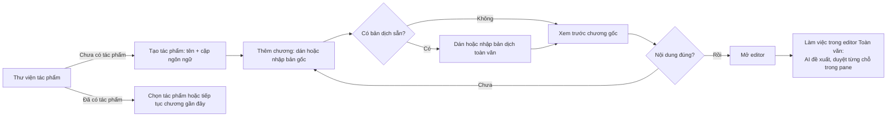

# Luồng đầu tiên: từ thư viện trống đến chương dịch đầu tiên

Cập nhật: 2026-09-23. Đây là phương án UX để thảo luận, chưa phải đặc tả MVP được duyệt. Ảnh trong mockup là minh họa giao diện, không xác nhận tên sản phẩm, định dạng hỗ trợ cuối cùng hay số liệu ví dụ.

*(Cập nhật 2026-10-03, [ADR-005](../decisions/0005-ai-first-proposals-no-sentence-mode.md): mode Từng câu và căn chỉnh bị bỏ. Bước cuối của luồng không còn là "chọn Toàn văn hoặc Từng câu" mà là mở editor Toàn văn, nơi AI dịch hoặc đề xuất và người dịch duyệt từng chỗ ngay trong pane. Các đoạn bên dưới nhắc "căn chỉnh" và "mode" được đánh dấu tại chỗ; phần nhập tác phẩm/chương không đổi.)*

## Căn cứ tham khảo

- [Smartcat: tạo dự án](https://help.smartcat.com/project-creation-overview/) đặt tên và cặp ngôn ngữ ở cấp dự án; cho phép tạo dự án khi chưa tải tệp và bổ sung tệp sau. Điều này ủng hộ việc tách “tác phẩm” khỏi “chương đầu tiên”.
- [Smartcat: định dạng được hỗ trợ](https://help.smartcat.com/supported-file-formats/) có TXT và Markdown. Đây là tham khảo khả năng nhập liệu, không phải cam kết hỗ trợ mọi biến thể Markdown của sản phẩm này.
- [Phrase: tạo dự án](https://support.phrase.com/hc/en-us/articles/10825044285340-Create-a-Project-TMS) yêu cầu tên và ngôn ngữ trước; [tạo job](https://support.phrase.com/hc/en-us/articles/10825587738268-Create-a-Job-TMS) mới tải tệp vào dự án. Mô hình này phù hợp với cấu trúc tác phẩm → nhiều chương, nhưng các bước quản trị dự án/nhân sự của CAT tool không cần xuất hiện trong luồng tối giản của dịch giả cá nhân.

**Suy luận cho Mira:** lần đầu chỉ cần tên tác phẩm và cặp ngôn ngữ, sau đó thêm chương. Cần cho phép bắt đầu với bản gốc trống bản dịch, hoặc nhập luôn bản dịch toàn văn có sẵn. Nhập liệu không được chặn vì chưa có bản dịch. *(Bản gốc ghi: "việc tách câu và liên kết bản gốc/bản dịch có thể thực hiện sau, theo [flow căn chỉnh](alignment.md)". Đã **thay thế** ngày 2026-10-03: không còn tách câu hay liên kết lưu bền; nhập raw chỉ chuẩn hóa và lưu, đơn vị là đoạn.)*

## Flow đề xuất

## Các màn hình mockup

Mockup gốc (`flow-00` đến `flow-04`) đã gỡ khỏi repo; mô tả dưới đây là phần còn dùng. Ảnh/tệp tham khảo cũ đã gỡ khỏi repo ở commit `551727d`; lấy lại bằng `git show 551727d^:docs/assets/<tên-tệp>` nếu cần.

1. 00 — Danh sách tác phẩm: trạng thái đã có dữ liệu, có tìm/lọc/sắp xếp, mở tác phẩm và tiếp tục chương gần đây.
2. 01 — Thư viện trống: trạng thái mới hoàn toàn, một hành động chính “Tạo tác phẩm”; chưa có project được chọn.
3. 02 — Tạo tác phẩm: tên + ngôn ngữ gốc/đích là thông tin cốt lõi; bìa và tác giả có thể bổ sung sau.
4. 03 — Thêm chương: dán văn bản hoặc nhập TXT/MD cho bản gốc; bản dịch toàn văn có sẵn là tùy chọn.
5. 04 — Xem trước chương: kiểm tra tên, ngôn ngữ, ranh giới đoạn và nội dung trước khi mở editor. Không tự tạo bản dịch.

*(Đã triển khai ngày 2026-10-01: “Mở tác phẩm” và mục “Tác phẩm gần đây” mở màn chi tiết với danh sách chương; “Tiếp tục” mở chương gần nhất, tạm thời là màn giữ chỗ editor.)* Trong thư viện đã có dữ liệu, **Mở tác phẩm** đi đến tổng quan tác phẩm; **Tiếp tục dịch** đưa thẳng về chương làm việc gần nhất. Thư viện trống là biến thể của cùng màn, không phải một bước mà người dùng hiện hữu luôn phải đi qua.

## Hành vi cần làm rõ trước khi lên roadmap

- “Mở tác phẩm có sẵn” trong thư viện là mở dữ liệu nội bộ, nhập backup dự án, hay cả hai?
- Cho phép tạo tác phẩm trống và bỏ qua bước thêm chương tới mức nào? Đây là hướng UI đang đề xuất, chưa chốt.
- Nhập một tệp cho một chương trước; nhập cả tập/nhiều chương cần quy tắc nhận biết ranh giới và màn hình xác nhận riêng.
- Nếu nhập bản dịch có sẵn, preview nên hiển thị cả hai văn bản; không dùng tỷ lệ liên kết làm tỷ lệ hoàn thành. *(Trạng thái “Chưa căn chỉnh” không còn: ADR-005 bỏ căn chỉnh và liên kết lưu bền.)*
- ~~Nút “Mở trình dịch” nên nhớ mode dùng gần nhất hay hỏi người dùng chọn mode trong lần đầu?~~ Hết câu hỏi: chỉ còn một editor, không có mode để chọn (ADR-005).
- Tên “tác phẩm” và “dự án” đang dùng lẫn trong thảo luận; chọn một thuật ngữ nhất quán trước khi viết UI thật.
- Số từ/đoạn trong ảnh chỉ là dữ liệu minh họa; bản triển khai phải tính từ nội dung đã nhập.

## Ranh giới bước đầu

Màn hình đầu tránh hỏi về AI model, workflow nhiều người, deadline, benchmark, phân đoạn tự động hoặc metadata căn chỉnh. Các tính năng đó có thể cấu hình khi người dùng đã có chương và hiểu nhu cầu dịch cụ thể.

---

[Mục lục handbook](../README.md)
