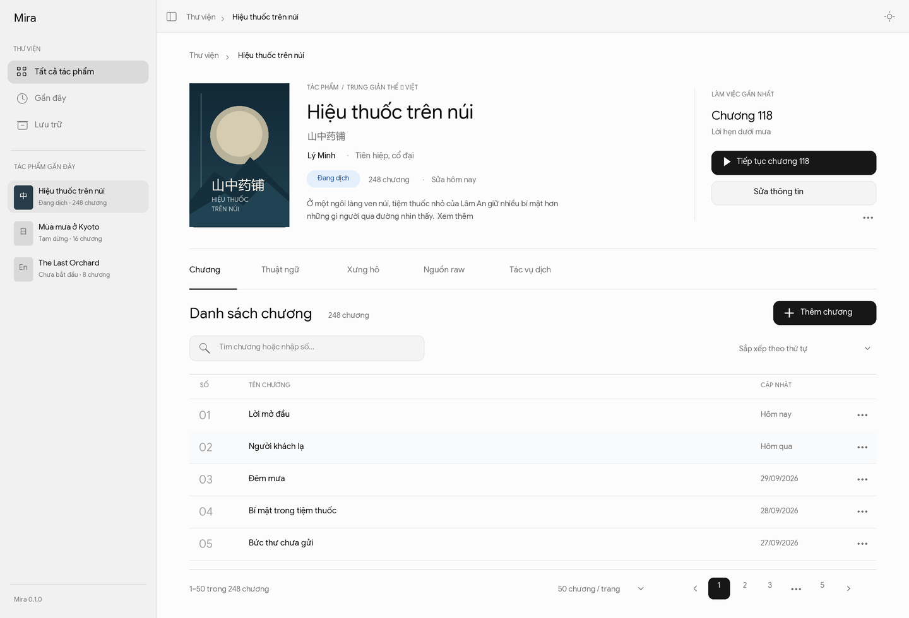

# Nghiên cứu màn chi tiết truyện và danh sách chương

Cập nhật: **2026-10-01** · Trạng thái: **quan sát tài liệu công khai + đề xuất cho Mira**; riêng cấu trúc bốn khu vực đã được người dùng chốt sau khi đối chiếu nguồn, chưa được triển khai. Chủ trì: research/product. Câu hỏi: màn chi tiết giúp dịch giả nhận ra đúng tác phẩm, quay lại đúng chương và quản lý mục lục dài như thế nào?

## Phạm vi bằng chứng

Đọc bản văn trang truyện Hako do công cụ tìm kiếm trích xuất và tài liệu chính chủ của OpenNovel, Reedsy Studio, GalTransl. Chưa mở được trực tiếp trang Hako, đăng nhập/thao tác trong các sản phẩm, kiểm tra trên dữ liệu 2.000–5.000 chương hoặc phỏng vấn dịch giả. Những gì nguồn công khai không giải thích (chẳng hạn quy tắc của nút “Đọc tiếp”) được ghi là **chưa xác minh**. Đây là so sánh các mẫu tương tác, không xếp hạng sản phẩm.

| Sản phẩm / đơn vị công việc | Quan sát có nguồn | Giới hạn khi áp vào Mira |
| --- | --- | --- |
| [Hako: trang truyện](https://ln.hako.vn/truyen/24830-nhung-thieu-nu-hac-hoa-va-cuoc-song-thuong-ngay-vun-vo-cua-toi) — trang đọc công khai | Bản văn trang cho thấy tên, tác giả, thể loại, tình trạng, tóm tắt, “Đọc tiếp” và mục lục. Mục lục chia theo tập; một tập dài có “Xem tiếp (N chương)”. | Tập và “Đọc tiếp” phục vụ người **đọc**; chưa xác minh cách ghi nhớ vị trí đọc. Lượt xem, đánh giá, bình luận và nhóm dịch không thuộc công việc quản lý bản dịch cá nhân. |
| [OpenNovel: Auto-Translate](https://www.opennovel.co/docs/auto-translate), [nhập EPUB](https://www.opennovel.co/docs/translating-epubs) — truyện và tác vụ dịch | Từ trang truyện có thể chọn chương hoặc một khoảng chương để dịch; tài liệu nói trạng thái dịch của các chương được hiển thị và chương lỗi được đưa lên trên để xử lý. EPUB thiếu mục lục vẫn nhập được nhưng chương không có tên chính xác. | Đây là luồng AI/batch đã có nội dung. Không suy ra Mira hiện có tiến độ, lỗi dịch hay nhập EPUB; change `work-detail-screen` chưa lưu nội dung chương. |
| [Reedsy Studio FAQ](https://reedsy.com/studio/resources/book-writing-software-faq/) — bản thảo sách | Chương có tên mặc định “Chapter X”, có thể sửa tên; panel trái liệt kê chương và hỗ trợ kéo thả đổi thứ tự. Có cấu trúc phần đầu/thân/cuối sách. | Reedsy phục vụ **viết và dàn trang**; kéo thả trong bản thảo không chứng minh phù hợp với hàng nghìn chương hoặc điều khiển bằng bàn phím trong Mira. |
| [GalTransl README](https://github.com/GalTransl/GalTransl/blob/main/README_EN.md) — dự án dịch visual novel | Bản desktop mô tả trang cấu hình provider, từ điển theo dự án, bàn làm việc dịch, và nơi xem cache/vấn đề sau khi dịch. Có tiến trình dịch trực tiếp. | README mô tả luồng cấp dự án, không cung cấp bằng chứng về layout màn chi tiết truyện hay mục lục dài. Các khu vực này chỉ hữu ích cho Mira khi dữ liệu từ điển, job và QA đã có. |

## Suy luận cho Mira

1. **Màn chi tiết là điểm chuyển việc.** Giữ đầu màn đủ thông tin để nhận diện tác phẩm và nút trở lại chương đang làm; đặt danh sách chương ngay bên dưới. Không biến màn này thành trang giới thiệu cho độc giả với số lượt xem/đánh giá. Đây là hướng đã có trong [đề xuất `work-detail-screen`](../../../openspec/changes/archive/2026-10-01-work-detail-screen/proposal.md), chưa được nghiệm thu bằng người dùng.
2. **Mục lục dài cần đường tìm nhanh.** Hako dùng tập và mở dần; với danh sách phẳng của Mira, tìm theo tên và nhảy tới vị trí giúp chạm được chương xa. Theo phản hồi người dùng ngày 2026-10-01, change `work-detail-screen` chuyển sang phân trang 50/100 chương thay vì “Hiện thêm”. Cần đo đúng trường hợp 2.000–5.000 chương và kiểm tra focus khi chuyển trang, thêm, xóa hoặc đổi vị trí. Việc Hako có tập là tín hiệu để thử trên corpus truyện thật, chưa đủ căn cứ đưa cấu trúc tập vào M0.
3. **Tên chương và số thứ tự là hai dữ liệu khác nhau.** Reedsy có tên mặc định; OpenNovel cho thấy nhập thiếu mục lục có thể làm mất tên chương. Mira nên cho tên trống và hiển thị “Chương N” theo vị trí, đồng thời giữ tên nguồn người dùng nhập khi có. Với truyện bắt đầu từ chương 101, ngoại truyện, chương 0 hoặc đánh số lại, số theo vị trí có thể gây hiểu lầm; cần quyết định có thêm trường số nguồn riêng hay chỉ ghi trong tên.
4. **Chỉ hiển thị tiến độ khi có dữ liệu và định nghĩa rõ.** OpenNovel nêu trạng thái/lỗi theo chương vì có job dịch. Màn chi tiết M0 của Mira mới lưu metadata chương: số chương và chương gần nhất là thông tin có thật; không gắn nhãn “đã dịch”, phần trăm hoàn thành hoặc lỗi AI. Khi có nội dung/job, thiết kế riêng trạng thái raw, dịch, soát và lỗi; không dùng tỷ lệ căn chỉnh làm tiến độ dịch.
5. **Giữ thao tác sắp xếp có thể dùng bằng bàn phím.** Reedsy chứng minh đổi thứ tự ngay từ mục lục là hữu ích. `work-detail-screen` đang đề xuất menu chuyển lên/xuống/đầu/cuối/vị trí cụ thể; kiểm tra cách này với danh sách dài trước khi cân nhắc kéo thả.
6. **Tài nguyên dịch thuộc cùng tác phẩm nhưng có nhịp riêng.** GalTransl tách từ điển, bàn dịch và nơi xử lý vấn đề. Sau khi xem xét bản vẽ năm tab, người dùng chốt **Chương, Ngữ cảnh, Nguồn, Tác vụ**; Ngữ cảnh chứa **Thuật ngữ, Xưng hô, Văn phong** ([quyết định hiện hành](../product/decisions.md)). Change M0 chỉ có vùng Chương nên chưa cần thanh tab; khu vực khác xuất hiện khi có màn và thao tác thật.

## Mockup thử

Bản vẽ dùng dữ liệu minh họa, bám token sáng và AppShell hiện có. Cột đầu màn giữ bìa và thông tin nhận diện, bên phải đặt “Tiếp tục chương 118”; danh sách chương được phân trang 50 hàng. Ảnh chỉ cho thấy năm hàng vì vùng danh sách cuộn trong khung nhìn. Nhãn “Đang dịch” là trạng thái **tác phẩm**, không phải tiến độ của từng chương. **Thanh năm tab là bản phác trước quyết định ngày 2026-10-01**; cấu trúc được chốt là bốn khu vực với ba mục con trong Ngữ cảnh. Các tab ngoài Chương chưa là màn đã triển khai. [Mã tạo ảnh](../experience/mockups/render-work-detail.py) cho phép sửa nhanh nội dung và kích thước.

## Nguồn tham khảo theo khu vực của tác phẩm

Các nguồn sau chứng minh **chức năng liên quan**, không chứng minh đối thủ dùng đúng hệ tab hoặc Mira nên sao chép bố cục của họ. Ngày đối chiếu bổ sung: **2026-10-01**.

| Khu vực trong mockup | Tiền lệ có nguồn | Mira cần làm khác / chưa có tiền lệ xác minh |
| --- | --- | --- |
| **Chương** | [Hako](https://ln.hako.vn/truyen/9122-kami-tachi-ni-hirowareta-otoko) có mục lục theo tập và mở thêm chương; [Reedsy Studio](https://reedsy.com/studio/resources/book-writing-software-faq/) đặt tên mặc định, đổi tên, đổi thứ tự trong panel chương; [OpenNovel](https://www.opennovel.co/docs/auto-translate) chọn một khoảng chương để dịch. | Mira dùng mục lục như bàn quản lý của dịch giả, số theo vị trí, tìm/nhảy và phân trang 50/100 theo phản hồi người dùng. Chưa xác minh đối thủ nào có đúng mô hình phân trang này. |
| **Thuật ngữ** | [OpenNovel](https://www.opennovel.co/docs/glossary) tách nhân vật, danh xưng, thuật ngữ; phát hiện mục mới và nhập CSV. [LinguaGacha](https://github.com/neavo/LinguaGacha/wiki/GlossaryEN) cho glossary và kiểm tra áp dụng sau dịch; [GalTransl](https://github.com/GalTransl/GalTransl/blob/main/README_EN.md) có từ điển theo dự án. | Mira cần glossary theo tác phẩm, người dùng duyệt trước khi AI dùng; nhãn nguồn/đích và lịch sử tác động lên bản dịch cần spec riêng. |
| **Xưng hô** | OpenNovel lưu giới tính nhân vật và bản dịch danh xưng; [AiNiee](https://github.com/NEKOparapa/AiNiee/blob/main/ModuleFolders/Domain/PromptBuilder/PromptBuilder.py) đưa tên, giới tính, đặc điểm và cách nói của nhân vật vào prompt; [Quick Translator Engine](https://github.com/thiendiepdt/quick-translator-engine), bản tái hiện engine, có tệp từ điển pronouns. | **Ma trận A gọi B / B gọi A** là hướng riêng của Mira; cách đổi theo ngữ cảnh/thời điểm còn cần spec. Chưa xác minh sản phẩm trên có màn ma trận tương đương. Không coi giới tính hay danh xưng đơn lẻ là đủ giải quyết xưng hô tiếng Việt. |
| **Nguồn raw** | [OpenNovel](https://www.opennovel.co/docs/getting-started) nhận URL chương; [hướng dẫn EPUB](https://www.opennovel.co/docs/translating-epubs) biến mục lục sách thành các chương. | Mira đã chốt nhiều nguồn raw và một nguồn chính, nhưng chưa tìm được sản phẩm trong mẫu khảo sát có đúng mô hình ghép nhiều nguồn theo cùng tác phẩm/chương. Bản đầu nhập TXT/Markdown; URL/EPUB không tự thành cam kết. |
| **Tác vụ dịch** | [OpenNovel](https://www.opennovel.co/docs/auto-translate) chọn khoảng chương, chạy nền, nêu chương lỗi để xử lý; [GalTransl](https://github.com/GalTransl/GalTransl/blob/main/README_EN.md) có Translation Workbench, tiến trình, cache và trang vấn đề; [LinguaGacha](https://github.com/neavo/LinguaGacha/wiki/BasicTutorialEN) hiển thị tiến trình dịch. | Mira đã chốt lưu nguồn gốc model và không ghi đè bản người dùng sửa; job tiếp tục sau lỗi là mục tiêu kiểm chứng. Tạm dừng/tiếp tục, đo chi phí và bố cục QA vẫn là đề xuất, chưa có UI chốt. |
| **Văn phong** (chưa vẽ tab riêng) | [Smartcat](https://help.smartcat.com/intelligence-fabric-translation-memory-glossaries-language-insights/) dùng bản dịch đã duyệt và hướng dẫn tone/style; AiNiee có [ô quy tắc văn phong và cặp câu ví dụ](https://github.com/NEKOparapa/AiNiee/blob/main/ModuleFolders/Domain/PromptBuilder/PromptBuilder.py). | Mira đã chốt lấy văn phong từ bản dịch cũ. Truy xuất các cặp liên quan theo chương rồi cho người dùng duyệt là đề xuất của Mira, chưa xác minh tương đương trong các công cụ truyện đã khảo sát. |

**Đã chốt sau review ngày 2026-10-01:** **Chương · Ngữ cảnh · Nguồn · Tác vụ**; Ngữ cảnh gồm Thuật ngữ, Xưng hô và Văn phong. Đây là quyết định về điều hướng, được đặc tả trong [change `work-area-navigation`](../../../openspec/changes/work-area-navigation/proposal.md); các hành vi từng tài nguyên cần change riêng. M0 `work-detail-screen` chỉ triển khai Chương, không có thanh tab rỗng.

## Các điểm cần quyết trước khi áp dụng đề xuất

| Câu hỏi | Vì sao còn mở | Kiểm chứng phù hợp |
| --- | --- | --- |
| Có cần nhóm theo tập ngay không? | Hako nhóm theo tập, còn change hiện tại chọn danh sách phẳng. | Thử tìm và di chuyển trong 2–3 mục lục thực tế: truyện có tập, web novel liên tục, ngoại truyện. |
| Số chương nguồn lưu riêng hay nằm trong tên? | Số hiển thị theo vị trí sẽ đổi khi sắp xếp; số gốc có thể không liên tục. | Nhập mẫu có chương 0/101, ngoại truyện và chương gộp; yêu cầu dịch giả tìm lại đúng chương. |
| “Tiếp tục” là chương mở gần nhất hay sửa gần nhất? | Hai hành vi khác nhau; mở để xem có thể đẩy tác phẩm lên đầu danh sách hiện tại. | Thử luồng mở xem chương cũ rồi trở lại công việc dở; xác nhận kỳ vọng của người dùng. |
| Chỉ mở chương có làm tác phẩm thành “Đang dịch”? | [Thiết kế hiện tại](../../../openspec/changes/archive/2026-10-01-work-detail-screen/design.md) đề xuất đổi trạng thái khi mở, nhưng quan sát đối thủ không xác thực quy tắc này. | Kiểm tra với tác phẩm chỉ được xem/đọc raw; hỏi người dùng khi nào họ coi là bắt đầu dịch. |

**Kết luận nghiên cứu:** Có đủ căn cứ để thử layout bìa/thông tin + hành động tiếp tục + mục lục tìm nhanh của change hiện tại. Chưa có bằng chứng để chốt nhóm tập, số nguồn riêng, quy tắc tiến độ hoặc tự đổi trạng thái tác phẩm. Các quyết định đó cần bài thử người dùng/corpus trước khi sửa spec. [Quyết định hiện hành](../product/decisions.md) và [hiện trạng code](../engineering/current-state.md) vẫn là nguồn chính cho phần đã chốt/đã làm.

---

[Mục lục handbook](../README.md)
