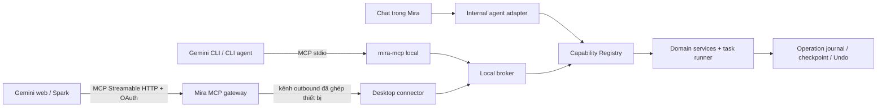

# Nghiên cứu tích hợp agent bên ngoài

Cập nhật: 2026-10-12 · Trạng thái: **đã bỏ**. Chủ sản phẩm thay hướng MCP bằng đăng nhập gói thuê bao
và gateway CLIProxyAPI tự chạy (xem "Quyết định 2026-10-12" trong
[ai-connections](../ai-connections/README.md)); trang này chỉ còn là lịch sử nghiên cứu.

## Kết luận

Gemini bản web có thể điều khiển Mira qua **Custom Connected App dùng MCP**. Đây là đường tích hợp
chính thức của Google, nhưng không thể nối thẳng tới MCP `stdio`, Named Pipe hoặc `localhost` trên máy
người dùng. Gemini web chạy ở hạ tầng Google và nhận một URL MCP, nên Mira cần endpoint HTTPS công
khai cùng một connector do ứng dụng desktop chủ động mở ra ngoài.

Ba bề mặt nên dùng chung một Capability Registry nhưng có adapter khác nhau:

| Bề mặt | Khả thi | Cầu nối | Lịch sử hội thoại |
| --- | --- | --- | --- |
| Gemini CLI và CLI agent khác | Cao | MCP `stdio` → broker local | Ở CLI; Mira lưu operation/task |
| Gemini web / Gemini Spark | Có, phụ thuộc tài khoản và rollout | MCP HTTPS → relay → connector desktop | Ở Gemini; Mira lưu operation/task |
| Web app Mira tự xây bằng Gemini API | Có, cần backend và UI riêng | Backend Mira → Gemini API / MCP → capability | Mira có thể làm nguồn lịch sử duy nhất |

Nếu mục tiêu trước mắt là cho công cụ khác điều khiển app local, làm MCP local trước. Nếu trình duyệt
là một bề mặt sản phẩm cốt lõi và mọi chat phải tập trung trong Mira, web app do Mira sở hữu phù hợp
hơn Gemini web chính thức.

## Gemini web làm được gì

Tài liệu hiện tại của Google cho phép người dùng thêm custom app trong Connected Apps bằng URL MCP.
Custom app có thể cung cấp tool cho chat hoặc Gemini Spark; thao tác ghi hiện cần người dùng xác nhận.
Google hỗ trợ Dynamic Client Registration, hoặc cho nhập thông tin OAuth trong phần thiết lập nâng
cao.

Khả năng này đang có điều kiện phát hành: tài khoản cá nhân đủ tuổi, khu vực, ngôn ngữ, Keep Activity
và bề mặt hỗ trợ đều có thể giới hạn. Vì vậy Mira phải coi Gemini web là integration tùy chọn và kiểm
tra khả năng trên tài khoản thực tế, không coi đây là đường vào duy nhất của agent.

Gemini Spark phù hợp để điều phối workflow dài và theo dõi task, nhưng môi trường máy tính từ xa của
Spark không phải máy Windows đang chạy Mira. Skill của Spark cũng không thay MCP: skill chứa hướng dẫn
và script nhưng script không được tự gọi dịch vụ web bên ngoài.

## Ranh giới quan trọng

### Lịch sử tập trung

MCP server nhận tool call, tham số và trả kết quả; nó không sở hữu toàn bộ transcript của Gemini.
Mira có thể lưu đầy đủ lịch sử **hoạt động trong Mira** gồm lệnh thực thi, task, tiến độ, lỗi, chi phí
và Undo, nhưng không nên hứa nhập nguyên cuộc trò chuyện từ Gemini web.

Nếu toàn bộ hội thoại phải xuất hiện ở màn chat tập trung của Mira, có hai đường đúng:

1. người dùng chat trong Mira desktop; hoặc
2. Mira có web app riêng dùng Gemini API và tự lưu session/turn.

Gemini web khi đó là một remote controller bổ sung, không phải nguồn lịch sử hội thoại chuẩn.

### Dữ liệu và quyền riêng tư

Khi dùng Gemini web, nội dung cần thiết cho tool call và kết quả đi qua Google và endpoint MCP của
Mira. Không gửi cả tác phẩm khi một đoạn, revision hoặc danh sách ID là đủ. UI kết nối phải nói rõ luồng
dữ liệu này và cho phép tắt connector.

### Tác vụ dài

Không giữ một request MCP mở trong lúc dịch 30 chương. Tool tạo task phải trả `taskId` sớm; agent dùng
tool đọc trạng thái, hủy hoặc retry. Task bền, checkpoint và recovery vẫn do Mira sở hữu theo roadmap
hiện tại.

### Token API và hạn mức agent

MCP không tạo thêm năng lực suy luận miễn phí. Chi phí phụ thuộc nơi model sinh bản dịch:

| Cách chạy | Ai sinh bản dịch? | Khi API key trong Mira hết quota |
| --- | --- | --- |
| Agent chỉ điều phối | Provider do Mira cấu hình | Task dịch vẫn thất bại hoặc chờ quota |
| Agent bên ngoài dịch | Gemini/Codex đọc nguồn rồi gọi tool lưu bản dịch | Không dùng API key của Mira; dùng hạn mức tài khoản Gemini/Codex |
| Hybrid | Agent bên ngoài dịch, Mira chạy lưu trữ và kiểm tra deterministic | Không dùng API cho phần deterministic; vẫn dùng hạn mức agent cho phần sinh chữ |

Vì vậy “không tốn token API” chỉ có nghĩa là chuyển phần suy luận sang quota hoặc subscription của
Gemini/Codex. Prompt, lịch sử, source text, tool result và bản dịch vẫn tiêu thụ hạn mức của dịch vụ đó.
Khi hạn mức Gemini/Codex hết, workflow cũng phải chờ reset, đổi model hoặc dùng nguồn inference khác.

Mira nên cho task ghi rõ `inference_source`: provider nội bộ, external agent hoặc local model. Trước khi
chạy, UI hiển thị nguồn nào sẽ bị tính quota; không tự động fallback từ API trả phí sang tài khoản bên
ngoài hoặc ngược lại.

## Kiến trúc đề xuất

### Local broker

- Electron main process là nơi duy nhất thực thi capability ghi.
- `mira-mcp` dùng `stdio`, rồi gọi broker qua Named Pipe hoặc loopback có token theo bản cài đặt.
- MCP không đọc SQLite, file tác phẩm hay IPC renderer trực tiếp.
- Cùng schema capability, target resolver, budget và validation với agent trong Mira.

### Remote gateway cho Gemini web

- Cung cấp MCP Streamable HTTP qua HTTPS với chứng thư công khai.
- Dùng OAuth 2.1 Authorization Code + PKCE; ưu tiên Dynamic Client Registration nếu bề mặt Gemini hỗ
  trợ.
- Ghép tài khoản với một hoặc nhiều thiết bị Mira; desktop chỉ mở kết nối outbound có xác thực.
- Khi app hoặc thiết bị offline, trả trạng thái rõ ràng thay vì giữ request vô hạn.
- Relay chỉ giữ metadata cần cho định tuyến và audit; không biến thư viện local thành bản sao cloud.

Đây là suy luận kiến trúc từ yêu cầu endpoint URL/HTTPS của Gemini: dịch vụ ở Google không thể gọi
trực tiếp Named Pipe, `stdio` hay loopback chỉ tồn tại trên máy người dùng.

## Bề mặt tool tối thiểu

Không tạo API tổng quát cho SQL, shell, file hay IPC. Bản thử chỉ cần:

- đọc: `list_works`, `list_chapters`, `read_chapter`, `search_work`, `get_context`;
- ghi: `start_translation_task`, `edit_translation`, `cancel_task`, `undo_operation`;
- điều hướng: `open_target` để đưa người dùng về đúng tác phẩm, chương hoặc task trong Mira;
- trạng thái: `get_task` và `retry_task_item`.

Kết quả đọc phải phân trang và có giới hạn kích thước. Mọi thao tác ghi tiếp tục dùng revision check,
write lease, journal và Undo. Operation bên ngoài ghi thêm `actor=external_mcp`, client, subject OAuth,
device, session/task ID để người dùng biết ai đã làm gì.

## Các lựa chọn

### 1. MCP local cho CLI — nên làm đầu tiên

Chi phí thấp nhất, không cần cloud, giữ dữ liệu trên máy và kiểm tra được contract capability. Bản đầu
chỉ cần đọc thư viện và một thao tác ghi có thể Undo. Hạn chế là transcript nằm ở CLI; Mira chỉ tập
trung lịch sử hoạt động.

### 2. Custom app cho Gemini web/Spark — làm sau task bền

Đây là đường chính thức để Gemini web gọi Mira. Nó cần gateway công khai, OAuth, ghép thiết bị, vận
hành relay và disclosure dữ liệu. Chỉ nên pilot sau khi vòng agent và task nhiều chương trong Mira đã
qua gate; thêm remote sớm sẽ khuếch đại lỗi target, cancel và recovery.

Một tunnel HTTPS tạm thời có thể dùng cho spike nội bộ, nhưng URL thay đổi, quyền truy cập và bề mặt
tấn công khiến nó không phù hợp làm kiến trúc sản phẩm.

### 3. Web app Mira dùng Gemini API — chỉ khi web là sản phẩm chính

Gemini API hỗ trợ function calling; Interactions API có thể gọi remote MCP bằng Streamable HTTP. Vì
Mira sở hữu UI, backend và session, phương án này đáp ứng tốt nhất yêu cầu lịch sử chat tập trung.
Đổi lại Mira phải xây đăng nhập, đồng bộ, lưu session, streaming, quota và vận hành backend. Chưa có
lý do làm phần này chỉ để hỗ trợ một người dùng điều khiển app local.

### 4. Extension hoặc tự động hóa giao diện Gemini — không đề xuất

DOM và flow đăng nhập có thể thay đổi, khó kiểm soát quyền ghi và không cho contract task đáng tin cậy.
Nó không giải quyết lịch sử tập trung hay thiết bị offline.

## Thứ tự đưa vào roadmap

1. Hoàn thành gate foundation và vòng agent hội thoại hiện tại.
2. Sau khi contract capability ổn định, thêm adapter MCP local và chứng minh một luồng đọc, một luồng
   ghi có Undo.
3. Sau gate task nhiều chương, thêm `start/get/cancel/retry` cho MCP local.
4. Chỉ khi có nhu cầu Gemini web thực tế, thêm gateway HTTPS, OAuth và desktop connector dưới cờ bật
   riêng; pilot với ít tài khoản trước.
5. Đánh giá web app Mira riêng khi lịch sử xuyên thiết bị trở thành yêu cầu sản phẩm đã chốt.

Nhánh này nên được xem là adapter vào Capability Registry, không phải một agent core thứ hai và không
thay thứ tự của [roadmap Trợ lý](agent-roadmap.md) lúc này.

## Tiêu chí cho spike Gemini web

- Gemini gọi được `list_works` mà không lộ đường dẫn local hoặc credential.
- Một lệnh ghi bắt buộc xác nhận, tạo operation có nguồn external và Undo được trong Mira.
- Dịch nhiều chương trả `taskId`; đóng tab Gemini không làm task mất trạng thái.
- Tắt connector hoặc thoát Mira làm tool trả `device_offline` có thể hiểu được.
- Không có endpoint cho phép bỏ qua target resolver, revision check hoặc budget.
- Log gateway không chứa toàn văn chương ngoài thời gian cần xử lý request.

## Nguồn chính thức

- [Gemini CLI: MCP servers](https://google-gemini.github.io/gemini-cli/docs/tools/mcp-server.html)
- [Gemini Apps: Connect and manage custom apps](https://support.google.com/gemini/answer/17209137)
- [Gemini Spark: tasks and workflows](https://support.google.com/gemini/answer/17094507)
- [Gemini Spark: skills](https://support.google.com/gemini/answer/17094296)
- [Gemini Enterprise: connect a custom MCP server](https://support.google.com/g/answer/17106276)
- [Gemini Enterprise: custom MCP server data store](https://docs.cloud.google.com/gemini/enterprise/docs/connectors/custom-mcp-server/set-up-custom-mcp-server)
- [Google Account Linking](https://developers.google.com/identity/account-linking)
- [Gemini API: function calling](https://ai.google.dev/gemini-api/docs/function-calling)

[Về module](README.md) · [Roadmap Trợ lý](agent-roadmap.md) · [Dữ liệu và an toàn](data-and-safety.md)
